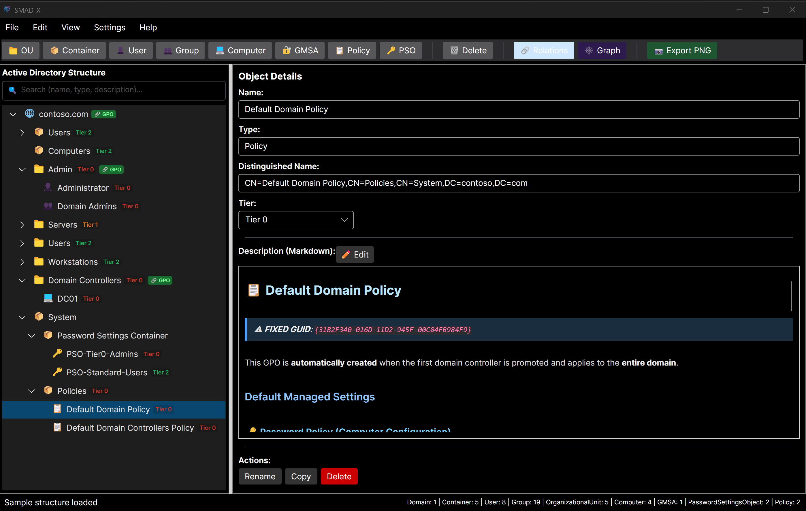
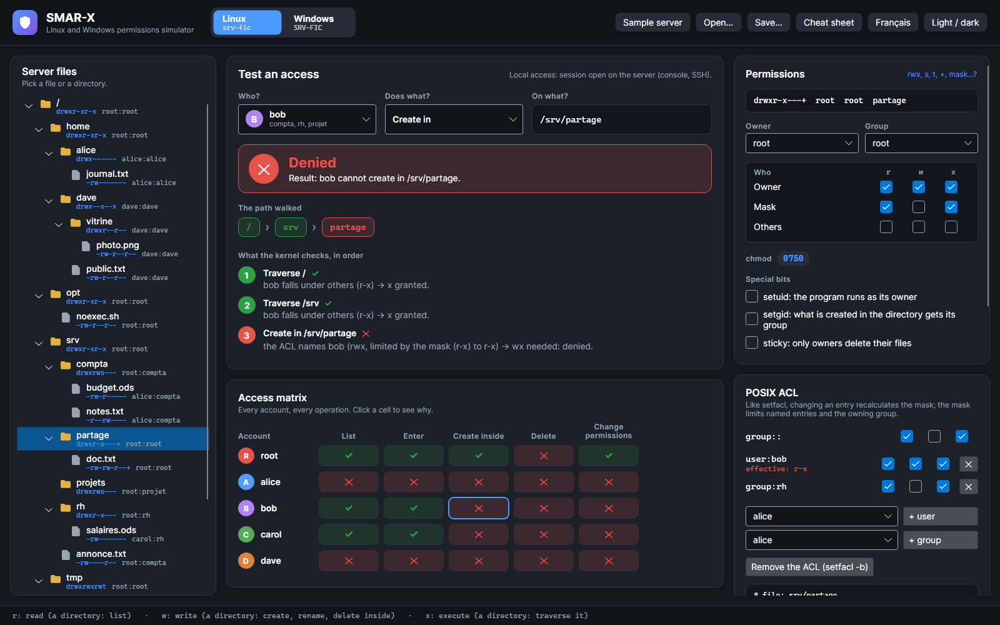
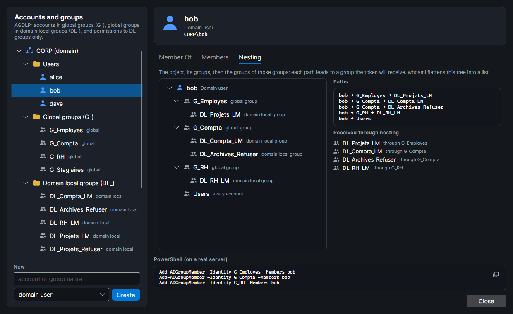
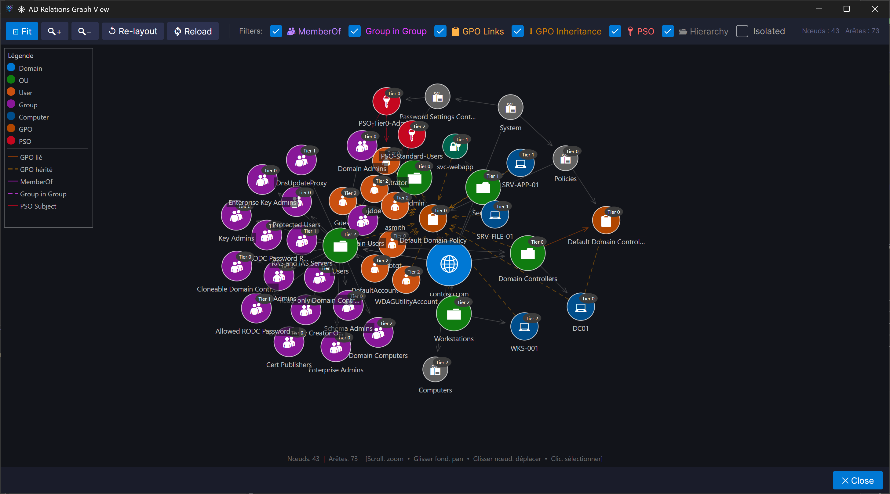

# SMA-X — Simulate, Model, Audit – eXpert

<p align="center">
  
  
  
  
  
  
  
</p>

> 🇫🇷 La documentation en français est disponible dans [ReadmeFR.md](./ReadmeFR.md).

**SMA-X** (*Simulate, Model, Audit – eXpert*) is a suite of three applications to **learn systems security** without risking a real infrastructure. Each simulator reproduces its subject faithfully, explains why an access is granted or denied, and serves as the basis for automatically graded labs, for a whole class. Built with Avalonia UI and .NET 10, for Windows, Linux and macOS.

| Tool | What it does | Documentation |
|---|---|---|
| 🛡️ **SMAD-X** | The **Active Directory** simulator: a domain identical to a fresh Windows Server 2019, 2022 or 2025 installation, audited against ANSSI, NIST, CIS and MITRE ATT&CK, its attack paths, the tier model, graded labs | [SMAD-X](https://jm2k69.github.io/SMAD-X/en/smad-x/) |
| 🔐 **SMAR-X** | The **file access rights** simulator, on Linux and Windows, on the server and through a share (SMB, Samba): who can do what, on what, and why | [SMAR-X](https://jm2k69.github.io/SMAD-X/en/smar-x/) |
| 🧑‍🏫 **SMAD-X Studio** | The **trainer's** tool, shared by both simulators: creates the labs, writes the subject and the trainer sheet, grades a whole class | [Studio](https://jm2k69.github.io/SMAD-X/en/labs/studio/) |

> 📖 **Documentation**: [jm2k69.github.io/SMAD-X/en](https://jm2k69.github.io/SMAD-X/en/) (English) · [jm2k69.github.io/SMAD-X](https://jm2k69.github.io/SMAD-X/) (français)

<p align="center">
  
</p>

<p align="center">
  
</p>

## ✅ Tested on real systems

The simulators are not written "from memory". Their results were compared, one by one, with those of real systems installed and measured for the purpose. These measurements are frozen in the tests: if an engine drifts from them, the tests fail and no release goes out.

| Tool | Real system | What is compared |
|---|---|---|
| SMAD-X | freshly promoted **Windows Server 2019, 2022 and 2025** domains | the fresh domain, object by object and permission by permission, and the audit of both |
| SMAD-X | a Windows Server 2025 domain hardened by **HardenAD** 2.9.9 | the applied model: OUs, groups, GPOs and their settings, memberships, delegations |
| SMAR-X | **Linux kernel** 6.19, Debian 13 | 925 accesses and 140 file creations |
| SMAR-X | **Samba** 4.22 | 20 connections, 160 operations and 72 creations through the shares |
| SMAR-X | **Windows Server 2025**, domain controller | 1,512 opens under each account's token, the owners, the real order of the ACLs |
| SMAR-X | Windows Server 2025, from a domain-joined **Windows 11** | 1,540 opens through the shares and 50 folders listed |
| SMAR-X | Windows 11 **Explorer** and **icacls** | the Security tab (96 account views, 103 Advanced entries, 8 sequences of ticked boxes) and how icacls shows rights (16,383 combinations) |
| SMAR-X | Windows 11 (PowerShell 5.1, NTFSSecurity) and Debian 13 | the 50 commands of the cheat sheet, replayed as they are written |

## 📦 Download

Each release, on the [Releases](https://github.com/JM2K69/SMAD-X/releases/latest) page, has **one archive per application and per platform** (Windows x64, Linux x64, macOS Intel and Apple Silicon): `SMAD-X-<platform>.zip`, `SMAD-X-Studio-<platform>.zip` and `SMAR-X-<platform>.zip`. Each holds a single standalone executable: nothing to install. A learner only needs the simulator of the lab.

---

## 🛡️ SMAD-X — Active Directory

<p align="center">
  
</p>

**SMAD-X** (*Simulate, Model and Audit Active Directory eXpert*) generates an AD structure faithful to a fresh Windows Server installation and lets you visualize, audit, document and export it without any real infrastructure.

### 🏗️ Complete and Faithful Default AD Structure
- Automatic generation of all containers and objects present in a freshly promoted AD domain, for Windows Server 2019, 2022 or 2025 (checked against real exports of each version):
  - **Builtin**: Administrators, Users, Guests, Server Operators, Account Operators, Backup Operators…
  - **Users**: Administrator, Guest, krbtgt + 16 default domain groups (Domain Admins, Schema Admins, Enterprise Admins, Protected Users, Key Admins, Cloneable Domain Controllers, Denied/Allowed RODC Password Replication Group…)
  - **Computers**: default container for domain-joined workstations
  - **Domain Controllers** (OU): DC01 with all FSMO roles
  - **System**: Password Settings Container, Policies (Default Domain Policy, Default Domain Controllers Policy)
  - **ForeignSecurityPrincipals**
- Create a custom domain via `File > New Domain`
- Distinguished Names computed automatically

### 🌐 Interactive Relationship Graph
- Force-directed visualization of all relationships between objects
- Separate rendering of **User → Group** memberships and **Group → Group** nesting
- Filters by object type (User, Group, Computer, OU, GPO, PSO…) and by tier
- Pan, zoom and node selection

### 🔗 Relationship Management
- **User → Group**: dedicated tab to assign users to groups
- **Group → Group**: dedicated tab to manage group nesting (groups inside groups)
- **GPO**: Group Policy Object links to domains and OUs, with visual badge `🔗 GPO` in the tree
- **PSO**: Password Settings Object assignment to users and groups
- GPOs are created under `System\Policies` to match the real AD structure

### 📤 Export
- **Native JSON** (`.smadx.json`): full save and reload of the structure
- **Real AD import**: a read-only PowerShell script that reads an existing domain into a `.smad-x.json` (SMAD-X never writes to a directory)

### 🎨 Microsoft Tiering Model
- **Tier 0**: Domain controllers, critical accounts and systems
- **Tier 1**: Infrastructure and application servers
- **Tier 2**: Workstations and standard users
- Per-tier colors configurable through the UI
- **Tiering models**: apply [Microsoft's Active Directory Tier Model](https://github.com/microsoft/ActiveDirectoryTierModel) or [HardenAD](https://github.com/LoicVeirman/HardenAD) to a new or existing domain (OUs per tier, administration groups and accounts, GPOs, delegations), then audit compliance with the model (TIER-05 to TIER-08); the model's GPOs act on attack paths (logon denials remove the admin sessions they forbid, restricted groups and preferences set the local administrators); **Analysis > Simulate tiering** migrates a copy of a classic domain to each model (objects placed by role and tier, rights kept through model groups) and compares score, ANSSI level and attack paths before and after; **authentication silos** (Settings > Authentication silos): an enforced silo keeps its administrators off the other computers, which removes their sessions from attack paths (TIER-09 reports a privileged account outside an enforced silo); both models are generated from their official release, with source and MIT license cited

### 📝 Built-in Markdown Documentation
- Every object has a rich Markdown description with role and **security notes**
- Edit / Preview toggle
- Pre-filled and localized descriptions for all default objects including security posture

### 🌐 AD Sites Topology
- Full site topology management: **Sites**, **Subnets**, **Domain Controllers**, **Replication Links**
- Sites window (Ctrl+Shift+S): table view + interactive graph layout
- Sites panel in main TreeView with building icon and site count in status bar
- GPOs linkable to sites; DC site assignment; linked-sites on nodes
- Sample topology: Default-First-Site-Name, Site-Paris, Site-Lyon (DCs, subnets, replication links, GPOs)
- PowerShell import script exports full site topology to `.smad-x.json` v2 format
  (WhenCreated, WhenChanged, LinkedGPOs, Tier, transport IP/SMTP auto-detected)

### 📄 Documentation Report Export
- **Combined** mode: full domain report in one file
- **Individual** mode: select objects one by one with type-filter checkboxes + scrollable list
- Format checkboxes: **Markdown** (always on), **DOCX**, **PDF** optional
- Theme picker: WordLike · Plain · Technical Document · GitHub · Compact · Report
- PDF: system font embedding + emoji fallback for full Unicode rendering (no preprocessing)
- Shortcut: Ctrl+Shift+R

### 🌙 Light / Dark Theme
- Switch between Light and Dark themes at runtime — no restart required
- Native Avalonia FluentTheme — menus and popups always rendered in the correct theme

### 🔍 Live Search in Tree
- Search bar above the TreeView: filter nodes by **name**, **type** or **description**
- Non-matching nodes are hidden; parent nodes are automatically expanded
- Clear button to reset the filter instantly

### 🌍 Multilingual Support
- Full interface available in **French** and **English** — language switch at runtime

### 🛡️ Delegations Viewer
- Dedicated window listing all AD delegation entries (trustee, right, target DN, category, tier, inheritance)
- Live filters by **trustee**, **target DN**, **category** (PasswordReset, ComputerManagement, AccountUnlock, AttributeWrite, FullControl, Other) and **hide inherited** toggle
- Statistics bar showing delegation counts by category
- **Export to CSV** for audit and reporting

### ⏱️ AD Timeline — Diff between two snapshots
- Load two `.smadx.json` files (older vs. newer) and compute a structured diff
- Highlights **Added**, **Removed** and **Modified** objects
- Filters by change type, object type and free-text search
- Summary statistics (added / removed / modified counts)
- **Export diff to CSV**

### ✅ Active Directory Validation
- Name validation following AD rules (forbidden characters, length, uniqueness)
- Container rules enforced (e.g. a Container can only hold CN objects, not OUs)

---

### 🛡️ Security Audit, Attack Paths and Labs
- **Security audit**: 35 rules sourced from the ANSSI AD checklist, NIST, CIS, MITRE ATT&CK and Microsoft, with a score and an estimated ANSSI level; the fresh domain has the default permissions of a real freshly installed AD, so the audit finds the same defaults on both
- **Attack paths**: who can take control of the domain and through which steps (Kerberoasting, AS-REP roasting, delegations, owners, GPOs, Kerberos delegation, DCSync, Shadow Credentials, RBCD, LAPS, local administrators and sessions, AdminSDHolder…), highlighted in the graph
- **Before / after** comparison and **undo / redo**
- **Labs** (`.smadx-lab.json`): realistic scenarios graded automatically, including 15 attack-path labs in French and English
- **Lab mode and exam mode**: open a lab directly (`SMAD-X.exe lab.smadx-lab.json`) with the domain locked; an exam has no hints, no score and no start over, measures the time spent, and can close the audit, its "How to fix" sections, the attack paths or the comparison; learners save a **submission** (`.smadx-submission.json`) to resume or hand in, sealed (SHA-256) and tied to a random work session
- Nothing is lost: closing with unsaved changes asks to save, and lab mode keeps a recovery copy every minute, offered at the next opening
- **For trainers**: the sample domains in [`Samples/AttackPaths`](Samples/AttackPaths/README.md) describe each path and its fix, so they are the answer keys of the attack-path labs; write your own labs with the [lab creation guide](https://jm2k69.github.io/SMAD-X/en/labs/create/)

## 🔐 SMAR-X — file access rights, Linux and Windows

**SMAR-X** (*Simulate, Model and Audit Rights eXpert*) answers one question: **who can do what, on what, and why**, on a sample Linux server and a sample Windows server member of a domain, locally or from the network ([documentation](https://jm2k69.github.io/SMAD-X/en/smar-x/)).

- **Tester**: an account, an operation, a path: allowed or denied, with each step of the Linux kernel or of Windows AccessCheck (the token, then each ACE in order)
- **Access matrix**: every account, every operation; a click on a cell explains it
- **Linux**: owner, group, `chmod`, special bits, POSIX ACLs and their mask, default ACLs, umask; **Samba** shares, with the `smb.conf` section
- **Windows**: the Explorer **Security tab** (Edit and Advanced windows, effective access), the `icacls` output as the real `icacls` writes it, **SMB** shares (Advanced Sharing, access-based enumeration), accounts and groups in a window like the **Active Directory console** (members, member of, nesting, AGDLP rules), and each account's **whoami**
- **From the network**: the same access on the server or through a share, side by side
- **Cheat sheet**: every abbreviation, then example commands (`icacls`, PowerShell, the **NTFSSecurity** module next to its `icacls` equivalents, `chmod`, `setfacl`, Samba), each copied in one click, and a **PDF export**
- **Labs** (`.smarx-lab.json`): a need to meet with only the necessary rights, graded by the engines; created from **recipes** (a company, its departments, Windows or Linux) and graded for a whole class in SMAD-X Studio

<p align="center">
  
</p>

## 🧑‍🏫 SMAD-X Studio — lab authoring for trainers

A third executable, shipped in its own archive ([documentation](https://jm2k69.github.io/SMAD-X/en/labs/studio/)), light or dark, for **SMAD-X and SMAR-X labs**:
- **New SMAD-X lab from a recommendation**: one recipe per audit rule / ANSSI control point, alone or **several combined** in the same domain; Studio builds a healthy, populated domain, injects only those misconfigurations, and produces the **fixed domain**, which gets all the points
- **New SMAR-X lab from a recipe**: a company, its departments and the platform; the correct servers are the solution, a broken copy is the start
- **Convert** a `.smad-x.json` scenario into a lab: the context becomes the statement, the path and the fix go into the trainer notes
- **One folder per lab**, laid out by role as soon as it is created (trainer copy, subject to hand out, submissions, results): every export goes to its place, and the lab reopens from its folder or the recent list; drop the learners' submissions on the window and they are filed and graded
- Markdown statement editor with preview, objective editor with **suggestions** from the audit and attack paths, and **guards** against brute-force fixes: a broken guard cancels the objectives that concerned the protected object
- **Comprehension questions** asked with the objectives: single or multiple choice, yes / no, matching, written answer; **partial credit** for objectives that can be counted and for questions with several answers
- **Trainer's copy and subject**: your file keeps the hints and the answer key; the exported **subject** has neither, and SMAD-X refuses to open the trainer's copy of an exam
- **Validation** like the shipped labs' tests (nothing met at start, effective guards, no visible solution, complete questions), a **suggested solution**, and a **trainer sheet**
- **Grading a class**: each grade, written answers graded by hand with a comment, success per objective and per question; CSV export (grade out of 20 for the school platform), **Moodle**, **individual PDF reports** and a Markdown class report; suspicious submissions are flagged
- **Command line** for batches: `SMAD-X.Studio recipe all --lang en --out labs`, `convert`, `validate`, `export-subject`, `grade lab.smadx-lab.json submissions/ --csv grades.csv --moodle moodle.csv --reports reports`, and the same `grade` for a SMAR-X lab

## 🚀 Quick Start

- **Download** an archive from the [Releases](https://github.com/JM2K69/SMAD-X/releases/latest) page: nothing to install.
- **From source** (.NET 10 SDK, Windows, macOS or Linux): `dotnet build`, then
  - `dotnet run --project SMAD-X/SMAD-X.csproj`
  - `dotnet run --project SMAR-X/SMAR-X.csproj`
  - `dotnet run --project SMAD-X.Studio/SMAD-X.Studio.csproj`

---

## 📖 Using SMAD-X

### Default Structure on Startup
On launch, SMAD-X automatically loads a `contoso.com` domain with a complete AD structure faithful to a fresh Windows Server installation.

### Create a New Domain
`File > New Domain` → enter the FQDN (e.g. `corp.local`) and choose the tiering: none, Tier 0/1/2 labels, or a published model (Microsoft or HardenAD).

### Add Objects
- Select a parent node in the tree
- Use the toolbar buttons: 📁 OU, 👤 User, 👥 Group, 💻 Computer, 🔑 GMSA…
- The object is created as a child of the selected node, with its DN computed automatically

### Copy / Paste

| Action | Shortcut |
|---|---|
| Copy an object (and its children) | `Ctrl+C` |
| Paste into the selected container | `Ctrl+V` |
| Delete | `Del` |

### Graph View
`View > Graph View`: force-directed visualization of all relationships.
Filter by object type or tier using the sidebar checkboxes.
Toggle **Group nesting** to display Group → Group edges separately.

### Relations Window
`View > Relations`: dedicated window with four tabs:

| Tab | Purpose |
|---|---|
| 👤 **User → Group** | Assign users to groups |
| 👥 **Group → Group** | Manage group nesting |
| 📋 **GPO Links → OU** | Link Group Policy Objects to OUs/Domain |
| 🔑 **PSO Subjects** | Assign Password Settings Objects |

### Delegations Window
`Analysis > Delegations...` (`Ctrl+D`): lists all delegation entries with filters by trustee, target DN, category and inheritance.
Export the full list to CSV for audit purposes. A column widens or narrows by dragging the right edge of its header.

### AD Timeline
`Analysis > Domain timeline...` (`Ctrl+T`): compare two `.smad-x.json` snapshots side-by-side.
Review added, removed and modified objects with export to CSV.

### Save / Load

| Action | Menu |
|---|---|
| Save | `File > Save…` (`.smad-x.json`) |
| Open | `File > Open…` |
| Import a real AD | `File > Generate AD Import Script…` (read-only script) |

---

## 🔐 Default Accounts & Groups — Security Reference

Every default object includes an in-app Markdown description with role and security guidance.

### 🔴 Tier 0 — Critical (Domain / Forest)

| Object | Type | Role | Key Security Points |
|---|---|---|---|
| **Administrator** | Account | Full domain access | Rename it, disable when not needed, monitor PtH / Mimikatz (Event 4624 type 3) |
| **krbtgt** | Account | Signs all Kerberos TGTs | Never delete/enable — Golden Ticket risk — rotate every 180 days (double rotation) |
| **Domain Admins** | Group | Full domain control | Keep minimal, use PAW, monitor Event 4728/4729 |
| **Enterprise Admins** | Group | Full forest control | Keep **empty** — add members only for forest-wide operations |
| **Schema Admins** | Group | Modify AD schema | Keep **empty** — schema changes are irreversible |
| **Domain Controllers** | Group | All domain controllers | A compromised DC = compromised domain |
| **Read-Only Domain Controllers** | Group | Contains RODCs | Manage Password Replication Policy carefully |
| **DnsAdmins** | Group | DNS administration | Privilege escalation via DLL injection (Shay Ber 2017 — Event 4662) |
| **Key Admins** | Group | Manage msDS-KeyCredentialLink | Shadow Credentials attack (Whisker / pyWhisker) |
| **Enterprise Key Admins** | Group | Key Admins, forest-wide scope | Shadow Credentials — forest scope — keep **empty** |
| **Cloneable Domain Controllers** | Group | DC cloning | Cloned DC inherits source DC secrets — control membership |

### 🟠 Tier 1 — Elevated Privileges

| Object | Key Risk |
|---|---|
| **Group Policy Creator Owners** | Malicious GPO deployment — monitor Event 5136/5137 |
| **Cert Publishers** | PKI escalation ESC1–ESC8 (Certify / Certipy) |
| **RAS and IAS Servers** | VPN/RADIUS interception if compromised |
| **DnsUpdateProxy** | DNS hijacking via ownerless DNS records |
| **Allowed RODC Replication** | Never place Tier 0 accounts here |

### 🟡 Tier 2 — Monitoring Required

| Object | Note |
|---|---|
| **Protected Users** | Add all Tier 0/1 accounts — blocks PtH, PtT, OverPtH, RC4, DES |
| **Denied RODC Replication** | Keep up-to-date with all critical accounts |
| **Domain Users** | Default group for all domain accounts — audit memberships |
| **Domain Computers** | All domain-joined machines — monitor unauthorized joins |

### 🟢 System / Low Risk

| Object | Note |
|---|---|
| **Guest** | Disabled by default since Server 2008 — do not enable |

---

## 🎨 Microsoft Tiering Model

| Tier | Color | Scope |
|---|---|---|
| **Tier 0** | 🔴 Red | Domain controllers, critical accounts and systems |
| **Tier 1** | 🟠 Orange | Infrastructure and application servers |
| **Tier 2** | 🟢 Green | Workstations and standard users |

Colors are configurable via `Settings > Tier Configuration`.

---

## 🏗️ Architecture

| Project | Role |
|---|---|
| **SMAD-X.Labs** | Shared foundation, with neither Active Directory nor UI: FR/EN translations and Markdown sheets, comprehension questions and their grading, submission seal and work session, trainer marks, log, safe text |
| **SMAD-X.Core** | Active Directory engine: models, files, audit, attack paths, tiering, labs, exports |
| **SMAD-X.UI** | Shared Avalonia elements: Markdown rendering, light / dark theme |
| **SMAD-X** | The application |
| **SMAD-X.Studio** | The trainer's tool: creates labs and grades submissions |
| **SMAD-X.Tests** | xUnit tests |
| **SMAR-X.Core** | Access rights engines: Linux kernel, Samba, NTFS, SMB, explained step by step; SMAR-X labs and their grading |
| **SMAR-X** | The access rights application |
| **SMAR-X.Tests** | xUnit tests, with the measurements made on real systems (`Fidelity/`) |
| **tools/** | Measurement tools (real systems), documentation screenshots, lab generators |

The SMAD-X application:

```
SMAD-X/
├── Models/
│   ├── ADObject.cs                  # Core data model (DN, GPO, PSO, MemberOf…)
│   ├── ADObjectType.cs              # AD object type enumeration
│   ├── ADTreeNode.cs                # TreeView display node (GPO badge, tier color)
│   └── TierConfiguration.cs        # Tier color configuration
├── Services/
│   ├── ADDataService.cs             # Default structure, JSON save/load
│   ├── ADImportPowerShellService.cs # Read-only import script for a real AD
│   ├── ADValidationService.cs       # Name validation and container rules
│   ├── LocalizationService.cs       # FR/EN multilingual support + security descriptions
│   └── ThemeService.cs              # Light/Dark theme management
├── ViewModels/
│   ├── MainWindowViewModel.cs       # Main ViewModel (MVVM)
│   ├── GraphViewModel.cs            # Graph view ViewModel
│   ├── RelationsViewModel.cs        # Relations ViewModel (User→Group, Group→Group, GPO, PSO)
│   ├── DelegationsViewModel.cs       # Delegations ViewModel (filter, stats, CSV export)
│   ├── DomainTimelineViewModel.cs    # Timeline ViewModel (diff, filters, CSV export)
│   └── TierConfigurationViewModel.cs
├── Views/
│   ├── MainWindow.axaml             # Main interface with GPO badge in tree
│   ├── GraphWindow.axaml            # Force-directed graph view
│   ├── RelationsWindow.axaml        # Relations window (4 tabs)
│   ├── DelegationsWindow.axaml      # Delegations viewer with filters and CSV export
│   ├── DomainTimelineWindow.axaml   # AD Timeline diff viewer
│   ├── NewDomainDialog.axaml        # New domain dialog
│   ├── TierConfigurationWindow.axaml
│   └── AboutDialog.axaml
├── Graph/
│   ├── GraphBuilder.cs              # Build graph from AD tree
│   ├── GraphCanvas.cs               # Avalonia graph renderer (zoom/pan/hit-test)
│   ├── GraphNode.cs / GraphEdge.cs  # Graph model
│   ├── GraphFilter.cs               # Type/tier/nesting filters
│   └── ForceSimulation.cs           # Force-directed algorithm
└── Converters/
	├── BoolToStringConverter.cs
	├── LocalizeConverter.cs
	└── MarkdownConverter.cs
```

---

## 🔧 Technologies

| Component | Version | Role |
|---|---|---|
| **.NET** | 10 | Cross-platform runtime |
| **Avalonia UI** | 12.0.3 | Cross-platform UI framework |
| **CommunityToolkit.Mvvm** | 8.4.2 | MVVM implementation |
| **OfficeIMO** (Markdown, Markdown.Pdf, Word, Word.Markdown) | 3.5.1 | Markdown model, PDF and DOCX export |
| **xUnit** | 2.9.3 | Tests |
| **System.Text.Json** | built-in | JSON serialization |

---

## 📝 Use Cases

| Profile | Use Case |
|---|---|
| **Trainer / Student** | Learn and teach AD concepts without real infrastructure |
| **Administrator** | Document and audit an existing AD architecture |
| **Architect** | Design and validate a new AD structure before deployment |
| **Pentester / Red Team** | Visualize attack paths via group relations, tiers and default account security notes |
| **Trainer (file rights)** | Teach Linux and NTFS permissions, shares and least privilege with SMAR-X, and grade the labs |
| **Student** | See why an access is granted or denied, step by step, on the server and through a share |

---
<p align="center">
  
</p>


## 🎯 Roadmap

- [x] Complete default AD structure faithful to a fresh domain
- [x] Force-directed relationship graph view
- [x] GPO / PSO / MemberOf management
- [x] Multilingual support FR/EN
- [x] Rich Markdown descriptions with security notes for all default accounts/groups
- [x] Import from a real Active Directory (via PowerShell — v2 JSON format with full site topology)
- [x] Group nesting (Group → Group) in graph and relations
- [x] GPO visual badge in TreeView
- [x] Split Relations window: User → Group and Group → Group tabs
- [x] Avalonia upgrade to 12.0.3 (FluentTheme, performance improvements)
- [x] Light / Dark theme (native Avalonia FluentTheme)
- [x] Search and filtering in the tree (live search by name / type / description)
- [x] Delegations viewer (filter by trustee / target DN / category / inheritance, CSV export)
- [x] AD Timeline — diff between two snapshots (added / removed / modified, CSV export)
- [x] **AD Sites topology** (sites, subnets, DCs, replication links, linked GPOs, tier)
- [x] **Documentation report export** (Markdown, DOCX, PDF with theme selection)
- [x] **SMAD-X Studio**: labs for SMAD-X and SMAR-X, from recipes, and a whole class graded
- [x] **SMAR-X**: file access rights on Linux and Windows, local and through shares, verified on real systems
- [ ] Multi-domain / forest support

---

## 📄 License

The SMA-X suite (SMAD-X, SMAD-X Studio and SMAR-X) is licensed under the **[Apache License 2.0](./LICENSE)**: you may use it, change it and distribute it, including in paid training, provided you keep the license and the [NOTICE](./NOTICE) file. It comes with no warranty.

Third-party libraries and fonts keep their own licenses (MIT, BSD, SIL Open Font License): see [THIRD-PARTY-NOTICES.md](./THIRD-PARTY-NOTICES.md). These files are also in every release archive.

---

> Inspired by [MockAD-Release](https://github.com/shokkadev/MockAD-Release) by shokkadev.

## 🤝 Contributing

Contributions are welcome! Feel free to open issues or pull requests.

## 👨‍💻 Author

**JM2K69**
