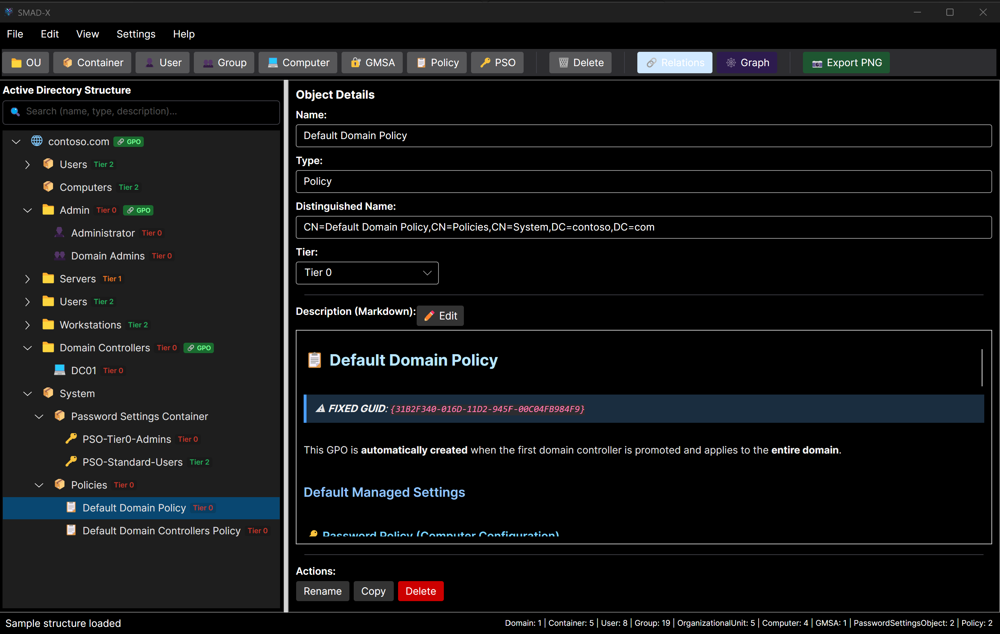
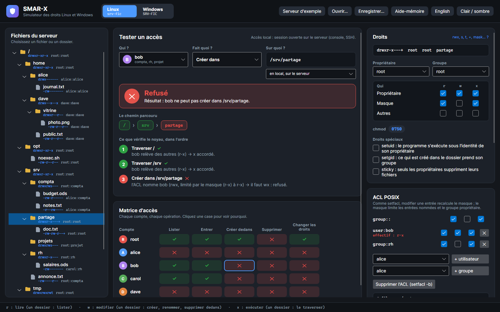
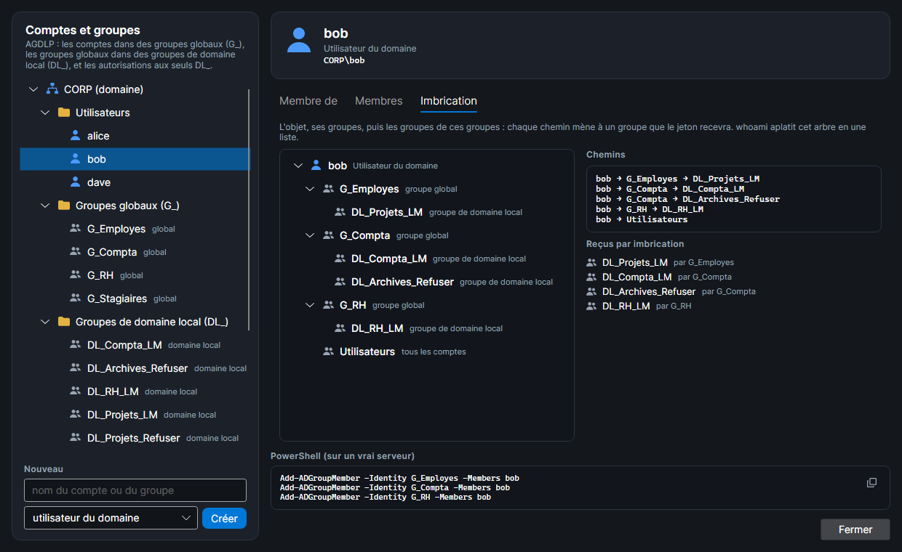
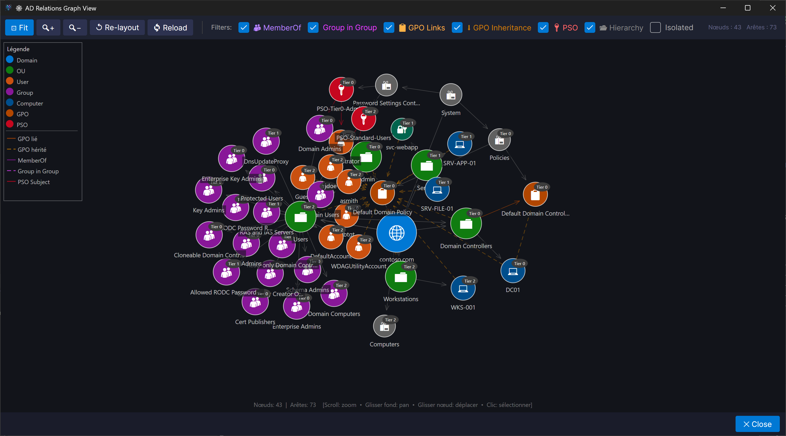

# SMA-X — Simuler, Modéliser, Auditer – eXpert

<p align="center">
  
  
  
  
  
  
  
</p>

> 🇬🇧 English documentation is available in [README.md](./README.md).

**SMA-X** (*Simuler, Modéliser, Auditer – eXpert*) est une suite de trois applications pour **apprendre la sécurité des systèmes** sans risquer une vraie infrastructure. Chaque simulateur reproduit son sujet fidèlement, explique pourquoi un accès est accordé ou refusé, et sert d'énoncé à des exercices corrigés automatiquement, pour toute une classe. Construite avec Avalonia UI et .NET 10, pour Windows, Linux et macOS.

| Outil | Ce qu'il fait | Documentation |
|---|---|---|
| 🛡️ **SMAD-X** | Le simulateur d'**Active Directory** : un domaine identique à une installation neuve de Windows Server 2019, 2022 ou 2025, audité selon l'ANSSI, le NIST, le CIS et MITRE ATT&CK, ses chemins d'attaque, le modèle en tiers, des exercices corrigés | [SMAD-X](https://jm2k69.github.io/SMAD-X/smad-x/) |
| 🔐 **SMAR-X** | Le simulateur des **droits d'accès aux fichiers**, sous Linux et sous Windows, sur le serveur et par un partage (SMB, Samba) : qui peut faire quoi, sur quoi, et pourquoi | [SMAR-X](https://jm2k69.github.io/SMAD-X/smar-x/) |
| 🧑‍🏫 **SMAD-X Studio** | L'outil du **formateur**, commun aux deux simulateurs : crée les exercices, écrit le sujet et la fiche formateur, corrige toute une classe | [Studio](https://jm2k69.github.io/SMAD-X/exercices/studio/) |

> 📖 **Documentation** : [jm2k69.github.io/SMAD-X](https://jm2k69.github.io/SMAD-X/) (français) · [jm2k69.github.io/SMAD-X/en](https://jm2k69.github.io/SMAD-X/en/) (English)

<p align="center">
  
</p>

<p align="center">
  
</p>

## ✅ Testé sur de vrais systèmes

Les simulateurs ne sont pas écrits « de mémoire ». Leurs résultats ont été comparés, un à un, à ceux de vrais systèmes installés et mesurés pour l'occasion. Ces relevés sont figés dans les tests : si un moteur s'en écarte, les tests échouent et aucune version ne sort.

| Outil | Système réel | Ce qui est comparé |
|---|---|---|
| SMAD-X | domaines **Windows Server 2019, 2022 et 2025** tout juste promus | le domaine neuf, objet par objet et permission par permission, et l'audit des deux |
| SMAD-X | un domaine Windows Server 2025 durci par **HardenAD** 2.9.9 | le modèle appliqué : OU, groupes, GPO et leurs paramètres, appartenances, délégations |
| SMAR-X | **noyau Linux** 6.19, Debian 13 | 925 accès et 140 créations de fichiers |
| SMAR-X | **Samba** 4.22 | 20 connexions, 160 opérations et 72 créations par les partages |
| SMAR-X | **Windows Server 2025**, contrôleur de domaine | 1 512 ouvertures sous le jeton de chaque compte, les propriétaires, l'ordre réel des ACL |
| SMAR-X | Windows Server 2025, depuis un **Windows 11** du domaine | 1 540 ouvertures par les partages et 50 dossiers listés |
| SMAR-X | l'**Explorateur** et **icacls** de Windows 11 | l'onglet Sécurité (96 vues de comptes, 103 entrées de la fenêtre Avancé, 8 séquences de cases cochées) et l'affichage des droits par icacls (16 383 combinaisons) |
| SMAR-X | Windows 11 (PowerShell 5.1, NTFSSecurity) et Debian 13 | les 50 commandes de l'aide-mémoire, rejouées telles qu'elles sont écrites |

## 📦 Téléchargement

Chaque version, sur la page [Releases](https://github.com/JM2K69/SMAD-X/releases/latest), a **une archive par application et par plateforme** (Windows x64, Linux x64, macOS Intel et Apple Silicon) : `SMAD-X-<plateforme>.zip`, `SMAD-X-Studio-<plateforme>.zip` et `SMAR-X-<plateforme>.zip`. Chacune contient un seul exécutable autonome : rien à installer. Un apprenant n'a besoin que du simulateur de l'exercice.

---

## 🛡️ SMAD-X — Active Directory

<p align="center">
  
</p>

**SMAD-X** (*Simulate, Model and Audit Active Directory eXpert*) génère une structure AD fidèle à une installation neuve de Windows Server et permet de la visualiser, l'auditer, la documenter et l'exporter sans aucune infrastructure réelle.

### 🏗️ Structure AD par défaut complète et fidèle
- Génération automatique de tous les containers et objets présents dans un domaine AD fraîchement promu, sous Windows Server 2019, 2022 ou 2025 (vérifiée sur de vrais exports de chaque version) :
  - **Builtin** : Administrators, Users, Guests, Server Operators, Account Operators, Backup Operators…
  - **Users** : Administrator, Guest, krbtgt + 16 groupes de domaine (Domain Admins, Schema Admins, Enterprise Admins, Protected Users, Key Admins, Cloneable Domain Controllers, Denied/Allowed RODC Password Replication Group…)
  - **Computers** : container par défaut pour les postes joints au domaine
  - **Domain Controllers** (OU) : DC01 avec tous les rôles FSMO
  - **System** : Password Settings Container, Policies (Default Domain Policy, Default Domain Controllers Policy)
  - **ForeignSecurityPrincipals**
- Création d'un domaine personnalisé via `Fichier > Nouveau domaine`
- Distinguished Names calculés automatiquement

### 🌐 Vue Graphe de relations interactif
- Visualisation force-directed de toutes les relations entre objets
- Rendu séparé des appartenances **User → Groupe** et de l'imbrication **Groupe → Groupe**
- Filtres par type d'objet (User, Group, Computer, OU, GPO, PSO…) et par tier
- Navigation pan/zoom et sélection de nœuds

### 🔗 Gestion des relations
- **User → Groupe** : onglet dédié pour affecter des utilisateurs à des groupes
- **Groupe → Groupe** : onglet dédié pour gérer l'imbrication de groupes
- **GPO** : liaisons des stratégies de groupe aux domaines et OUs, avec badge visuel `🔗 GPO` dans l'arborescence
- **PSO** : application des Password Settings Objects aux utilisateurs et groupes
- Les GPOs sont créées sous `System\Policies` pour correspondre à la structure AD réelle

### 📤 Export
- **JSON natif** (`.smadx.json`) : sauvegarde et rechargement complet de la structure
- **Import d'un AD réel** : un script PowerShell en lecture seule lit un domaine existant et produit un `.smad-x.json` (SMAD-X n'écrit jamais dans un annuaire)

### 🎨 Modèle de tiering Microsoft
- **Tier 0** : Contrôleurs de domaine, comptes et systèmes critiques
- **Tier 1** : Serveurs d'infrastructure et d'applications
- **Tier 2** : Postes de travail et utilisateurs standard
- Couleurs configurables par tier via l'interface
- **Modèles de cloisonnement** : appliquer le [modèle en tiers de Microsoft](https://github.com/microsoft/ActiveDirectoryTierModel) ou [HardenAD](https://github.com/LoicVeirman/HardenAD) à un domaine neuf ou existant (OU par tier, groupes et comptes d'administration, GPO, délégations), puis auditer le respect du modèle (TIER-05 à TIER-08) ; les GPO du modèle agissent sur les chemins d'attaque (les refus d'ouverture de session suppriment les sessions d'administrateurs qu'ils interdisent, les groupes restreints et les préférences fixent les administrateurs locaux) ; **Analyse > Simuler un cloisonnement** migre une copie d'un domaine classique vers chaque modèle (objets rangés par rôle et par tier, droits gardés par les groupes du modèle) et compare score, niveau ANSSI et chemins d'attaque avant et après ; **silos d'authentification** (Configuration > Silos d'authentification) : un silo appliqué tient ses administrateurs à l'écart des autres ordinateurs, ce qui retire leurs sessions des chemins d'attaque (TIER-09 signale un compte privilégié hors d'un silo appliqué) ; les deux modèles sont générés depuis leur version officielle, avec la source et la licence MIT citées

### 📝 Documentation Markdown intégrée
- Chaque objet dispose d'une description Markdown enrichie avec rôle et **notes de sécurité**
- Mode édition / mode prévisualisation
- Descriptions pré-remplies et localisées pour tous les objets par défaut

### 🌐 Topologie des sites AD
- Gestion complète de la topologie : **Sites**, **Sous-réseaux**, **Contrôleurs de domaine**, **Liens de réplication**
- Fenêtre Sites (Ctrl+Maj+S) : vue tableau + mise en page graphique interactive
- Panneau Sites dans l’arborescence principale avec icône bâtiment et compteur dans la barre d’état
- GPOs liées aux sites ; affectation DC-site ; sites liés visibles sur les nœuds
- Topologie d’exemple : Default-First-Site-Name, Site-Paris, Site-Lyon (DCs, sous-réseaux, liens, GPOs)
- Le script PowerShell exporte la topologie complète vers le format `.smad-x.json` v2
  (WhenCreated, WhenChanged, GPOs liées, Tier, transport IP/SMTP auto-détecté)

### 📄 Export de rapport de documentation
- Mode **combiné** : rapport complet du domaine en un seul fichier
- Mode **individuel** : sélection objet par objet avec cases de filtre par type + liste défilante
- Cases de format : **Markdown** (toujours actifé), **DOCX**, **PDF** optionnels
- Choix du thème : WordLike · Plain · Technical Document · GitHub · Compact · Report
- PDF : intégration des polices système + repli emoji pour un rendu Unicode complet
- Raccourci : Ctrl+Maj+R

### 🌙 Thème clair / sombre
- Basculement entre le thème clair et le thème sombre à la volée — sans redémarrage
- Thème natif Avalonia FluentTheme — menus et popups toujours rendus dans le bon thème

### 🔍 Recherche live dans l’arborescence
- Barre de recherche au-dessus du TreeView : filtrer les nœuds par **nom**, **type** ou **description**
- Les nœuds non correspondants sont masqués ; les parents sont automatiquement dépliés
- Bouton d’effacement pour réinitialiser le filtre instantanément

### 🌍 Support multilingue
- Interface entièrement disponible en **Français** et en **English** — changement à chaud

### 🛡️ Visualiseur de délégations
- Fenêtre dédiée listant toutes les entrées de délégation AD (trustee, droit, DN cible, catégorie, tier, héritage)
- Filtres en direct par **trustee**, **DN cible**, **catégorie** (PasswordReset, ComputerManagement, AccountUnlock, AttributeWrite, FullControl, Other) et bascule **masquer l'héritage**
- Barre de statistiques affichant le nombre de délégations par catégorie
- **Export CSV** pour l'audit et le reporting

### ⏱️ Chronologie AD — Diff entre deux instantanés
- Chargement de deux fichiers `.smadx.json` (ancien vs. récent) avec calcul d'un diff structuré
- Mise en évidence des objets **Ajoutés**, **Supprimés** et **Modifiés**
- Filtres par type de changement, type d'objet et recherche libre
- Statistiques récapitulatives (compteurs ajoutés / supprimés / modifiés)
- **Export du diff en CSV**

### ✅ Validation Active Directory
- Validation des noms selon les règles AD (caractères interdits, longueur, unicité)
- Règles de conteneurs respectées

---

### 🛡️ Audit de sécurité, chemins d'attaque et exercices
- **Audit de sécurité** : 31 règles sourcées (checklist AD de l'ANSSI, NIST, CIS, MITRE ATT&CK, Microsoft), avec un score et un niveau ANSSI estimé
- **Chemins d'attaque** : qui peut prendre le contrôle du domaine, et par quelles étapes (Kerberoasting, AS-REP roasting, délégations, propriétaires, GPO, délégation Kerberos…), surlignés dans le graphe
- Comparaison **avant / après** et **annuler / rétablir**
- **Exercices** (`.smadx-lab.json`) : des scénarios réalistes corrigés automatiquement, dont 12 exercices de chemins d'attaque en français et en anglais
- **Mode exercice et mode examen** : un exercice ouvert directement (`SMAD-X.exe exercice.smadx-lab.json`) verrouille le domaine ; un examen n'a ni indice, ni score, ni « Recommencer », mesure le temps passé et peut fermer l'audit, ses sections « Comment corriger », les chemins d'attaque ou la comparaison ; l'apprenant enregistre une **copie** (`.smadx-submission.json`) pour reprendre ou rendre son travail, scellée (SHA-256) et liée à une session de travail tirée au hasard
- Rien ne se perd : fermer avec des modifications non enregistrées demande d'enregistrer, et le mode exercice garde chaque minute une copie de secours, proposée à l'ouverture suivante
- **Pour les formateurs** : les domaines d'exemple de [`Samples/AttackPaths`](Samples/AttackPaths/README.md) décrivent chaque chemin et sa correction, ce sont donc les corrigés des exercices de chemins d'attaque ; pour écrire vos propres exercices : le [mode opératoire](https://jm2k69.github.io/SMAD-X/exercices/creer/)

## 🔐 SMAR-X — droits d'accès aux fichiers, Linux et Windows

**SMAR-X** (*Simulate, Model and Audit Rights eXpert*) répond à une question : **qui peut faire quoi, sur quoi, et pourquoi**, sur un serveur Linux et un serveur Windows membre d'un domaine, d'exemple, sur le serveur ou depuis le réseau ([documentation](https://jm2k69.github.io/SMAD-X/smar-x/)).

- **Testeur** : un compte, une opération, un chemin : autorisé ou refusé, avec chaque étape du noyau Linux ou d'AccessCheck sous Windows (le jeton, puis chaque ACE dans l'ordre)
- **Matrice d'accès** : chaque compte, chaque opération ; un clic sur une case l'explique
- **Linux** : propriétaire, groupe, `chmod`, bits spéciaux, ACL POSIX et leur masque, ACL par défaut, umask ; partages **Samba**, avec la section de `smb.conf`
- **Windows** : l'**onglet Sécurité** de l'Explorateur (fenêtres Modifier et Avancé, accès effectif), la sortie d'`icacls` telle que l'écrit le vrai `icacls`, les partages **SMB** (Partage avancé, énumération basée sur l'accès), les comptes et les groupes dans une fenêtre comme la **console Active Directory** (membres, membre de, imbrication, règles AGDLP), et le **whoami** de chaque compte
- **Depuis le réseau** : le même accès sur le serveur ou par un partage, côte à côte
- **Aide-mémoire** : chaque abréviation, puis des commandes d'exemple (`icacls`, PowerShell, le module **NTFSSecurity** en face de ses équivalents `icacls`, `chmod`, `setfacl`, Samba), chacune copiée d'un clic, et un **export PDF**
- **Exercices** (`.smarx-lab.json`) : un besoin à satisfaire avec seulement les droits nécessaires, corrigé par les moteurs ; créés à partir de **recettes** (une entreprise, ses services, Windows ou Linux) et corrigés pour toute une classe dans SMAD-X Studio

<p align="center">
  
</p>

## 🧑‍🏫 SMAD-X Studio — création d'exercices pour les formateurs

Un troisième exécutable, livré dans sa propre archive ([documentation](https://jm2k69.github.io/SMAD-X/exercices/studio/)), clair ou sombre, pour les **exercices SMAD-X et SMAR-X** :
- **Nouvel exercice SMAD-X à partir d'une recommandation** : une recette par règle d'audit / point de contrôle ANSSI, seule ou **plusieurs réunies** dans le même domaine ; Studio construit un domaine sain et peuplé, n'y injecte que ces manques, et produit le **domaine corrigé**, qui obtient tous les points
- **Nouvel exercice SMAR-X à partir d'une recette** : une entreprise, ses services et la plateforme ; les serveurs corrects sont la solution, une copie abîmée est le départ
- **Convertir** un scénario `.smad-x.json` en exercice : le contexte devient l'énoncé, le chemin et la correction vont dans les notes du formateur
- **Un dossier par exercice**, rangé par rôle dès sa création (exemplaire du formateur, sujet à distribuer, copies, résultats) : chaque export va à sa place, et l'exercice se rouvre par son dossier ou la liste des récents ; les copies glissées sur la fenêtre sont rangées et corrigées
- Éditeur d'énoncé Markdown avec aperçu, éditeur d'objectifs avec **suggestions** tirées de l'audit et des chemins d'attaque, et **gardes** contre les corrections brutales : une garde violée annule les objectifs qui concernaient l'objet protégé
- **Questions de compréhension** posées avec les objectifs : choix unique ou multiple, oui / non, association, réponse écrite ; **crédit partiel** pour les objectifs qui se comptent et les questions à plusieurs réponses
- **Exemplaire du formateur et sujet** : votre fichier garde les indices et le corrigé ; le **sujet** exporté n'en a aucun, et SMAD-X refuse d'ouvrir l'exemplaire d'un examen
- **Validation** comme les tests des exercices fournis (rien d'atteint au départ, gardes efficaces, aucune solution visible, questions complètes), **solution proposée** et **fiche formateur**
- **Corriger une classe** : la note de chacun, les réponses écrites notées à la main avec une appréciation, la réussite par objectif et par question ; exports CSV (note sur 20 pour l'ENT), **Moodle**, **comptes rendus individuels en PDF** et bilan Markdown ; les copies suspectes sont signalées
- **Fiches des sources** : pour chaque règle d'audit, la fiche de chaque source qu'elle cite (ANSSI, NIST, CIS, MITRE ATT&CK, Microsoft), avec sa provenance et sa licence, exportée en PDF une à une ou pour les règles cochées ; une source se relit sur le web pour voir ce qui a changé depuis votre version
- **Ligne de commande** pour les lots : `SMAD-X.Studio recipe all --lang fr --out exercices`, `convert`, `validate`, `export-subject`, `grade exercice.smadx-lab.json copies/ --csv notes.csv --moodle moodle.csv --reports comptes-rendus`, et le même `grade` pour un exercice SMAR-X

## 🚀 Démarrage rapide

- **Télécharger** une archive sur la page [Releases](https://github.com/JM2K69/SMAD-X/releases/latest) : rien à installer.
- **Depuis les sources** (.NET 10 SDK, Windows, macOS ou Linux) : `dotnet build`, puis
  - `dotnet run --project SMAD-X/SMAD-X.csproj`
  - `dotnet run --project SMAR-X/SMAR-X.csproj`
  - `dotnet run --project SMAD-X.Studio/SMAD-X.Studio.csproj`

---

## 📖 Utiliser SMAD-X

### Structure par défaut au démarrage
Au lancement, SMAD-X charge automatiquement un domaine `contoso.com` avec une structure AD complète et fidèle à une installation fraîche de Windows Server.

### Créer un nouveau domaine
`Fichier > Nouveau domaine` → saisissez le FQDN (ex : `corp.local`) et choisissez le cloisonnement en tiers : aucun, étiquettes Tier 0/1/2, ou un modèle publié (Microsoft ou HardenAD).

### Ajouter des objets
- Sélectionnez un nœud parent dans l'arborescence
- Utilisez les boutons de la barre d'outils : 📁 OU, 👤 Utilisateur, 👥 Groupe, 💻 Ordinateur, 🔑 GMSA…
- L'objet est créé comme enfant du nœud sélectionné, avec son DN calculé automatiquement

### Copier / Coller

| Action | Raccourci |
|---|---|
| Copier un objet (et ses enfants) | `Ctrl+C` |
| Coller dans le conteneur sélectionné | `Ctrl+V` |
| Supprimer | `Suppr` |

### Vue Graphe
`Affichage > Vue Graphe` : visualisation force-directed de toutes les relations.
Filtrez par type d'objet ou par tier via les cases à cocher.
Activez **Imbrication de groupes** pour afficher séparément les arêtes Groupe → Groupe.

### Fenêtre Relations
`Affichage > Relations` : fenêtre dédiée avec quatre onglets :

| Onglet | Rôle |
|---|---|
| 👤 **User → Groupe** | Affecter des utilisateurs à des groupes |
| 👥 **Groupe → Groupe** | Gérer l'imbrication de groupes |
| 📋 **Liens GPO → OU** | Lier des stratégies de groupe aux OUs/Domaine |
| 🔑 **Sujets PSO** | Affecter des Password Settings Objects |

### Fenêtre Délégations
`Analyse > Délégations...` (`Ctrl+D`) : liste toutes les entrées de délégation avec filtres par mandataire, DN cible, catégorie et héritage.
Exportez la liste complète en CSV pour vos audits. Une colonne s'élargit ou se rétrécit en faisant glisser le bord droit de son en-tête.

### Chronologie AD
`Analyse > Évolution du domaine...` (`Ctrl+T`) : comparez deux instantanés `.smad-x.json` côte à côte.
Visualisez les objets ajoutés, supprimés et modifiés avec export en CSV.

### Sauvegarde / Chargement

| Action | Menu |
|---|---|
| Enregistrer | `Fichier > Enregistrer…` (`.smad-x.json`) |
| Ouvrir | `Fichier > Ouvrir…` |
| Importer un AD réel | `Fichier > Générer le script d'import depuis AD…` (script en lecture seule) |

---

## 🔐 Comptes et groupes par défaut — Référence sécurité

Chaque objet par défaut dispose d'une description Markdown intégrée dans l'application, incluant son rôle et des recommandations de sécurité.

### 🔴 Tier 0 — Critiques (Domaine / Forêt)

| Objet | Type | Rôle | Points de sécurité clés |
|---|---|---|---|
| **Administrator** | Compte | Accès complet au domaine | Renommer, désactiver si inutilisé, surveiller PtH / Mimikatz (Event 4624 type 3) |
| **krbtgt** | Compte | Signe tous les tickets Kerberos (TGT) | Ne jamais supprimer/activer — Golden Ticket — renouveler tous les 180j (double rotation) |
| **Domain Admins** | Groupe | Contrôle total du domaine | Limiter les membres, utiliser PAW, surveiller Event 4728/4729 |
| **Enterprise Admins** | Groupe | Contrôle total de la forêt | Maintenir **vide** — membres uniquement pour opérations forêt |
| **Schema Admins** | Groupe | Modification du schéma AD | Maintenir **vide** — modifications irréversibles |
| **Domain Controllers** | Groupe | Tous les DCs | Un DC compromis = domaine compromis |
| **Read-Only Domain Controllers** | Groupe | Contient les RODCs | Gérer soigneusement la Password Replication Policy |
| **DnsAdmins** | Groupe | Administration DNS | Escalade de privilèges via DLL injection (Shay Ber 2017 — Event 4662) |
| **Key Admins** | Groupe | Gestion msDS-KeyCredentialLink | Attaque Shadow Credentials (Whisker / pyWhisker) |
| **Enterprise Key Admins** | Groupe | Key Admins, portée forêt | Shadow Credentials — portée forêt — maintenir **vide** |
| **Cloneable Domain Controllers** | Groupe | Clonage de DCs | Le DC cloné hérite des secrets du DC source — contrôler l'appartenance |

### 🟠 Tier 1 — Privilèges élevés

| Objet | Risque principal |
|---|---|
| **Group Policy Creator Owners** | Déploiement de GPO malveillante — surveiller Event 5136/5137 |
| **Cert Publishers** | Escalade PKI ESC1–ESC8 (Certify / Certipy) |
| **RAS and IAS Servers** | Interception VPN/RADIUS si compromis |
| **DnsUpdateProxy** | DNS hijacking via enregistrements sans propriétaire |
| **Allowed RODC Replication** | Ne jamais y placer des comptes Tier 0 |

### 🟡 Tier 2 — Surveillance requise

| Objet | Note |
|---|---|
| **Protected Users** | Ajouter tous les comptes Tier 0/1 — bloque PtH, PtT, OverPtH, RC4, DES |
| **Denied RODC Replication** | Maintenir à jour avec tous les comptes critiques |
| **Domain Users** | Groupe par défaut de tous les comptes du domaine — auditer les appartenances |
| **Domain Computers** | Toutes les machines jointes au domaine — surveiller les jonctions non autorisées |

### 🟢 Système / Risque faible

| Objet | Note |
|---|---|
| **Guest** | Désactivé par défaut depuis Server 2008 — ne pas activer |

---

## 🎨 Modèle de tiering Microsoft

| Tier | Couleur | Périmètre |
|---|---|---|
| **Tier 0** | 🔴 Rouge | Contrôleurs de domaine, comptes et systèmes critiques |
| **Tier 1** | 🟠 Orange | Serveurs d'infrastructure et d'applications |
| **Tier 2** | 🟢 Vert | Postes de travail et utilisateurs standard |

Les couleurs sont configurables via `Paramètres > Configuration des tiers`.

---

## 🏗️ Architecture

| Projet | Rôle |
|---|---|
| **SMAD-X.Labs** | Socle commun, sans Active Directory ni interface : traductions FR/EN et fiches Markdown, questions de compréhension et leur correction, sceau et session des copies, notes du formateur, journal, texte sûr |
| **SMAD-X.Core** | Moteur Active Directory : modèles, fichiers, audit, chemins d'attaque, cloisonnement, exercices, exports |
| **SMAD-X.UI** | Éléments Avalonia partagés : rendu Markdown, thème clair / sombre |
| **SMAD-X** | L'application |
| **SMAD-X.Studio** | L'outil du formateur : crée les exercices et corrige les copies |
| **SMAD-X.Tests** | Tests xUnit |
| **SMAR-X.Core** | Moteurs des droits d'accès : noyau Linux, Samba, NTFS, SMB, expliqués étape par étape ; exercices SMAR-X et leur correction |
| **SMAR-X** | L'application des droits d'accès |
| **SMAR-X.Tests** | Tests xUnit, avec les relevés faits sur de vrais systèmes (`Fidelity/`) |
| **tools/** | Outils de mesure (vrais systèmes), captures de la documentation, générateurs d'exercices, l'outil des fiches de sources (`SmadxSources`) |
| **sources/** | Une fiche par élément cité par les règles d'audit (ANSSI, NIST, CIS, MITRE ATT&CK, Microsoft, modèles de cloisonnement), en français et en anglais, avec sa provenance et sa licence ; un PDF par fiche à la demande |

L'application SMAD-X :

```
SMAD-X/
├── Models/
│   ├── ADObject.cs                  # Modèle de données principal (DN, GPO, PSO, MemberOf…)
│   ├── ADObjectType.cs              # Énumération des types d'objets AD
│   ├── ADTreeNode.cs                # Nœud TreeView (badge GPO, couleur tier)
│   ├── ADSite.cs                    # Modèle site (sous-réseaux, DCs, GPOs, tier)
│   ├── ADSubnet.cs                  # Modèle sous-réseau (CIDR, emplacement)
│   ├── ADSiteLink.cs                # Lien de réplication (transport, coût, planning)
│   ├── ADSitesTopology.cs           # Conteneur racine (Sites + SiteLinks)
│   ├── ADRootDocument.cs            # Document v2 (Domaine + SitesTopology)
│   └── TierConfiguration.cs        # Configuration des couleurs de tiering
├── Services/
│   ├── ADDataService.cs             # Structure par défaut, sauvegarde/chargement JSON v1/v2
│   ├── ADDocumentReportService.cs   # Export de rapport MD/DOCX/PDF
│   ├── ADImportPowerShellService.cs # Script d'import en lecture seule (v2 + sites)
│   ├── ADValidationService.cs       # Validation des noms et règles de conteneurs
│   ├── LocalizationService.cs       # Support multilingue FR/EN + descriptions sécurité
│   └── ThemeService.cs              # Gestion du thème clair/sombre
├── ViewModels/
│   ├── MainWindowViewModel.cs       # ViewModel principal (MVVM)
│   ├── GraphViewModel.cs            # ViewModel vue graphe
│   ├── RelationsViewModel.cs        # ViewModel relations (User→Groupe, Groupe→Groupe, GPO, PSO)
│   ├── SitesViewModel.cs            # ViewModel sites (tableau + mise en page graphe)
│   ├── DelegationsViewModel.cs      # ViewModel délégations (filtre, stats, export CSV)
│   ├── DomainTimelineViewModel.cs   # ViewModel chronologie AD (diff, filtres, export CSV)
│   └── TierConfigurationViewModel.cs
├── Views/
│   ├── MainWindow.axaml             # Interface principale avec badge GPO + panneau Sites
│   ├── GraphWindow.axaml            # Vue graphe force-directed
│   ├── RelationsWindow.axaml        # Fenêtre relations (4 onglets)
│   ├── SitesWindow.axaml            # Fenêtre topologie sites (tableau + graphe)
│   ├── ExportReportDialog.axaml     # Dialogue export rapport (MD/DOCX/PDF)
│   ├── DelegationsWindow.axaml      # Visualiseur de délégations avec filtres et export CSV
│   ├── DomainTimelineWindow.axaml   # Visualiseur diff chronologie AD
│   ├── NewDomainDialog.axaml        # Dialogue nouveau domaine
│   ├── TierConfigurationWindow.axaml
│   └── AboutDialog.axaml
├── Graph/
│   ├── GraphBuilder.cs              # Construction du graphe depuis l'arbre AD
│   ├── GraphCanvas.cs               # Rendu Avalonia (zoom/pan/hit-test)
│   ├── GraphNode.cs / GraphEdge.cs  # Modèles du graphe
│   ├── GraphFilter.cs               # Filtres par type/tier/imbrication
│   └── ForceSimulation.cs           # Algorithme force-directed
└── Converters/
	├── BoolToStringConverter.cs
	├── LocalizeConverter.cs
	└── MarkdownConverter.cs
```

---

## 🔧 Technologies

| Composant | Version | Rôle |
|---|---|---|
| **.NET** | 10 | Runtime cross-platform |
| **Avalonia UI** | 12.0.3 | Framework UI cross-platform |
| **CommunityToolkit.Mvvm** | 8.4.2 | Implémentation MVVM |
| **OfficeIMO** (Markdown, Markdown.Pdf, Word, Word.Markdown) | 3.5.1 | Modèle Markdown, export PDF et DOCX |
| **xUnit** | 2.9.3 | Tests |
| **System.Text.Json** | intégré | Sérialisation JSON |

---

## 📝 Cas d'usage

| Profil | Usage |
|---|---|
| **Formateur / Étudiant** | Apprendre et enseigner les concepts AD sans infrastructure |
| **Administrateur** | Documenter et auditer une architecture AD existante |
| **Architecte** | Concevoir et valider une nouvelle structure avant déploiement |
| **Pentester / Red Team** | Visualiser les chemins d'attaque via les relations, les tiers et les notes de sécurité des comptes par défaut |
| **Formateur (droits de fichiers)** | Enseigner les droits Linux et NTFS, les partages et le moindre privilège avec SMAR-X, et corriger les exercices |
| **Étudiant** | Voir pourquoi un accès est accordé ou refusé, étape par étape, sur le serveur et par un partage |

---


<p align="center">
  
</p>

<p align="center">
  
</p>


## 🎯 Feuille de route

- [x] Structure AD par défaut complète et fidèle
- [x] Vue graphe de relations force-directed
- [x] Gestion GPO / PSO / MemberOf
- [x] Support multilingue FR/EN
- [x] Descriptions Markdown enrichies avec notes de sécurité pour tous les comptes/groupes par défaut
- [x] Import depuis un Active Directory réel (via PowerShell — format JSON v2 avec topologie sites complète)
- [x] Imbrication de groupes (Groupe → Groupe) dans le graphe et les relations
- [x] Badge GPO visuel dans l'arborescence
- [x] Fenêtre Relations divisée : onglets User → Groupe et Groupe → Groupe
- [x] Thème clair / sombre
- [x] Recherche et filtrage dans l'arborescence (recherche live par nom / type / description)
- [x] Visualiseur de délégations (filtres trustee / DN cible / catégorie / héritage, export CSV)
- [x] Chronologie AD — diff entre deux instantanés (ajoutés / supprimés / modifiés, export CSV)
- [x] **Topologie des sites AD** (sites, sous-réseaux, DCs, liens de réplication, GPOs liées, tier)
- [x] **Export de rapport de documentation** (Markdown, DOCX, PDF avec sélection du thème)
- [x] **SMAD-X Studio** : exercices SMAD-X et SMAR-X, à partir de recettes, et correction de toute une classe
- [x] **SMAR-X** : droits d'accès aux fichiers sous Linux et Windows, en local et par les partages, vérifiés sur de vrais systèmes
- [ ] Support multi-domaines / forêts

---

## 📄 Licence

La suite SMA-X (SMAD-X, SMAD-X Studio et SMAR-X) est sous **[licence Apache 2.0](./LICENSE)** : vous pouvez l'utiliser, la modifier et la redistribuer, y compris dans une formation payante, à condition de conserver la licence et le fichier [NOTICE](./NOTICE). Elle est fournie sans garantie.

Les bibliothèques et polices tierces gardent leur propre licence (MIT, BSD, SIL Open Font License) : voir [THIRD-PARTY-NOTICES.md](./THIRD-PARTY-NOTICES.md). Ces fichiers sont aussi dans chaque archive de version.

---

> Inspiré de [MockAD-Release](https://github.com/shokkadev/MockAD-Release) par shokkadev.

## 🤝 Contribution

Les contributions sont les bienvenues ! N'hésitez pas à ouvrir des issues ou des pull requests.

## 👨‍💻 Auteur

**JM2K69**
