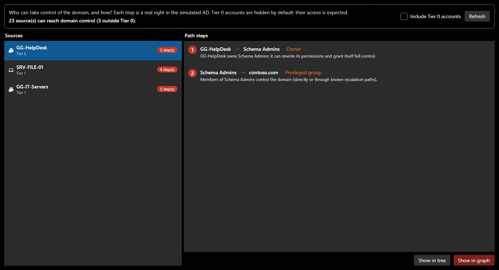

# Attack paths

The audit lists weaknesses one by one. An attacker **chains** them. **Analysis > Attack paths** (`Ctrl+Shift+K`) answers the question that matters: *who can take control of the domain, and through which steps?*

*Screenshot: the sample domain, with a weakness added for this documentation. The help desk is still the owner of the Schema Admins group.*

## Reading the window

- **Sources, on the left**: every account, group or machine that can reach domain control, with its number of steps. **Any domain user** stands for an attacker with nothing but an ordinary account: a path from this source is the most severe, and it comes first.
- **Steps, on the right**: the shortest path, each step with its technique and explanation.
- **Include Tier 0 accounts**: these accounts control the domain by definition, so they are hidden by default. What remains is what needs fixing.
- **Show in tree** selects the step's object; **Show in graph** highlights the whole path.

## How the attack graph is built

SMAD-X builds an "*X can take control of Y*" graph, like a much simpler BloodHound, then looks for the shortest path to the domain with a breadth-first search.

| Technique | Edge | Why |
|---|---|---|
| **Member of** | account or group → group | the member inherits the group's rights |
| **Privileged group** | group → domain | Domain Admins, Enterprise Admins, Administrators, Schema Admins, Account / Server / Backup / Print Operators, DnsAdmins, Key Admins, Enterprise Key Admins, Domain Controllers |
| **Domain controller** | DC → domain | compromising a DC compromises the domain (DCSync, NTDS.dit) |
| **Owner** | owner → object | an owner can always rewrite permissions |
| **Full control** | trustee → OU and its objects | GenericAll delegation |
| **Write all attributes** | trustee → object and what it contains | GenericWrite: SPN, msDS-KeyCredentialLink, members, delegation |
| **Modify permissions**, **Change owner** | trustee → object | WriteDacl, WriteOwner: full control is then one step away |
| **Password reset** | trustee → users of the OU | changing the password is enough; all extended rights allow it too |
| **Group membership change** | trustee → groups of the OU | right to write the `member` attribute |
| **DCSync** | trustee → domain | replication rights on the domain root (or all extended rights): the secrets of every account |
| **Shadow Credentials** | trustee → users and computers | write `msDS-KeyCredentialLink`, add one's key and authenticate as the account |
| **Resource-based constrained delegation (RBCD)** | trustee → computers | write `msDS-AllowedToActOnBehalfOfOtherIdentity`: a ticket to the machine in anyone's name |
| **Targeted Kerberoasting** | trustee → users | add an SPN to the account, then crack its password offline |
| **Read the LAPS password** | trustee → computers managed by LAPS | the local administrator password |
| **Read the gMSA password** | trustee → group managed service account | the account's password, hence its rights |
| **Local administrator** | account or group → computer | controls the machine and what sits in its memory |
| **Open session** | computer → account | an administrator of the machine steals the credentials of the logged-on account |
| **Linked GPO** | GPO → accounts of the OU | whoever controls the GPO runs code on them |
| **GPO link**, **GPO linked to the OU** | trustee → OU → its accounts | whoever controls an OU (or can write `gPLink`) links a GPO there, which reaches even protected accounts |
| **Container contents** | container → its accounts and groups | whoever controls the container grants itself a right inherited by what it contains |
| **AdminSDHolder** | AdminSDHolder → protected accounts and groups | SDProp copies its permissions onto them every hour |
| **Kerberoasting** | any user → account with an SPN | ticket encrypted with the password, cracked offline |
| **AS-REP roasting** | any user → account without preauthentication | response encrypted with the password |
| **Empty password** | any user → PASSWD_NOTREQD account | an empty password may be accepted |
| **Unconstrained delegation** | server → domain | a DC coerced into authenticating leaves its TGT there |
| **Constrained delegation to a DC** | account → DC | impersonating an administrator to a DC service |

Delegations granted to **Domain Users**, **Authenticated Users** or **Everyone** start from "any domain user". A disabled account is not an entry point.

!!! info "What AdminSDHolder prevents"
    A delegation set on an OU does not apply to protected objects (`adminCount = 1`): SDProp disabled their inheritance. A trustee who can reset passwords in an OU therefore cannot reset the password of a Domain Admins member stored in that OU. But whoever controls the OU can link a GPO to it, which also reaches protected accounts; and whoever controls AdminSDHolder controls every protected object. Not every sensitive group is protected, though: check the list of protected groups for your Windows Server version.

Local administrators and sessions are not in the directory: a joined computer has Domain Admins as local administrator, and sessions are set by hand (the computer's **Security** section, see [Modeling](modeling.md)), to show where an administrator logs on.

## Practise

The [labs of the "Attack paths" series](labs/index.md) offer fifteen realistic situations, in English and French, to solve with this window. Their solutions are not published: finding the path and the right fix is up to you.
