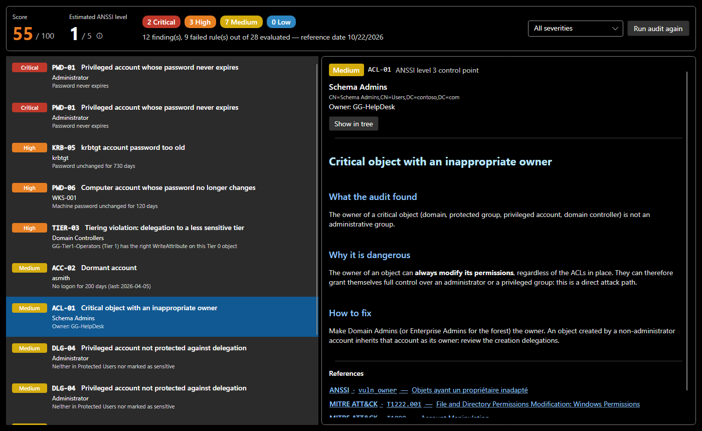

# Security audit

**Analyse > Security audit** (`Ctrl+Shift+A`) checks the domain against **28 rules**. Each one relies on recognised sources:

- the [ANSSI Active Directory checklist](https://cert.cyber.gouv.fr/uploads/ad_checklist.html), with each control point's official identifier and level;
- **NIST**: SP 800-53 (security controls) and SP 800-63B (authentication);
- **CIS Controls** v8;
- **MITRE ATT&CK**, for the matching attack techniques;
- **Microsoft** documentation (tiered access model, protected accounts, delegation).

## Reading the result

| Element | Meaning |
|---|---|
| **Score** | 100 minus one penalty per failed rule: 12 (critical), 6 (high), 3 (medium), 1 (low). A rule counts once, whether it affects one object or ten, so that a widespread issue does not overshadow a rare but critical one. |
| **Estimated ANSSI level** | the level of the most critical failed ANSSI control point, from 1 (most severe) to 5 (no failed point). It is an ANSSI-style estimate, not the official computation of ANSSI's ADS tool. |
| **Counters** | findings per severity, and a severity filter |
| **Finding list** | rule, affected object and detail (for example "password unchanged for 730 days") |
| **Sheet** | what the audit found, why it is dangerous, how to fix, going further, and clickable references |

**Show in tree** selects the affected object; the tree also shows an `AUDIT` badge on every object at fault. Fix, then **Run audit again**.

The screenshot shows the sample domain with a weakness added for this documentation: the help desk owns the Schema Admins group (ACL-01).

## Rule families

| Prefix | Area | Examples |
|---|---|---|
| `KRB` | Kerberos | kerberoastable accounts, AS-REP roasting, old krbtgt |
| `DLG` | delegation | unconstrained delegation outside DCs, constrained delegation to a DC, delegable privileged accounts |
| `PWD` | passwords | expiry, password not required, unchanged passwords (privileged accounts, DCs, computers, managed service accounts) |
| `ACC` | accounts | Guest enabled, dormant accounts |
| `PRIV` | privileged groups | groups that should stay empty, DnsAdmins, missing or orphaned adminCount, protected group outside Tier 0 |
| `ACL` | owners | non-administrative owner of a critical object |
| `TIER` | tiering | membership, GPO or delegation across tiers |
| `GRP` | groups | nesting loops |

The full list, with each rule's severity, ANSSI level and references, is on the [Audit rules](reference/audit-rules.md) page, generated from the code.

## Discuss rather than apply

Sheets point out where frameworks disagree. Example: NIST (SP 800-63B) advises against forcing periodic password changes **on users**, while ANSSI requires expiry for **privileged accounts**. Both views meet: a long, unique password, changed as soon as a compromise is possible.
