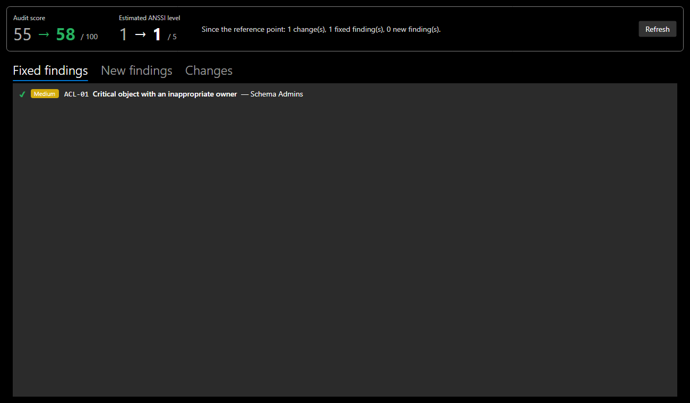

# Before / after, undo / redo

## Measuring the effect of a fix

**Analyse > Before / after...** (`Ctrl+Shift+B`) compares the domain with its **reference point**:

- by default, the state of the domain when it was opened or created;
- or the current state, after **Analyse > Set the reference point here**, just before starting a fix.

| Element | Content |
|---|---|
| **Audit score** | before → after, green when it improves, red when it drops |
| **Estimated ANSSI level** | before → after |
| **Fixed findings** | present at the reference point, gone since |
| **New findings** | appeared since: a fix can create another one |
| **Changes** | objects added, removed or modified, with the changed fields |

*Screenshot: in the documentation demo, giving the Schema Admins group back to Domain Admins fixes finding ACL-01, and the score goes from 55 to 58.*

!!! tip "A fix can bring up a finding"
    Always check the **New findings** tab: fixing an object can move the problem elsewhere. An account removed from a protected group keeps `adminCount = 1`, for example, and the audit reports it as an **orphaned adminCount**: in a real AD, SDProp does not reset this attribute.

**Refresh** runs the comparison again after further changes, without closing the window.

## Undo and redo

| Action | Shortcut |
|---|---|
| Undo | `Ctrl+Z` (**Edit > Undo**) |
| Redo | `Ctrl+Y` or `Ctrl+Shift+Z` (**Edit > Redo**) |

- History keeps up to **100 states**. Each state is a full copy of the domain, so no change escapes undo.
- A change made in the details panel is recorded when the selection changes, or when you undo.
- The tree's selection and expanded nodes are kept, even when undoing a rename.
- History starts over when a file is opened or a domain is created.
