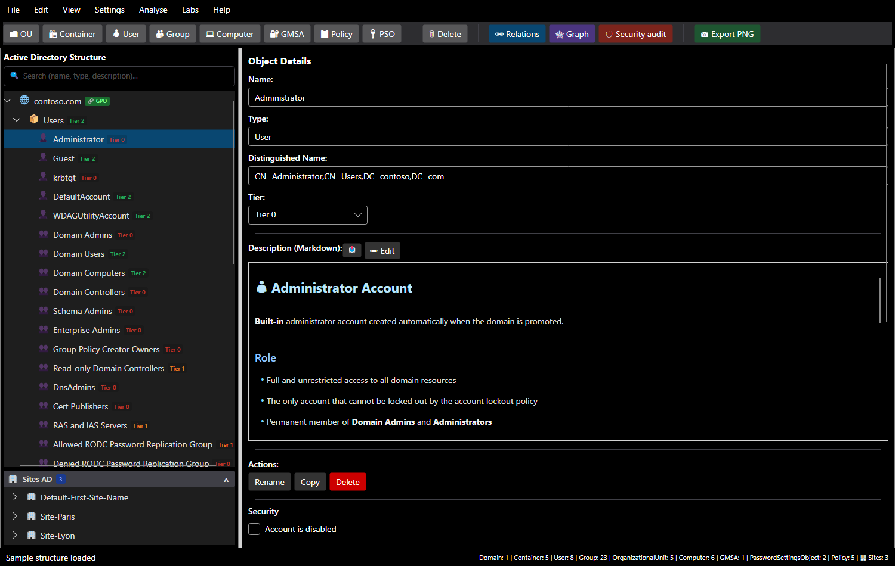
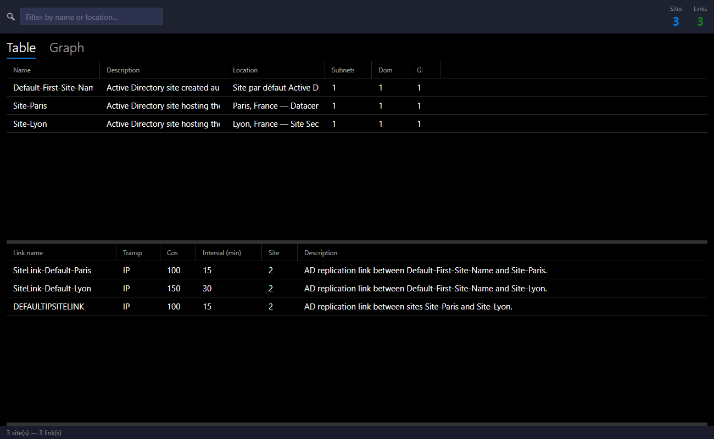

# Getting started

## The main window

| Area | Purpose |
|---|---|
| **Menus** | File, Edit, View, Settings, **Analyse**, **Labs**, Help |
| **Toolbar** | create an object (OU, container, user, group, computer, gMSA, policy, PSO) under the selected object; Relations, Graph, Security audit, Export PNG |
| **Active Directory Structure** | the domain tree, with a search bar (name, type or description) and badges: tier, linked `GPO`, `DEL` delegation, `AUDIT` finding |
| **AD Sites** | below the tree: sites, their subnets and domain controllers |
| **Object Details** | name, type, DN, tier, Markdown sheet, actions, **Security** section |
| **Status bar** | latest message and object counts per type |

## A first domain

=== "Start from the sample"

    On startup, SMAD-X loads `contoso.com`: a full AD structure, three sites (Paris, Lyon and the default site), GPOs and PSOs. **File > New Structure (sample)** (`Ctrl+Shift+N`) reloads it at any time.

=== "Create a domain"

    **File > New Domain...** (`Ctrl+N`), enter the DNS name (for example `corp.local`) and choose whether to apply tier classification. SMAD-X creates what an AD holds right after the first domain controller is promoted: Builtin, Users, Computers, Domain Controllers with DC01, System (Policies, Password Settings Container), ForeignSecurityPrincipals.

=== "Open a file"

    **File > Open...** (`Ctrl+O`) loads a `.smad-x.json`. A file from an older version is converted on load; a file written by a newer version of SMAD-X is refused with a clear message.

## Adding and editing objects

1. Select the parent container in the tree.
2. Click the object type in the toolbar, or right-click the parent.
3. Fill in the details panel. The DN is computed automatically.

| Action | Shortcut |
|---|---|
| Rename | `F2` |
| Copy / paste (with children) | `Ctrl+C` / `Ctrl+V` |
| Delete | `Del` |
| Undo / redo | `Ctrl+Z` / `Ctrl+Y` |

SMAD-X enforces AD rules: forbidden characters, length, unique names, and allowed child types (a container cannot hold OUs, for example).

A new name is confirmed with **Enter** or by leaving the field; **Esc** cancels it. As in the directory, renaming an object updates everything that refers to it: group memberships, PSOs, linked GPOs, owners, delegations and site domain controllers. Deleting an object removes these references; the status bar says how many were touched.

## Each object's sheet

Every object has a **Markdown description**. Built-in objects come with sheets written in English and French: role, security notes, recommendations. Switching language translates these original sheets, never the ones you wrote or changed. **Edit** switches to editing, and **File > Import Description (.md)...** replaces the sheet with a file.

## AD sites

**Analyse > View sites...** (`Ctrl+Shift+S`) manages the topology: sites, subnets, domain controllers, replication links, with a table and a graph view.

## Language and theme

**View > Language** and **View > Theme** switch the language (English, French) and the theme (dark, light) without restarting.

## Going further

- [Model a domain's security](modeling.md): account options, delegations, owners, tiers.
- [Audit the domain](audit.md).
- [Try a first lab](labs/index.md).
