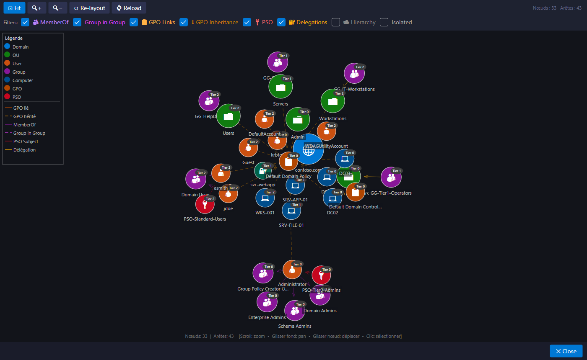
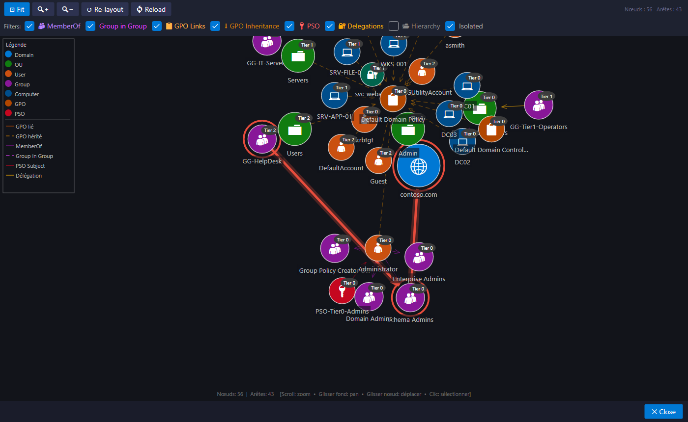

# The relations graph

**View > Graph View...** (or the **Graph** button) draws objects and their links with a force-directed layout: linked objects move closer, the others move apart.

## What is drawn

| Link | Meaning |
|---|---|
| MemberOf | an account is a member of a group |
| Group in Group | a group is nested in another |
| GPO link / inherited GPO | a GPO applies to an OU, directly or through inheritance |
| PSO Subject | a PSO applies to an account or a group |
| Delegation | a trustee has delegated rights over an object |
| Hierarchy | the tree's parent-child links (off by default) |

Checkboxes filter link types, and **Isolated** shows or hides objects without links.

## Navigating

| Gesture | Effect |
|---|---|
| Mouse wheel | zoom |
| Drag the background | pan |
| Drag a node | move it |
| Click a node | select it and show its details |
| **Fit** | frame the whole graph, or the highlighted attack path |
| **Re-layout** | restart the layout |

## An attack path in the graph

From the [Attack paths](attack-paths.md) window, **Show in graph** opens the graph with the path highlighted in red: arrows in the direction of the attack and rings around the objects it goes through. Once the layout settles, the view automatically frames the path.

