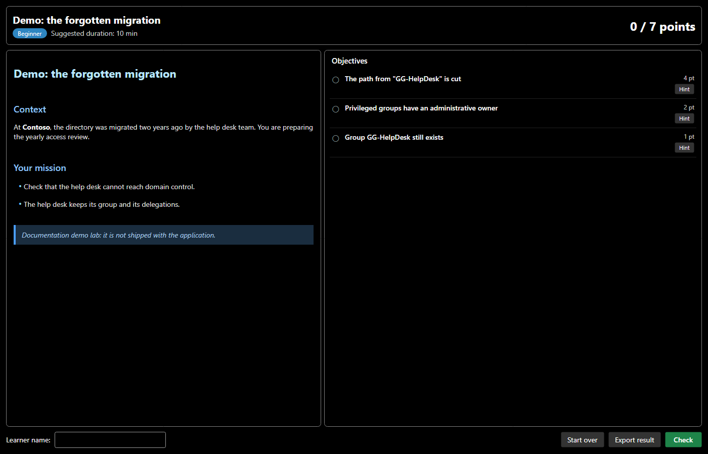
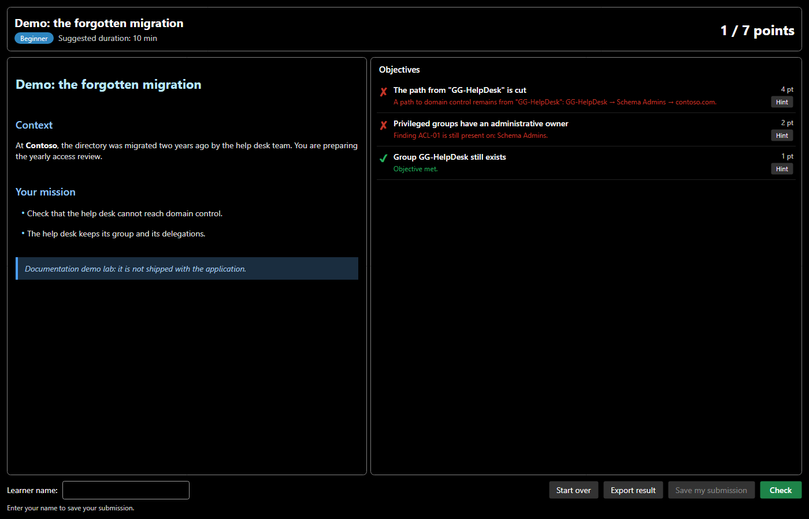
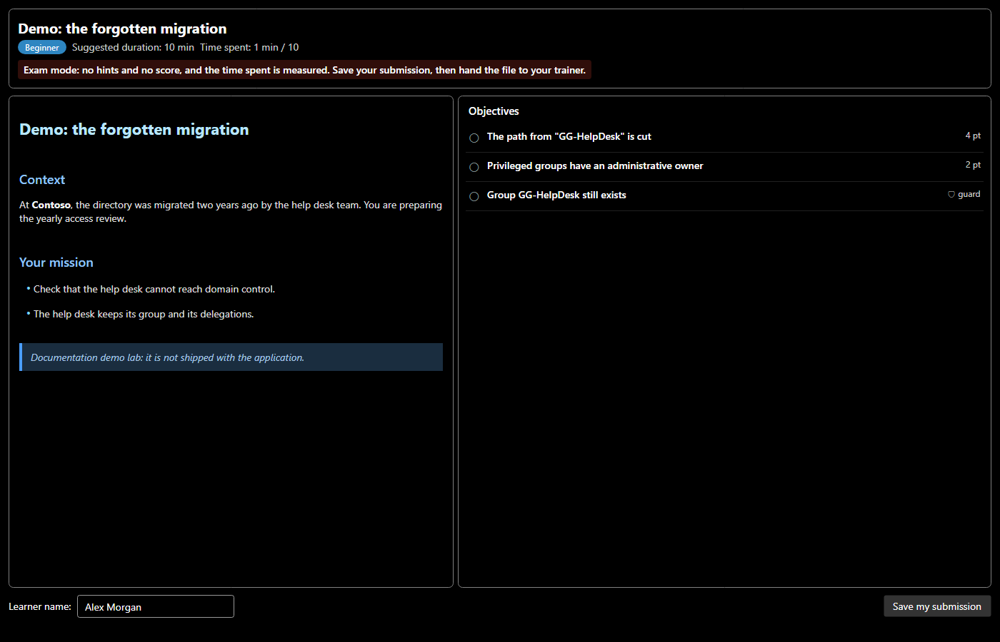

# Labs

A lab puts the learner in a realistic situation (an organisation, a role, a triggering event and business constraints), then **grades the work automatically** with the audit, attack paths and a comparison with the starting domain.

## Opening a lab

| How | Content |
|---|---|
| **Labs > Built-in labs** | five general labs, bilingual |
| **Labs > Attack paths** | fifteen labs, each in the interface language, with its own domain |
| **Labs > Open a lab...** | a `.smadx-lab.json` file received from a trainer, or a `.smadx-submission.json` submission to resume |
| Double-click the file, or `SMAD-X.exe lab.smadx-lab.json` | the same file, opened directly in lab mode (see below) |

The full list is in the [catalog](catalog.md).

Opening a lab replaces the current domain with the lab's starting domain. Its dates are shifted so that the lab takes place "today": an account that logged on yesterday still did, whatever day the lab is taken.

## The lab window

- **On the left, the statement**: the context, your mission and your tools. It does not give the answer away.
- **On the right, the objectives**, with their points, then the comprehension **questions** if there are any: tick a choice, match each item with a proposal from the list, or write your answer.
- **Hint** reveals a lead for the objective; a hint that was viewed counts, even if hidden again.
- **Check** grades every objective against the current state of the domain.
- **Start over** reloads the starting domain.
- **Export result** produces a Markdown report (objectives, result, hints viewed, learner name).
- **Save my submission** writes your work to a `.smadx-submission.json` file, to hand in to the trainer (see below). Enter your name first; the optional **ID** (your number or address) lets the trainer report the grade in the school platform or Moodle.

If the window is closed, **Labs > Show the lab** opens it again.

## Grading

Each objective is an automatic check. An objective that is not met explains what is missing. For an attack path, it shows the **remaining path**, step by step. An objective with **partial credit** (◐) already earns the share of the work done: 3 findings cleared out of 4 give 75 % of its points.

The questions are graded with the objectives. A written answer SMAD-X does not recognise is left to the trainer, who will read it.

The screenshots show a demo lab built for this documentation and absent from the application. The solutions of the shipped labs are not published.

Labs also include **guards**, already met at the start and marked 🛡, which refuse brute-force solutions: deleting the service account, removing the service desk's legitimate delegation, emptying a business group… A guard earns no points. If you break it, the objectives that concerned the protected object no longer count: deleting the vulnerable account does cut the attack path, but it is not a fix.

## Lab mode

Opened directly on a lab or a submission (double-click, or file name after `SMAD-X.exe`), SMAD-X switches to **lab mode**: the window title names the lab, and the menus keep only what the lab needs. Nothing can replace your domain: **New domain**, **Open**, the other labs and their shortcuts (`Ctrl+N`, `Ctrl+O`) are disabled, and `Ctrl+S` saves your submission.

**Labs > Leave lab mode** brings every menu back. A lab opened from the **Labs** menu does not switch to lab mode, unless it is an exam.

## Saving and handing in your submission

**Save my submission** (or **Labs > Save my submission...**, or `Ctrl+S` in lab mode) writes a `lab_First Last.smadx-submission.json` file that holds:

- the lab as you received it;
- your domain as you left it;
- your answers to the questions, the hints viewed and the date of your work.

Each save **seals** the submission: a SHA-256 fingerprint of all its content (name, dates, hints, domain). The domain also carries the mark of **your work session**, drawn at random when the lab opens. A submission edited by hand, handed in under another name or whose domain comes from a classmate is usually reported to the trainer (see the limits of these checks in [SMAD-X Studio](studio.md)). Two identical solutions, each done on its own, are not.

SMAD-X also keeps a **recovery copy**: every minute in lab mode, and when closing, your unsaved work is written to a SMAD-X folder. If it closes badly (power cut, crash), the next time the lab opens SMAD-X offers to resume that work. Closing SMAD-X with unsaved changes always asks you to save your submission.

Later saves rewrite the same file. To resume later, open the submission: SMAD-X reloads your domain, your answers, your name and your hints. To hand in your work, give the file to the trainer: they grade it in [SMAD-X Studio](studio.md), with their own copy of the lab. The score shown in your window is never reused as is.

## Exam mode

The trainer can mark a lab as an **exam** in SMAD-X Studio. An exam always opens in lab mode and cannot be left. It has no hints, no score and no **Start over**: the learner does the work, saves the submission and hands it in. The **time spent** is shown and written in the submission; going over it blocks nothing, but the trainer sees it.

Depending on the trainer's settings, the **Check** button shows which objectives are met, with no score and no explanation, and some tools may be closed: security audit, the "How to fix" section of the sheets, attack paths, before / after comparison. By default, everything is open.

The questions of an exam are not graded in SMAD-X: the subject you received has no answer key. Your answers are saved in the submission, and the trainer grades them in SMAD-X Studio. The trainer's own copy, which holds the hints and the answer key, does not open as an exam: SMAD-X explains why and does not open it.

!!! note "What exam mode guarantees"
    Exam mode removes the aids and prevents opening another domain from SMAD-X. It is not proctoring software: it locks neither the computer nor other applications.

## Writing your own labs

Labs are created and graded in [SMAD-X Studio](studio.md). The [guide](create.md) explains how to prepare a domain in SMAD-X and send it to Studio, or write a lab with the repository's generators.
