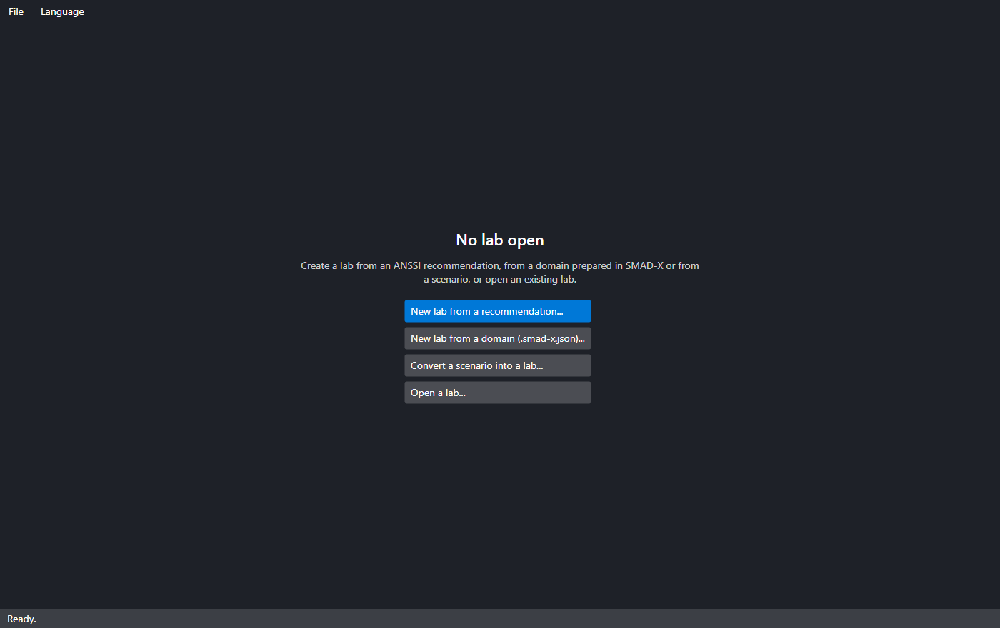
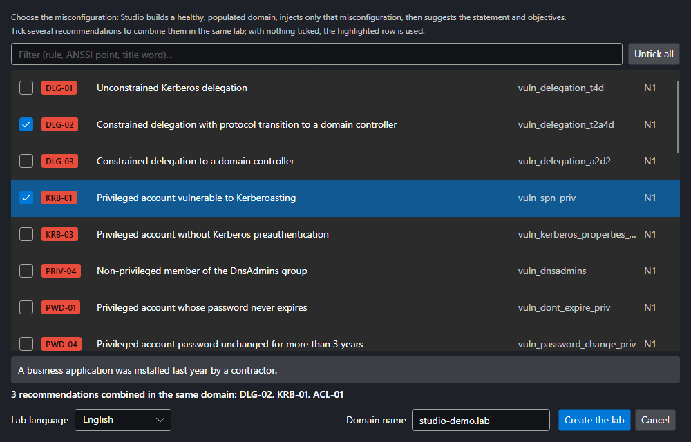
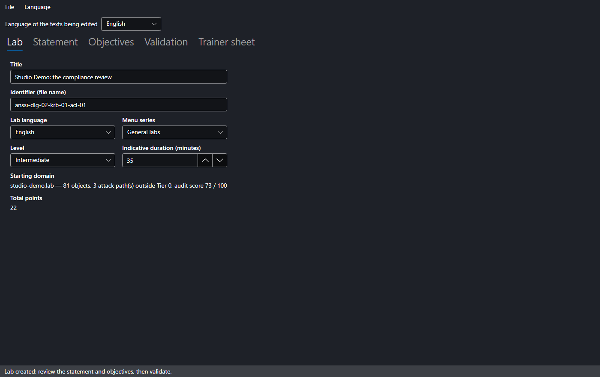
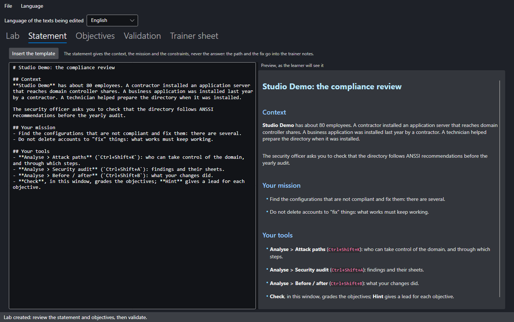
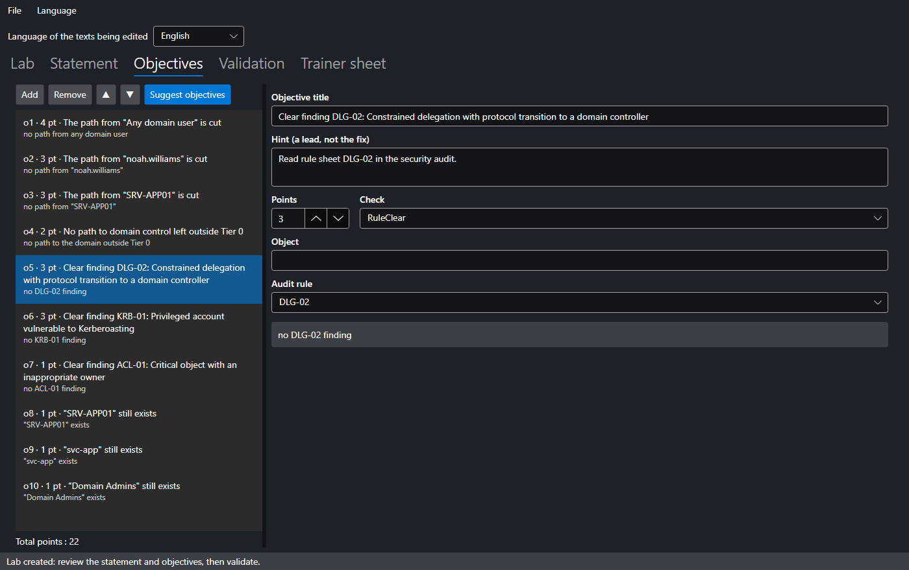
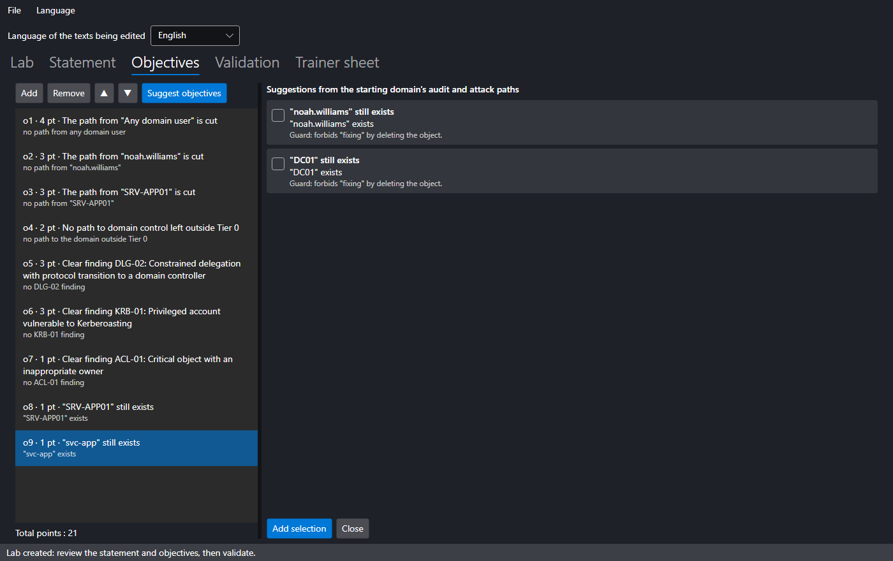
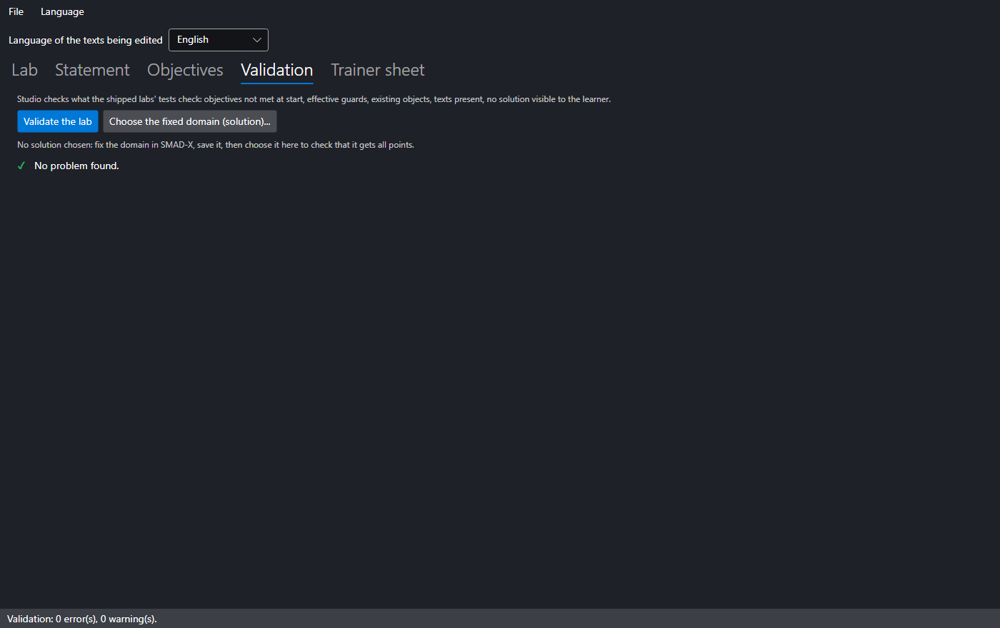

# SMAD-X Studio

**SMAD-X Studio** is the trainer's tool: a second executable, shipped in the same archive as SMAD-X, that creates labs, checks them and produces the trainer sheet. It does, with a window, what the [how-to](create.md) describes by hand.

Studio does not replace SMAD-X: the domain is prepared and fixed in SMAD-X, the lab is shaped in Studio, and the learner does it in SMAD-X (**Labs > Open a lab...**).



---

## Three ways to start

| **File** menu | Starting point | What Studio prepares |
|---|---|---|
| **New lab from a recommendation...** | a misconfiguration, among the audit rules and ANSSI control points | a healthy, populated domain with only that misconfiguration, the statement, the objectives and the trainer notes |
| **New lab from a domain (.smad-x.json)...** | a domain prepared and saved in SMAD-X | the statement template and the objectives suggested by the audit and the attack paths |
| **Convert a scenario into a lab...** | a `.smad-x.json` scenario whose description follows the *Context / The path / Fix it* outline | the statement taken from the context; the path and the fix go into the trainer notes |

**Open a lab...** resumes an existing `.smadx-lab.json` file, with its notes.

### From a recommendation



Each audit rule has its recipe, with the matching ANSSI control point and its level (N1 to N4). The list can be filtered by rule id, ANSSI point or title word. Choose the lab language and the domain name: Studio builds a realistic directory (departments, users, workstations), checks that it is healthy, then injects **only** the chosen misconfiguration.

#### Combining several recommendations

Tick several rows to put their misconfigurations **in the same domain**: the lab gets one objective per targeted rule, the objectives suggested by the audit and the attack paths, and the guards of every recipe. Level and duration grow with the number of misconfigurations, and the trainer notes have one section per rule. With nothing ticked, the highlighted row is used; **Untick all** goes back to a single recommendation.

Some recipes do not go together: two recipes that create the same object (KRB-01 and KRB-02 both create the business application's service account), or a recipe that cancels another one's misconfiguration. Studio explains it under the list and disables **Create the lab** while the combination is not possible.

The statement it writes stays general ("check compliance before the yearly audit"): it names neither the rule nor the object to fix. Enrich it with your organisation's context.

---

## The tabs

### Lab



Title, identifier (the file name), language, menu series (general labs or attack paths), level and duration. The starting domain summary gives the number of objects, the attack paths outside Tier 0 and the audit score.

A lab is either **bilingual** or exists in **one language** only. The *Language of the texts being edited* list, at the top of the window, chooses which texts you edit.

### Statement



The statement is written in Markdown, with a preview as the learner will see it. **Insert the template** lays out the *Context / Your mission / Your tools* outline.

!!! warning "The statement never gives the answer"
    It describes the situation, the mission and the constraints. The attack path and the fix go into the **trainer notes**. Validation rejects a statement that contains a solution section.

### Objectives



On the left, the objectives and the total points; on the right, the selected objective: title, hint, points and check. Only the fields the chosen check needs are shown, and object names autocomplete from the starting domain. The available checks are described in the [how-to](create.md).

**Suggest objectives** analyses the starting domain and suggests what the lab does not contain yet:



- one objective per attack path outside Tier 0, and "no path left to domain control";
- one objective per failed audit rule;
- **guards**, already met at start, that refuse a brute-force solution (deleting the account instead of fixing it).

Recommended suggestions are ticked; **Add selection** adds them to the list.

### Validation



**Validate the lab** runs the checks of the shipped labs' tests:

- texts present in every language of the lab, unique ids, positive points;
- no main objective met at start, every guard met, and each guard actually effective;
- cited objects and rules exist in the starting domain;
- no solution visible to the learner, neither in the statement nor in the domain descriptions.

To go further, fix the domain in SMAD-X as a learner would, save it, then **Choose the fixed domain (solution)...**: Studio checks that this fix gets all points.

### Trainer sheet

The **trainer notes** (the solution, things to watch for) and the trainer sheet preview: objectives, guards, attack paths and audit of the starting domain, then the notes. **Export trainer sheet...** saves it as Markdown.

---

## The files

| File | Content | Give to learners |
|---|---|---|
| `<id>.smadx-lab.json` | the lab: statement, starting domain, objectives | **yes** |
| `<id>.smadx-lab.notes.md` | the trainer notes, saved beside the lab | **no** |
| `<id>.trainer.md` | the exported trainer sheet | **no** |

The notes are never written into the lab: handing out the `.smadx-lab.json` file alone does not reveal the solution.

---

## Command line

Studio also produces labs in batches, without a window:

```bash
SMAD-X.Studio list-recipes --lang en
```

```bash
SMAD-X.Studio recipe KRB-01 DLG-02 --lang en --domain training.lab --out labs
```

```bash
SMAD-X.Studio recipe KRB-01 DLG-02 ACL-01 --combine --lang en --out labs
```

```bash
SMAD-X.Studio recipe all --lang fr --out exercices
```

```bash
SMAD-X.Studio convert scenarios --lang en --out labs
```

```bash
SMAD-X.Studio validate labs --solution fixed.smad-x.json
```

| Command | Purpose |
|---|---|
| `list-recipes` | lists the recipes: rule, severity, ANSSI point, title |
| `recipe <rule>...` or `recipe all` | creates one lab per recipe; with `--combine`, a single lab that brings them together |
| `convert <file or folder>...` | converts `.smad-x.json` scenarios |
| `validate <file or folder>...` | validates labs, with an optional fixed domain |

| Option | Effect |
|---|---|
| `--lang fr` or `--lang en` | language of the lab and of the messages |
| `--domain <name>` | domain name created by a recipe (`corp.example.lab` by default) |
| `--out <folder>` | output folder (the current folder by default) |
| `--date yyyy-mm-dd` | reference date: the same date gives the same file, byte for byte |
| `--solution <file>` | fixed domain to grade during validation |
| `--combine` | `recipe`: a single lab with every misconfiguration in the same domain |
| `--verbose` | also shows the checks that passed |

Each lab written is validated straight away. The exit code is **0** when all is well, **1** when a lab has errors or the recipes cannot be combined (it is still written, to be fixed in Studio) and **2** for a wrong command.
