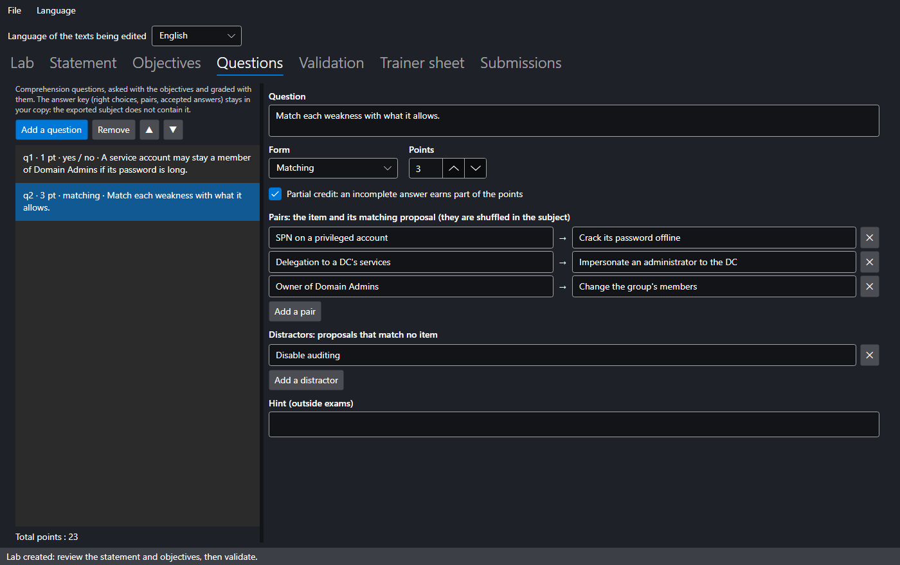

# SMAD-X Studio

**SMAD-X Studio** is the trainer's tool: a second executable, shipped in the same archive as SMAD-X, that creates labs, checks them and produces the trainer sheet. It does, with a window, what the [how-to](create.md) describes by hand.

Studio does not replace SMAD-X: the domain is prepared and fixed in SMAD-X, the lab is shaped in Studio, the learner does it in SMAD-X and hands in a **submission**, which Studio grades with the rest of the class.


---

## Three ways to start

| **File** menu | Starting point | What Studio prepares |
|---|---|---|
| **New lab from a recommendation...** | a misconfiguration, among the audit rules and ANSSI control points | a healthy, populated domain with only that misconfiguration, the statement, the objectives and the trainer notes |
| **New lab from a domain (.smad-x.json)...** | a domain prepared and saved in SMAD-X | the statement template and the objectives suggested by the audit and the attack paths |
| **Convert a scenario into a lab...** | a `.smad-x.json` scenario whose description follows the *Context / The path / Fix it* outline | the statement taken from the context; the path and the fix go into the trainer notes |

**Open a lab (its folder)...** (`Ctrl+O`) reopens a lab by its folder, or by one of its role folders: Studio finds there everything the creation laid out (your copy, the subject, the fixed domain, the notes) and grades the submissions of `3-submissions` straight away. Dropping that folder on the Studio window does the same, and the start screen lists the **recent labs**, reopened in one click. **Open a lab file (.smadx-lab.json)...** resumes a lab saved on its own, with its notes.

**As soon as it is created**, Studio asks where to keep the lab, suggesting the folder of the previous one, and creates its folder there, laid out by role (see [The files](#the-files)): your copy, the subject to hand out and the trainer sheet are already written. Each step then writes in its place, without asking: the subject in `2-to-hand-out`, the sheet in `1-trainer`, the submissions you add in `3-submissions`, the grades and reports in `4-results`. If you cancel the folder choice, the lab stays open without being saved: **Save** will ask where to keep it.

### From a recommendation


Each audit rule has its recipe, with the matching ANSSI control point and its level (N1 to N4). The list can be filtered by rule id, ANSSI point or title word. Choose the lab language, the Windows Server version that promoted the domain (2019, 2022 or 2025) and the domain name: Studio builds a realistic directory (departments, users, workstations), checks that it is healthy, then injects **only** the chosen misconfiguration. This starting domain comes from a new AD that Studio hardens: built-in accounts fixed, a 12-character password policy with lockout, a join quota of 0, delegation groups for the service desk and IT.

#### Combining several recommendations

Tick several rows to put their misconfigurations **in the same domain**: the lab gets one objective per targeted rule, the objectives suggested by the audit and the attack paths, and the guards of every recipe. Level and duration grow with the number of misconfigurations, and the trainer notes have one section per rule. With nothing ticked, the highlighted row is used; **Untick all** goes back to a single recommendation.

Some recipes do not go together: two recipes that create the same object (KRB-01 and KRB-02 both create the business application's service account), or a recipe that cancels another one's misconfiguration. Studio explains it under the list and disables **Create the lab** while the combination is not possible.

The statement it writes stays general ("check compliance before the yearly audit"): it names neither the rule nor the object to fix. Enrich it with your organisation's context.

#### The fixed domain

Studio also produces the **fixed domain**: the starting domain with the expected fix of each chosen recommendation applied, the one the rule sheet describes, without deleting anything. Validation uses it to check that it gets all the objectives' points, and the trainer sheet lists what it changes. It is saved with the lab, in `1-trainer/fixed-domain.smad-x.json` (see [The files](#the-files)): open it in SMAD-X to show the fix, but do not give it to learners.

---

## The tabs

### Lab


Title, identifier (the file name), language, menu series (general labs or attack paths), level and duration. The starting domain summary gives the Windows Server version that promoted it, the number of objects, the attack paths outside Tier 0 and the audit score.

A lab is either **bilingual** or exists in **one language** only. The *Language of the texts being edited* list, at the top of the window, chooses which texts you edit.

**Exam mode**: in SMAD-X, the lab has no hints, no score and no "Start over", and no other domain can be opened; the time spent is measured. The learner saves a submission and hands it in. Two settings complete exam mode:

- **Allow "Check"**: the learner sees which objectives are met, with no score and no explanation;
- **Tools closed during the exam**: security audit, the "How to fix" section of the sheets, attack paths, before / after comparison. All are open by default: they help analyse, but they also show what grading checks.

**Your copy and the subject**: the file Studio saves in `1-trainer` is **your copy**, with the hints and the answer key of the questions; submissions are graded with it. It is not handed out: for an exam, SMAD-X refuses to open it. At every save, Studio also writes the **subject**, under the same name, in `2-to-hand-out`: without the answer key and, for an exam, without the hints. That is the file to hand out. **Export the subject for learners...** (**File** menu, or the button in the Lab tab) saves the lab and rewrites the subject in `2-to-hand-out`, without asking: the subject and the copy that will grade the submissions stay identical. For a lab saved on its own by an earlier version, it asks where to write the subject, and refuses to write it over your copy.

Closing Studio with an unsaved lab or notes asks you to save.

### Statement


The statement is written in Markdown, with a preview as the learner will see it. **Insert the template** lays out the *Context / Your mission / Your tools* outline.

!!! warning "The statement never gives the answer"
    It describes the situation, the mission and the constraints. The attack path and the fix go into the **trainer notes**. Validation rejects a statement that contains a solution section.

### Objectives


On the left, the objectives and the total points; on the right, the selected objective: title, hint, points and check. Only the fields the chosen check needs are shown, and object names autocomplete from the starting domain. The available checks are described in the [how-to](create.md).

**Suggest objectives** analyses the starting domain and suggests what the lab does not contain yet:


- one objective per attack path outside Tier 0, and "no path left to domain control";
- one objective per failed audit rule;
- **guards** (**Guard** box, 🛡 in the list), already met at start, that refuse a brute-force solution (deleting the account instead of fixing it). A guard earns no points; broken, it cancels the objectives that concerned the protected object at start: its audit finding, the attack paths that went through it, the checks that name it.

Recommended suggestions are ticked; **Add selection** adds them to the list.

**Partial credit** (◐ in the list): for a check that can be counted, the objective earns the share of the way covered since the start. It applies to a rule's findings over the whole domain (3 accounts fixed out of 4: 75 % of the points), to the findings of a severity, to the audit score (the share of the way to the target score) and to the attack paths outside Tier 0 or from any domain user. A broken guard also cancels the share earned.

### Questions



Comprehension questions, asked in the lab window with the objectives and graded with them. **Add a question**, then choose its form:

| Form | The learner… | Answer key | Partial credit |
|---|---|---|---|
| **Single choice** | ticks one answer | the right answer | no |
| **Multiple choice** | ticks several answers | the right answers | each right answer ticked counts, each wrong one counts against |
| **Yes / no** | answers yes or no to a statement | the right answer | no |
| **Matching** | matches each item with a proposal, from a list | the pairs; distractors are possible | the share of items matched right |
| **Written answer** | writes the answer | the accepted answers, one per line (optional) | no |

A written answer is recognised regardless of case, accents, extra spaces and final punctuation. Any other answer, or a question with no accepted answer, is graded **by hand** in the Submissions tab.

The answer key stays in your copy. The exported subject holds neither the right choices, nor the pairs, nor the accepted answers, and a matching question's proposals are shuffled in it. In an exam, SMAD-X saves the answers in the submission without grading them; outside exams, the lab handed out holds the answer key, and **Check** grades the questions too (validation points it out).

### Validation


**Validate the lab** runs the checks of the shipped labs' tests:

- texts present in every language of the lab, unique ids, positive points;
- no main objective met at start, every guard met, each guard actually effective, and the shortcut it refuses earns no more than half the points;
- cited objects and rules exist in the starting domain;
- no solution visible to the learner, neither in the statement nor in the domain descriptions;
- complete questions: texts, at least two choices, a right answer (exactly one for single choice or yes / no), each matching item linked to a proposal.

#### The solution

Validation also checks the solution, the **fixed domain**: it must get all the objectives' points. There are three ways to get it:

| How | What Studio does |
|---|---|
| the lab comes from recommendations | it produces the fixed domain with the lab: the expected fix of each recommendation |
| **Suggest a solution** | for any lab: it fixes each finding of the starting audit as its rule sheet describes, deleting nothing (it disables, removes a membership or a delegation, renews a password), the most severe first; then it fulfils the objectives the audit does not see: a delegation to give, a membership, an account option, a tier. A fix that would break a guard is set aside. |
| **Choose the fixed domain (solution)...** | your own fix, made in SMAD-X as a learner would and saved as `.smad-x.json`: Studio brings it back to the dates of the start |

In all three cases, the fixed domain is kept with the lab, in `1-trainer`, and the trainer sheet lists what it changes. What a suggested solution does not reach shows in the validation ("The solution fails"). To finish it: save, open `1-trainer/fixed-domain.smad-x.json` in SMAD-X, do the rest, save, then **Choose the fixed domain (solution)...**.

### Trainer sheet

The **trainer notes** (the solution, things to watch for) and the trainer sheet preview: objectives, guards, questions and their answer key, attack paths and audit of the starting domain, what the fixed domain changes, then the notes. **Export trainer sheet...** saves the lab and writes the sheet as Markdown in `1-trainer`.

---

## Grading a class


Each learner saves their work in SMAD-X with **Save my submission**: a `.smadx-submission.json` file holding the lab they received, their domain, their answers to the questions and the hints viewed. The simplest: with the lab open, **drop the submissions on the Studio window**, or a folder of submissions (a USB stick, an assignment downloaded from the school platform): Studio files them in `3-submissions`, with the grades by hand that come with them, and grades them straight away. A submission already filed is not copied again; another file of the same name gets a number. You can also put the submissions into `3-submissions` yourself, from the file explorer: they are graded when the lab opens, or as soon as you come back to Studio if it is already open. Opened by its folder, the lab is always **your copy** (`1-trainer`), not the subject, which has no answer key. In the **Submissions** tab, the same submissions can also be added with buttons:

- **Add submissions...**: pick one or several submissions at once;
- **Add a folder...**: every submission in the folder and its subfolders, filed with their subfolders (a Moodle download has one folder per learner, and the submissions may have the same name there).

Studio grades each submission with **your** copy of the lab, as it is open: the starting domain is prepared again at the date the learner started, and the check runs at the date of the submission. The score the learner may have seen is never reused. After changing objectives or points, **Regrade** grades everything again.

Each row gives the grade (to the hundredth with partial credit; followed by `*` when answers remain to be graded), the percentage, the number of hints viewed, the time spent, one dot per objective then per question (green met, orange in part, red not met, grey to grade; hover for details) and the remarks:

| Remark | Meaning |
|---|---|
| submission for another lab | it is not graded |
| submission changed outside SMAD-X | its seal no longer matches its content: name, dates, hints or domain edited by hand |
| same work session as …'s submission | one submission handed in under several names: one is a copy of the other |
| the domain does not come from this submission's session | someone else's work, handed in under one's own submission; Studio names the original learner if it has their submission |
| unsealed submission, no work session | the submission was not saved by SMAD-X: these checks are impossible |
| starting domain replaced, session check impossible | the lab received, inside the submission, was replaced by another domain to escape the session check |
| exam submission made outside exam mode, exam settings changed | the lab received was changed to get checking, "Start over" or closed tools back |
| hints viewed during the exam | the submission carries hints although the exam has none |
| the learner received your copy instead of the subject | the lab received held the hints or the answer key |
| question with no answer key: open your copy | the lab open in Studio is the subject: the questions cannot be graded |
| the answer changed since you graded it | the learner handed in a new submission: grade the answer again |
| time exceeded | the learner spent more than the planned duration (nothing was blocked) |
| submission made with another SMAD-X version | its audit rules differ from those of your Studio: the grade may differ from the learner's; grade a class with a single version |
| other starting domain | the submission was made on another version of the lab: the grade may be wrong |
| no name, several submissions | check before recording the grade |
| unreadable submission | the file is damaged or is not a SMAD-X submission |

Red remarks need your attention; the grade stays displayed. Two identical solutions, each done on its own, are not reported: what gives a copy away is not the solution, it is the work session. SMAD-X draws it at random when the lab opens, derives from it the internal identifiers of every object in the learner's domain, and seals each submission with a SHA-256 fingerprint of all its content.

!!! note "What these checks guarantee"
    They catch the common cases: a submission edited in a text editor, a classmate's submission handed in under one's own name, a domain taken from someone else. The format is public and SMAD-X runs on the learner's computer: they do not stop a determined forger who would rewrite the whole file consistently. An absolute guarantee would require collecting submissions on a machine the learner does not control.

### Grading by hand and commenting

Select a submission: the **Selected submission** panel shows each answer, the automatic grading and a **Points given** field. Left empty, the automatic grading counts; filled in, it replaces it, for instance for a written answer Studio did not recognise. The **comment** appears in the learner's report. **Save the grade** writes it all beside the submission, in `<submission>.smadx-marks.json`: the sealed submission itself is never changed. If the learner hands in a new submission with another answer, the grade given by hand no longer applies.

### Exporting the grades

The **Success per objective** tab shows what the class understood and what to go over again, objective by objective and question by question. The exports use the **Grade out of** scale (20 by default) and are written, without asking anything, in the lab folder's `4-results` folder:

| Button | Produces |
|---|---|
| **Export grades (CSV)...** | a spreadsheet for Excel: name, ID, points, grade out of the scale, hints, time, answers to grade, points of each objective and each question, remarks. The grade column can be pasted into the school platform. |
| **Export for Moodle (CSV)...** | the Moodle grade import file (*Grades > Import > CSV file*): the learner's ID, name and grade out of the scale. In Moodle, map the ID column to the students' email address or ID number, and the grade to the grade item, whose maximum grade must be the scale. |
| **Individual reports (PDF)...** | one PDF per graded submission, in `4-results/reports`: the grade, each objective with its explanation, the answers to the questions and the comment. It holds neither the answer key nor the trainer-only remarks. |
| **Export class results (Markdown)...** | the class results: average, median, everyone's grade, success per objective and per question. |

In SMAD-X, the learner can enter an **ID** (their number or address) beside their name: the exports use it.

---

## The files

Studio lays each new lab out in a folder named after it, created in the chosen folder (or in the chosen folder itself, if it is empty; a lab of the same name is never overwritten: the new folder gets a number), with one subfolder per role. **File > Save to a folder...** moves it elsewhere. Folders and files have English or French names, depending on the interface language when the lab folder is created:

```
iam-review/
├── README.md                the role of each folder
├── 1-trainer/               keep it to yourself
│   ├── iam-review.smadx-lab.json   your copy: statement, starting domain, objectives, questions, hints and answer key
│   ├── trainer-notes.md            the trainer notes (the solution)
│   ├── fixed-domain.smad-x.json    the fixed domain, for a lab created from recommendations
│   └── trainer-sheet.md            the trainer sheet
├── 2-to-hand-out/
│   └── iam-review.smadx-lab.json   the subject: the only file to give learners
├── 3-submissions/           the submissions handed in (<id>_<name>.smadx-submission.json)
│                            and, beside each one, your grades by hand (<id>_<name>.smadx-marks.json)
└── 4-results/               grades.csv, grades-moodle.csv, class-results.md, reports/ (one PDF per learner)
```

At every **Save**, Studio rewrites your copy, the notes, the fixed domain, the sheet, the subject and the README. Your copy and the subject have the same name: the folder tells which one to hand out. The notes and the fixed domain are never written into the lab, and the subject has no answer key: handing out `2-to-hand-out` does not reveal the solution.

Change the lab ID (**Lab** tab): at the next save, your copy and the subject take the new name, and so does the folder if it had the old one. Do it before handing out the subject: a submission carries the ID of the lab it was made from, and Studio refuses to grade it with another one. **File > Open the lab folder** (or the button beside its path) opens it in the file explorer.

A lab saved on its own by an earlier version still opens, with its notes beside it (`<id>.smadx-lab.notes.md`); **Save to a folder...** lays it out by role.

---

## Command line

Studio also produces labs in batches and grades a class, without a window:

```bash
SMAD-X.Studio list-recipes --lang en
```

```bash
SMAD-X.Studio recipe KRB-01 DLG-02 --lang en --domain training.lab --out labs
```

```bash
SMAD-X.Studio recipe KRB-01 DLG-02 ACL-01 --combine --lang en --out labs
```

```bash
SMAD-X.Studio recipe all --lang fr --out exercices
```

```bash
SMAD-X.Studio convert scenarios --lang en --out labs
```

```bash
SMAD-X.Studio validate labs --solution fixed.smad-x.json
```

```bash
SMAD-X.Studio grade labs/anssi-krb-01 --lang en
```

```bash
SMAD-X.Studio grade labs/anssi-krb-01/1-trainer/anssi-krb-01.smadx-lab.json submissions-group-a submissions-group-b --lang en --csv grades.csv --moodle moodle.csv --reports reports --report results.md
```

| Command | Purpose |
|---|---|
| `list-recipes` | lists the recipes: rule, severity, ANSSI point, title |
| `recipe <rule>...` or `recipe all` | creates one lab per recipe, each in its own folder laid out by role (your copy, notes, fixed domain, sheet, subject); with `--combine`, a single lab that brings them together |
| `convert <file or folder>...` | converts `.smad-x.json` scenarios, each into its own folder |
| `validate <file or folder>...` | validates labs (every one in a folder, subfolders included, subjects excepted), with their fixed domain, or the one given by `--solution` |
| `export-subject <file or folder>...` | rewrites the subject of each lab into its `2-to-hand-out` folder, or into `--out` |
| `grade <lab folder>` | grades the submissions of `3-submissions` and writes every result to `4-results` |
| `grade <lab> <submission or folder>...` | grades the given submissions, wherever they are; `--csv`, `--moodle`, `--reports` and `--report` choose the files. `+` met, `~` in part, `-` not met, `?` to grade by hand in Studio |

| Option | Effect |
|---|---|
| `--lang fr` or `--lang en` | language of the lab and of the messages |
| `--domain <name>` | domain name created by a recipe (`corp.example.lab` by default) |
| `--server 2019`, `2022` or `2025` | Windows Server version that promoted this domain (`2022` by default) |
| `--out <folder>` | folder in which the lab folders are created (the current folder by default) |
| `--date yyyy-mm-dd` | reference date: the same date gives the same file, byte for byte |
| `--solution <file>` | fixed domain to grade during validation |
| `--combine` | `recipe`: a single lab with every misconfiguration in the same domain |
| `--exam` | `recipe`, `convert`: lab in exam mode |
| `--exam-check` | with `--exam`: "Check" allowed (objectives met, no score) |
| `--exam-close audit,fixes,paths,comparison` | with `--exam`: tools closed during the exam |
| `--csv <file>` | `grade`: grade spreadsheet for Excel |
| `--moodle <file>` | `grade`: Moodle grade import file |
| `--reports <folder>` | `grade`: one PDF report per learner |
| `--scale <n>` | `grade`: scale of the exported grades (20 by default) |
| `--report <file>` | `grade`: class results in Markdown |
| `--verbose` | also shows the checks that passed |

Each lab written is validated straight away. The exit code is **0** when all is well, **1** when a lab has errors (it is still written, to be fixed in Studio), the recipes cannot be combined or a submission needs attention (not graded, changed or copied), and **2** for a wrong command.
