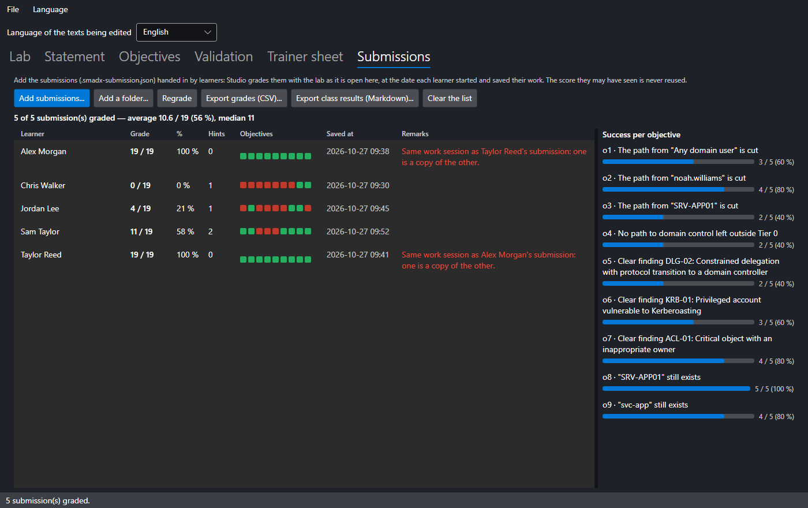

# SMAD-X Studio

**SMAD-X Studio** is the trainer's tool: a second executable, shipped in the same archive as SMAD-X, that creates labs, checks them and produces the trainer sheet. It does, with a window, what the [how-to](create.md) describes by hand.

Studio does not replace SMAD-X: the domain is prepared and fixed in SMAD-X, the lab is shaped in Studio, the learner does it in SMAD-X and hands in a **submission**, which Studio grades with the rest of the class.


---

## Three ways to start

| **File** menu | Starting point | What Studio prepares |
|---|---|---|
| **New lab from a recommendation...** | a misconfiguration, among the audit rules and ANSSI control points | a healthy, populated domain with only that misconfiguration, the statement, the objectives and the trainer notes |
| **New lab from a domain (.smad-x.json)...** | a domain prepared and saved in SMAD-X | the statement template and the objectives suggested by the audit and the attack paths |
| **Convert a scenario into a lab...** | a `.smad-x.json` scenario whose description follows the *Context / The path / Fix it* outline | the statement taken from the context; the path and the fix go into the trainer notes |

**Open a lab...** resumes an existing `.smadx-lab.json` file, with its notes.

From SMAD-X, **Labs > Create a lab with SMAD-X Studio...** opens Studio on the domain shown: it becomes the starting domain of a new lab, as with **New lab from a domain**.

### From a recommendation


Each audit rule has its recipe, with the matching ANSSI control point and its level (N1 to N4). The list can be filtered by rule id, ANSSI point or title word. Choose the lab language and the domain name: Studio builds a realistic directory (departments, users, workstations), checks that it is healthy, then injects **only** the chosen misconfiguration.

#### Combining several recommendations

Tick several rows to put their misconfigurations **in the same domain**: the lab gets one objective per targeted rule, the objectives suggested by the audit and the attack paths, and the guards of every recipe. Level and duration grow with the number of misconfigurations, and the trainer notes have one section per rule. With nothing ticked, the highlighted row is used; **Untick all** goes back to a single recommendation.

Some recipes do not go together: two recipes that create the same object (KRB-01 and KRB-02 both create the business application's service account), or a recipe that cancels another one's misconfiguration. Studio explains it under the list and disables **Create the lab** while the combination is not possible.

The statement it writes stays general ("check compliance before the yearly audit"): it names neither the rule nor the object to fix. Enrich it with your organisation's context.

---

## The tabs

### Lab


Title, identifier (the file name), language, menu series (general labs or attack paths), level and duration. The starting domain summary gives the number of objects, the attack paths outside Tier 0 and the audit score.

A lab is either **bilingual** or exists in **one language** only. The *Language of the texts being edited* list, at the top of the window, chooses which texts you edit.

**Exam mode**: in SMAD-X, the lab has no hints, no score and no "Start over", and no other domain can be opened; the time spent is measured. The learner saves a submission and hands it in. The exam file is written **without the hints**: the learner cannot read them in the file. Two settings complete exam mode:

- **Allow "Check"**: the learner sees which objectives are met, with no score and no explanation;
- **Tools closed during the exam**: security audit, the "How to fix" section of the sheets, attack paths, before / after comparison. All are open by default: they help analyse, but they also show what grading checks.

Closing Studio with an unsaved lab or notes asks you to save.

### Statement


The statement is written in Markdown, with a preview as the learner will see it. **Insert the template** lays out the *Context / Your mission / Your tools* outline.

!!! warning "The statement never gives the answer"
    It describes the situation, the mission and the constraints. The attack path and the fix go into the **trainer notes**. Validation rejects a statement that contains a solution section.

### Objectives


On the left, the objectives and the total points; on the right, the selected objective: title, hint, points and check. Only the fields the chosen check needs are shown, and object names autocomplete from the starting domain. The available checks are described in the [how-to](create.md).

**Suggest objectives** analyses the starting domain and suggests what the lab does not contain yet:


- one objective per attack path outside Tier 0, and "no path left to domain control";
- one objective per failed audit rule;
- **guards** (**Guard** box, 🛡 in the list), already met at start, that refuse a brute-force solution (deleting the account instead of fixing it). A guard earns no points; broken, it cancels the objectives that concerned the protected object at start: its audit finding, the attack paths that went through it, the checks that name it.

Recommended suggestions are ticked; **Add selection** adds them to the list.

### Validation


**Validate the lab** runs the checks of the shipped labs' tests:

- texts present in every language of the lab, unique ids, positive points;
- no main objective met at start, every guard met, each guard actually effective, and the shortcut it refuses earns no more than half the points;
- cited objects and rules exist in the starting domain;
- no solution visible to the learner, neither in the statement nor in the domain descriptions.

To go further, fix the domain in SMAD-X as a learner would, save it, then **Choose the fixed domain (solution)...**: Studio checks that this fix gets all points.

### Trainer sheet

The **trainer notes** (the solution, things to watch for) and the trainer sheet preview: objectives, guards, attack paths and audit of the starting domain, then the notes. **Export trainer sheet...** saves it as Markdown.

---

## Grading a class



Each learner saves their work in SMAD-X with **Save my submission**: a `.smadx-submission.json` file holding the lab they received, their domain and the hints viewed. Open the lab in Studio, then, in the **Submissions** tab:

- **Add submissions...**: pick one or several submissions at once;
- **Add a folder...**: every submission in the folder and its subfolders, for instance the folder where the class dropped its work.

Studio grades each submission with **your** copy of the lab, as it is open: the starting domain is prepared again at the date the learner started, and the check runs at the date of the submission. The score the learner may have seen is never reused. After changing objectives or points, **Regrade** grades everything again.

Each row gives the grade, the percentage, the number of hints viewed, the time spent, one dot per objective (green when met, red otherwise; hover to see the objective) and the remarks:

| Remark | Meaning |
|---|---|
| submission for another lab | it is not graded |
| submission changed outside SMAD-X | its seal no longer matches its content: name, dates, hints or domain edited by hand |
| same work session as …'s submission | one submission handed in under several names: one is a copy of the other |
| the domain does not come from this submission's session | someone else's work, handed in under one's own submission; Studio names the original learner if it has their submission |
| unsealed submission, no work session | the submission was not saved by SMAD-X: these checks are impossible |
| starting domain replaced, session check impossible | the lab received, inside the submission, was replaced by another domain to escape the session check |
| exam submission made outside exam mode, exam settings changed | the lab received was changed to get checking, "Start over" or closed tools back |
| hints viewed during the exam | the submission carries hints although the exam has none |
| time exceeded | the learner spent more than the planned duration (nothing was blocked) |
| submission made with another SMAD-X version | its audit rules differ from those of your Studio: the grade may differ from the learner's; grade a class with a single version |
| other starting domain | the submission was made on another version of the lab: the grade may be wrong |
| no name, several submissions | check before recording the grade |
| unreadable submission | the file is damaged or is not a SMAD-X submission |

Red remarks need your attention; the grade stays displayed. Two identical solutions, each done on its own, are not reported: what gives a copy away is not the solution, it is the work session. SMAD-X draws it at random when the lab opens, derives from it the internal identifiers of every object in the learner's domain, and seals each submission with a SHA-256 fingerprint of all its content.

!!! note "What these checks guarantee"
    They catch the common cases: a submission edited in a text editor, a classmate's submission handed in under one's own name, a domain taken from someone else. The format is public and SMAD-X runs on the learner's computer: they do not stop a determined forger who would rewrite the whole file consistently. An absolute guarantee would require collecting submissions on a machine the learner does not control.

On the right, the **success per objective** shows what the class understood and what to go over again. **Export grades (CSV)...** produces a spreadsheet for Excel (one column per objective); **Export class results (Markdown)...** produces the class results: average, median, everyone's grade and success per objective.

---

## The files

| File | Content | Give to learners |
|---|---|---|
| `<id>.smadx-lab.json` | the lab: statement, starting domain, objectives | **yes** |
| `<id>.smadx-lab.notes.md` | the trainer notes, saved beside the lab | **no** |
| `<id>.trainer.md` | the exported trainer sheet | **no** |
| `<id>_<name>.smadx-submission.json` | a learner's submission, handed in to the trainer | (written by the learner) |

The notes are never written into the lab: handing out the `.smadx-lab.json` file alone does not reveal the solution.

---

## Command line

Studio also produces labs in batches and grades a class, without a window:

```bash
SMAD-X.Studio list-recipes --lang en
```

```bash
SMAD-X.Studio recipe KRB-01 DLG-02 --lang en --domain training.lab --out labs
```

```bash
SMAD-X.Studio recipe KRB-01 DLG-02 ACL-01 --combine --lang en --out labs
```

```bash
SMAD-X.Studio recipe all --lang fr --out exercices
```

```bash
SMAD-X.Studio convert scenarios --lang en --out labs
```

```bash
SMAD-X.Studio validate labs --solution fixed.smad-x.json
```

```bash
SMAD-X.Studio grade labs/anssi-krb-01.smadx-lab.json submissions-group-a submissions-group-b --lang en --csv grades.csv --report results.md
```

| Command | Purpose |
|---|---|
| `list-recipes` | lists the recipes: rule, severity, ANSSI point, title |
| `recipe <rule>...` or `recipe all` | creates one lab per recipe; with `--combine`, a single lab that brings them together |
| `convert <file or folder>...` | converts `.smad-x.json` scenarios |
| `validate <file or folder>...` | validates labs, with an optional fixed domain |
| `grade <lab> <submission or folder>...` | grades a class's submissions: as many files and folders as needed; `+` objective met, `-` not met |

| Option | Effect |
|---|---|
| `--lang fr` or `--lang en` | language of the lab and of the messages |
| `--domain <name>` | domain name created by a recipe (`corp.example.lab` by default) |
| `--out <folder>` | output folder (the current folder by default) |
| `--date yyyy-mm-dd` | reference date: the same date gives the same file, byte for byte |
| `--solution <file>` | fixed domain to grade during validation |
| `--combine` | `recipe`: a single lab with every misconfiguration in the same domain |
| `--exam` | `recipe`, `convert`: lab in exam mode, written without the hints |
| `--exam-check` | with `--exam`: "Check" allowed (objectives met, no score) |
| `--exam-close audit,fixes,paths,comparison` | with `--exam`: tools closed during the exam |
| `--csv <file>` | `grade`: grade spreadsheet for Excel |
| `--report <file>` | `grade`: class results in Markdown |
| `--verbose` | also shows the checks that passed |

Each lab written is validated straight away. The exit code is **0** when all is well, **1** when a lab has errors (it is still written, to be fixed in Studio), the recipes cannot be combined or a submission needs attention (not graded, changed or copied), and **2** for a wrong command.
