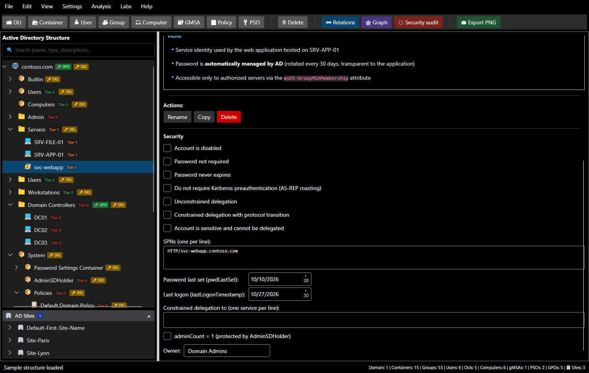
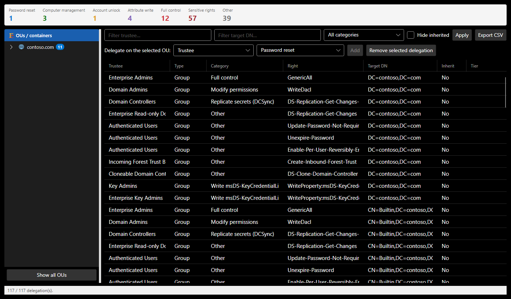

# Modeling a domain

SMAD-X does not just draw a directory: it models its **security attributes**, the very ones an attacker exploits and the audit checks.

## Objects

| Type | Role | Notes |
|---|---|---|
| **Domain** | root, holds delegations, linked GPOs and the default password policy | |
| **OU** | organizational unit: delegations, GPOs, tier classification | under the domain or another OU |
| **Container** | `CN=` such as Users, Computers, System | under the domain, an OU or a container; never holds an OU |
| **User**, **Computer**, **gMSA** | accounts | account options, SPNs, Kerberos delegation; for a computer, LAPS, local administrators and sessions |
| **Group** | scope (domain local, global, universal) and type (security, distribution) | nesting according to scope |
| **Policy (GPO)** | created in `CN=Policies,CN=System`, nowhere else | linked to OUs, the domain or sites |
| **PSO** | fine-grained password policy, created in the Password Settings Container | applied to users or groups |

These placement rules are those of the AD schema: SMAD-X refuses an OU in a container, and the **Policy** and **PSO** buttons always create the object in its System container, whatever object is selected.

## The password policy

Select the **domain**: the **Password policy** section of the panel gives the default policy (Default Domain Policy), which applies to every account without a PSO. A **PSO** has the same section, with its precedence. As in AD, an account's effective policy is the PSO with the lowest precedence applied to the account itself, otherwise to one of its groups, otherwise the domain's.

The domain also holds **ms-DS-MachineAccountQuota**: the number of computers any user can join to the domain (10 by default, to be set to 0).

A new domain keeps the values of an installation (7 characters, quota of 10): the audit reports it (rules PWD-08, PWD-09 and ACC-03). The section also shows the Windows Server version that promoted the domain, when it is known.

## The Security section

It mirrors real Active Directory attributes:

| Field | AD attribute | What it shows |
|---|---|---|
| Account is disabled | `userAccountControl` (ACCOUNTDISABLE) | a disabled account is not an entry point |
| Password not required | `userAccountControl` (PASSWD_NOTREQD) | an empty password is accepted |
| Password never expires | `userAccountControl` (DONT_EXPIRE_PASSWORD) | ANSSI point for privileged accounts |
| Kerberos preauthentication not required | `userAccountControl` (DONT_REQ_PREAUTH) | AS-REP roasting |
| Unconstrained delegation | `userAccountControl` (TRUSTED_FOR_DELEGATION) | TGT theft |
| Constrained delegation with protocol transition | `userAccountControl` (TRUSTED_TO_AUTH_FOR_DELEGATION) | impersonation to a service |
| Account is sensitive and cannot be delegated | `userAccountControl` (NOT_DELEGATED) | protects an administrator |
| SPNs | `servicePrincipalName` | Kerberoasting |
| Password last set, last logon | `pwdLastSet`, `lastLogonTimestamp` | dormant accounts, old krbtgt |
| Constrained delegation to | `msDS-AllowedToDelegateTo` | delegation to a domain controller |
| adminCount | `adminCount` | object protected by AdminSDHolder |
| Owner | security descriptor owner | an owner can rewrite permissions |

For a **computer**, the **Computer** part adds:

| Field | Where it comes from | What it lets you show |
|---|---|---|
| LAPS manages the local administrator password, expiration | `msLAPS-PasswordExpirationTime` (Windows LAPS) or `ms-Mcs-AdmPwdExpirationTime` (legacy LAPS) | without LAPS, the same password on every machine (LAPS-01); whoever can read the LAPS password becomes administrator |
| Local administrators | local Administrators group, outside the directory | Domain Admins by default, Builtin Administrators on a DC; a group added (through a GPO) administers the machine |
| Open sessions | outside the directory (BloodHound collects them on the machines) | a logged-on administrator leaves their credentials in memory: their account is within reach of any administrator of the machine (TIER-04) |

Options use the real `userAccountControl` bits: the PowerShell import carries them as they are.

!!! tip "AdminSDHolder"
    Members of protected groups (Domain Admins, Account Operators, Backup Operators…) have `adminCount = 1`: the SDProp process applies AdminSDHolder's permissions to them and **disables inheritance**. SMAD-X takes this into account: a delegation set on an OU does not apply to these objects. This is why some attack paths do not exist. Domain controllers, however, are not protected: they are members of Domain Controllers only through their primary group, which SDProp ignores.

## Memberships and relations

**View > Manage Relations...** (or the **Relations** button) opens four tabs:

| Tab | Use |
|---|---|
| User → Group | account membership |
| Group → Group | group nesting |
| GPO → OU | GPO links to OUs and the domain |
| PSO | accounts and groups a PSO applies to |

The audit and attack paths compute **effective membership**: an account that belongs to a group which is itself a member of Domain Admins is a domain administrator.

Nesting follows AD scopes (AGDLP model): a **global** group only holds accounts and global groups, a **universal** group also accepts universal groups but not domain local ones, a **domain local** group accepts all three. An impossible nesting is refused with its explanation. A gMSA can be a group member, like an account.

## Delegations

**Analysis > Delegations...** (`Ctrl+D`) lists delegations: trustee, right, category, target DN, inheritance, tier. Filter by trustee, target or category, hide inherited delegations, and export to CSV. The counters group the categories; **Sensitive rights** counts those that give an object or its secrets without looking like it.

| Category | AD right | What it gives |
|---|---|---|
| Password reset | `ResetPassword` | the account, by changing its password |
| Computer management | `CreateChild:computer` | joining machines to the domain |
| Account unlock | `WriteProperty:lockoutTime` | unlocking an account |
| Attribute write | `WriteProperty:<attribute>` | depends on the attribute |
| Modify members | `WriteProperty:member` | the group's rights |
| Full control | `GenericAll` | everything |
| Write all attributes | `GenericWrite` | SPN, msDS-KeyCredentialLink, members, delegation: control of the object |
| Modify permissions, change owner | `WriteDacl`, `WriteOwner` | full control, in one step |
| Replicate secrets (DCSync) | `DS-Replication-Get-Changes-All` | on the domain root, the secrets of every account |
| Write msDS-KeyCredentialLink | `WriteProperty:msDS-KeyCredentialLink` | authenticating as the account (Shadow Credentials) |
| Write resource-based delegation | `WriteProperty:msDS-AllowedToActOnBehalfOfOtherIdentity` | a ticket to the machine in anyone's name (RBCD) |
| Write SPNs | `WriteProperty:servicePrincipalName` | targeted Kerberoasting |
| Read the LAPS, gMSA password | `ReadProperty:msLAPS-Password`, `msDS-ManagedPassword` | the machine's local administrator, the service account |
| Link GPOs | `WriteProperty:gPLink` | linking a GPO to the OU or the domain |
| All extended rights | `AllExtendedRights` | resetting passwords, reading LAPS and, on the domain, replicating |

To **delegate**, select an OU (or the domain) on the left, choose the trustee and the category, then **Add**. **Remove the selected delegation** deletes it, on any object: a delegation set on an account or a computer, read by the import, is removed from here too.

## The tier model

Every object is classified in a tier, following Microsoft's administration model:

| Tier | Content |
|---|---|
| **Tier 0** | domain controllers, accounts and groups that control the directory |
| **Tier 1** | servers and applications |
| **Tier 2** | workstations and users |

**Settings > Manage Tiers...** changes names, levels and colors. The audit checks tiering: an object must not be a member of a more sensitive group (TIER-01), nor receive a delegation over a more sensitive object (TIER-03).
