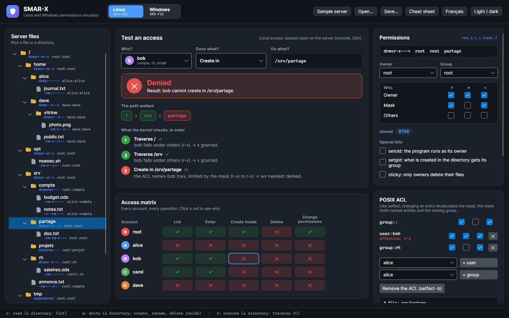

# SMAR-X

SMAR-X (*Simulate, Model and Audit Rights eXpert*) is the third application of the suite: a simulator of **file access rights**, on Linux and on Windows. It answers one question: **who can do what, on what, and why**? The goal is to learn to grant only the rights that are needed.

A sample Linux server (`srv-fic`) and a sample Windows server (`SRV-FIC`) open at startup. The **Linux / Windows** button switches between them, **Open...** and **Save...** read and write a `.smar-x.json` file, and **Cheat sheet** explains every abbreviation (`rwx`, `F`, `M`, `RD`, `(OI)`, `(CI)`…).

*Screenshot: bob creates a file in `/srv/partage`. The tester shows each kernel step: the POSIX ACL, then the mask that limits what it grants.*

## What each workspace offers

| Area | Linux | Windows |
|---|---|---|
| **Tree** | files and directories, the `ls -l` of each | NTFS files and folders, owner, inheritance disabled |
| **Tester** | an account, an operation, a path: allowed or denied, with each kernel step | the same with AccessCheck: the token, then each ACE in order |
| **Access matrix** | every account, every operation; click a cell to see why | same |
| **Permissions** | owner, group, `chmod`, special bits, POSIX ACL and mask | the Explorer [Security tab](security-tab.md), and the ACE list as `icacls` shows it |
| **Creation** | what a new file would get: umask, setgid, default ACL | what a new file would get: inheritance, CREATOR OWNER |
| **Commands** | `chmod`, `chown`, `setfacl` that recreate what is shown | `icacls` that recreates what is shown |
| **Accounts** | accounts, groups, `usermod`, `useradd`, `groupadd` | local accounts and groups, `net localgroup` |

The access studied is **local**: a session open on the server. Access through a network share comes next.

## Faithful to real systems

SMAR-X's engines are not written "from memory": their results are compared with those of real systems. The measurements are frozen in the tests (`SMAR-X.Tests/Fidelity`), which fail if the simulator drifts away from them.

| Real system | What is compared | Tool |
|---|---|---|
| Linux kernel 6.19, Debian 13, `setfacl` 2.3.2 | 925 accesses and 140 creations on the sample server | `tools/SmarxKernelCheck` |
| Windows Server 2025 (domain controller) | 1,512 file and folder opens under each account's token, the owners, the ACLs in their real order | `tools/SmarxWindowsCheck` |
| Windows 11 (Explorer) | the Security tab: 96 account views, 103 Advanced window entries, 8 sequences of clicked boxes | `tools/SmarxSecurityTabCheck` |

What these comparisons taught about Windows is described in [Verified Windows rules](windows-rules.md).
