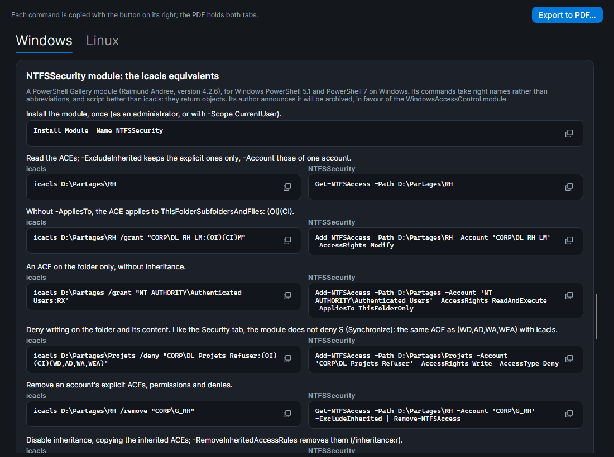

# SMAR-X

SMAR-X (*Simulate, Model and Audit Rights eXpert*) is the third application of the [SMA-X](../index.md) suite: a simulator of **file access rights**, on Linux and on Windows. It answers one question: **who can do what, on what, and why**? The goal is to learn to grant only the rights that are needed.

A sample Linux server (`srv-fic`) and a sample Windows server (`SRV-FIC`) open at startup. The **Linux / Windows** button switches between them, **Open...** and **Save...** read and write a `.smar-x.json` file, and **Cheat sheet** explains every abbreviation (`rwx`, `F`, `M`, `RD`, `(OI)`, `(CI)`…) and gives example commands (see [The cheat sheet](#the-cheat-sheet)).

*Screenshot: bob creates a file in `/srv/partage`. The tester shows each kernel step: the POSIX ACL, then the mask that limits what it grants.*

## What each workspace offers

| Area | Linux | Windows |
|---|---|---|
| **Tree** | files and directories, the `ls -l` of each | NTFS files and folders, owner, inheritance disabled |
| **Tester** | an account, an operation, a path: allowed or denied, with each kernel step | the same with AccessCheck: the token, then each ACE in order |
| **Access matrix** | every account, every operation; click a cell to see why | same |
| **Permissions** | owner, group, `chmod`, special bits, POSIX ACL and mask, default ACL (see [Linux permissions](linux-rights.md)) | the Explorer [Security tab](security-tab.md), and the ACE list as `icacls` shows it |
| **Creation** | what a new file would get: umask, setgid, default ACL | what a new file would get: inheritance, CREATOR OWNER |
| **Commands** | `chmod`, `chown`, `setfacl` that recreate what is shown | `icacls` that recreates what is shown |
| **Accounts** | accounts, groups, `usermod`, `useradd`, `groupadd` | server and domain accounts, global, domain local and local groups, nested following AGDLP, in the [Accounts and groups](windows-rules.md#the-accounts-and-groups-window) window, like the Active Directory console; `Add-ADGroupMember`, `net localgroup`; each account's [whoami](windows-rules.md#whoami-an-accounts-token) |

Each block of commands (`chmod`, `setfacl`, `icacls`, PowerShell, `smb.conf` section…) has, on its right, a button that **copies it to the clipboard**: a check mark confirms the copy. You then paste it into a terminal of the lab.

Under **From where?**, the tester picks where the access comes from: **On the server** (a session open on the server), or **From the network**, through a share: **SMB** on Windows (see [Access through a share](shares.md)), **Samba** on Linux (see [Samba share](samba.md)).

The **Labs** button opens a lab: a need to meet with only the permissions required, graded by **Check** (see [Labs](labs.md)).

## The cheat sheet

**Cheat sheet** opens a window with two tabs, **Windows** and **Linux**. Each first explains the abbreviations SMAR-X shows, then gives example commands on the sample servers: for each, what it does, then the command, with a button that copies it.

- **Windows**: `icacls` (grant, replace, deny, remove, inheritance, owner, backup); PowerShell without a module (`Get-Acl`, `Set-Acl`, `New-SmbShare`, `Grant-SmbShareAccess`, `Add-ADGroupMember`, `whoami /groups`); the **NTFSSecurity** module, each command next to its `icacls` equivalent, then the `-AppliesTo` values next to the inheritance flags, and the `-AccessRights` values next to the abbreviations.
- **Linux**: `ls`, `stat`, `chown`, `chmod` (octal, letters, `X`, setgid, sticky), `getfacl` and `setfacl` (ACL, default ACL, recursive, backup and restore), `umask`, an account's groups (`id`, `usermod -aG`), and `testparm`, `smbpasswd`, `smbcontrol` for Samba.

NTFSSecurity is a PowerShell Gallery module (`Install-Module -Name NTFSSecurity`), for Windows PowerShell 5.1 and PowerShell 7 on Windows. Its commands take right names (`Modify`, `ReadAndExecute`) and return objects: they script better than `icacls`. Its author announces it will be archived, in favour of the WindowsAccessControl module. SMAR-X shows these commands, it does not run them. Each was replayed on a real system (see [Faithful to real systems](#faithful-to-real-systems)). The module's write deny leaves the same ACE as `icacls` (WD,AD,WA,WEA), without S. `Enable-NTFSAccessInheritance` leaves the same ACEs as `/inheritance:e`, but in another order.

**Export to PDF…** saves both tabs to a PDF, in the interface language. At the top, the SMAR-X shield and where the document comes from: SMAR-X and its version, the SMA-X suite and its [GitHub repository](https://github.com/JM2K69/SMAD-X), the date. Each page carries the origin and its number at the bottom ("page 3 / 13").

*Screenshot: the Windows tab, at the `icacls` equivalents of the NTFSSecurity module.*

## Faithful to real systems

SMAR-X's engines are not written "from memory": their results are compared with those of real systems. The measurements are frozen in the tests (`SMAR-X.Tests/Fidelity`), which fail if the simulator drifts away from them.

| Real system | What is compared | Tool |
|---|---|---|
| Linux kernel 6.19, Debian 13, `setfacl` 2.3.2 | 925 accesses and 140 creations on the sample server | `tools/SmarxKernelCheck` |
| Samba 4.22, Debian 13 | 20 connections, 160 operations and 72 creations through the shares, under each account | `tools/SmarxSambaCheck` |
| Windows Server 2025 (domain controller) | 1,512 file and folder opens under each account's token, the owners, the ACLs in their real order | `tools/SmarxWindowsCheck` |
| Windows Server 2025, from a Windows 11 of the domain | 1,540 opens through the shares and 50 folders listed, under each account's network identity | `tools/SmarxWindowsCheck --network` |
| Windows 11 (Explorer) | the Security tab: 96 account views, 103 Advanced window entries, 8 sequences of clicked boxes | `tools/SmarxSecurityTabCheck` |
| Windows 11 (`icacls`) | how rights are shown: the 16,383 combinations of special rights, allowed and denied, and the inheritance flags | `tools/SmarxWindowsCheck/icacls-display.ps1` |
| Windows 11 (PowerShell 5.1, NTFSSecurity 4.2.6) and Debian 13 | the 50 cheat sheet commands, each as it is written: it does what is said, and each NTFSSecurity command leaves the same ACEs as its `icacls` equivalent | `tools/SmarxGlossaryCheck` |

What these comparisons taught about Windows is described in [Verified Windows rules](windows-rules.md). What SMAR-X does not simulate is gathered in [Limits](limits.md).
