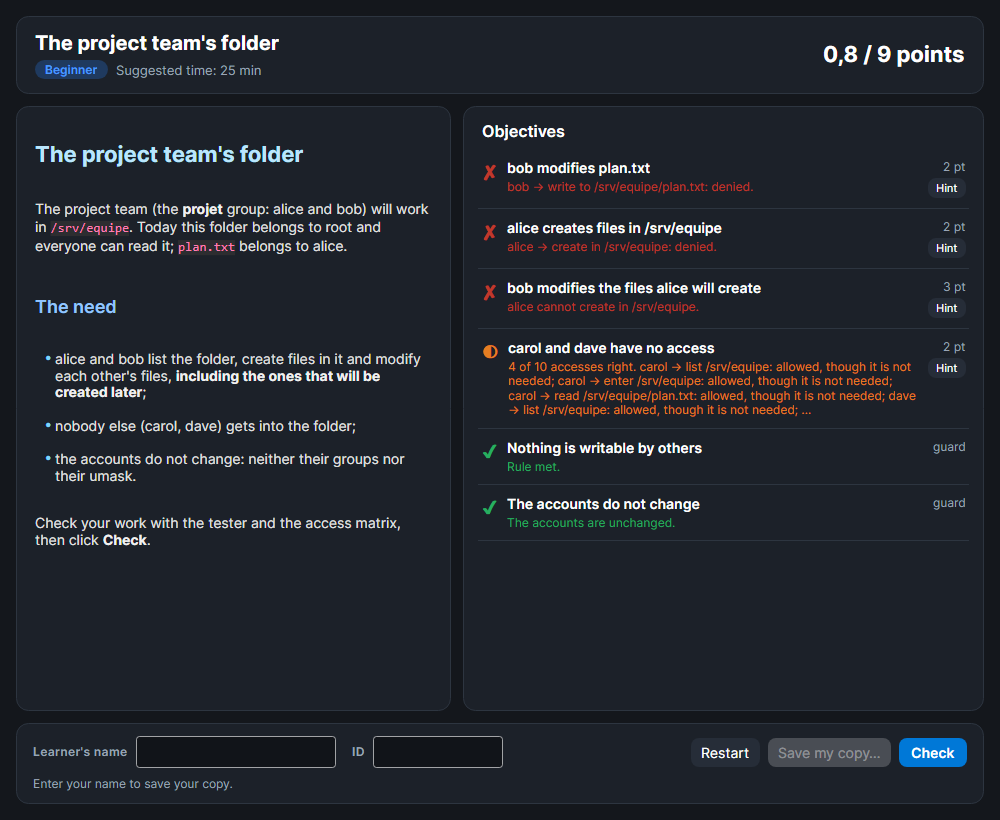

# Labs

A SMAR-X lab describes a need: who must be able to do what, on what, and nothing more. The learner sets the permissions in SMAR-X, then **Check** grades the work with the tester's engines, the ones compared with real systems.

*Screenshot: a provided lab, checked at the start. Nothing is done yet: no objective is met, the guards hold.*

## Opening a lab

The **Labs** button in the header offers:

- the labs provided with SMAR-X;
- **Open a lab file (.smarx-lab.json)…**, for a lab given by the trainer;
- **Show the current lab** and **Leave the lab**, during a lab.

The lab replaces the servers of the workspace it uses (Linux, Windows or both) with its starting servers, and the tree opens on the first objective's object. The lab window opens alongside: the learner works in the main window, as usual.

During a lab, **Sample server** and **Open…** are hidden: they would replace the learner's work. **Leave the lab** reloads the sample servers.

## The objectives

| Objective | What is checked |
|---|---|
| Access allowed | an account can perform an operation on an object, locally or through a share |
| Access denied | an account cannot perform it |
| Exactly the accesses needed | for a few accounts, objects and operations: each access is allowed **if and only if** it is needed. Without partial credit, every cell must be right; with it, each right cell earns its share of the points |
| What a new file gets | what an account will create in a folder, another account will be able to read or modify it |
| Hygiene rule | a good practice, see below |
| Guard | see below |

**The hygiene rules:**

- Linux: nothing is writable by others (`o+w`), except a sticky folder such as `/tmp`; no setuid or setgid program.
- Windows: neither Modify nor Full control for Everyone, Authenticated Users or Users.
- Windows, AGDLP: NTFS permissions name no account, no global group and no local group created on the server; only domain local groups and the built-in identities (see [Groups: AGDLP](windows-rules.md#groups-agdlp)).
- Windows share: the practice Microsoft recommends, a broad share which NTFS narrows down. Full Control for Administrators only, and Everyone Read at most; Authenticated Users: Change is fine.

**A guard** is marked "guard". It is met at the start and earns no point: it forbids an easy way out, such as opening a folder to everyone, adding an account to a group or changing permissions that were right. Broken, it **cancels** the objectives about the same account or the same path. An "accounts do not change" guard covers their groups, their primary group and their umask; on Windows, also whether they are administrators, even through a nested group. Nesting a group in another does not change the accounts.

## Checking

**Check** grades all the objectives and questions on the servers as they are:

| Sign | Meaning |
|---|---|
| ✔ | met |
| ◐ | partly met: a share of the points is earned |
| ✘ | not met |
| ○ | not checked yet |

Each objective says why: the access tested and its result, the accesses too many or missing, the rule that is not met. The score shows at the top right.

- **Hint** opens the hint of an objective or a question. The hints viewed are recorded in the copy.
- **Restart** puts back the starting servers.
- The comprehension **questions** (choices, matching, written answer) are graded with the objectives.

## The copy

With their name and, optionally, their **ID** (their number or address, used by the grade exports), the learner saves their copy: **Save my copy…** writes a `.smarx-submission.json` file. It holds the lab received, the learner's servers, their answers, the hints viewed, and the start and save dates. The copy is **sealed**: the seal covers its whole content, so a copy edited by hand is spotted when it is graded. The trainer creates labs and grades a class's copies in [SMAD-X Studio](../labs/studio.md#smar-x-labs).

## Exam mode

In an exam, there are no hints, no score and no **Restart**. **Check** is available only if the trainer allowed it: it then shows only the objectives met, without explanation. The learner saves their copy and hands it to the trainer.

The trainer's copy of an exam holds the answer key of the questions: SMAR-X refuses to open it. The subject is what gets handed out.

## The provided labs

| Lab | Level | Server | Topic |
|---|---|---|---|
| The project team's folder | beginner | Linux | a folder shared by a team, including for the files to come |
| The HR department share | intermediate | Windows | a broad share for a department, and its NTFS permissions following AGDLP |
| Why can't carol write? | intermediate | Linux and Samba | diagnose an access denied through a share, then fix it without granting anything more |

## How it is verified

The objectives are checked by the tester's engines, compared with real systems (see [Faithful to real systems](index.md#faithful-to-real-systems)). Each provided lab is tested:

- it fails at the start, and its guards hold;
- its solution, written only in the tests, earns all the points;
- the easy ways out are caught: opening the folder to everyone, adding an account to the group, opening the share to Everyone.
