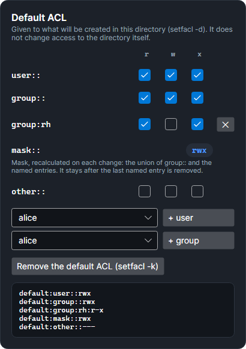

# Linux permissions

On Linux, SMAR-X's right column changes the permissions of the chosen file or directory, as `chown`, `chmod` and `setfacl` would. Each change applies at once: the tester, the access matrix and the **What a new item would get** card are recalculated, and the **Equivalent commands** card gives the commands that recreate what is shown.

## The mode

The **Permissions** card gives the `ls -l` line, the owner and the group, then a **who × r w x** grid: owner, group, others. The octal mode (`chmod`) follows each checked box. The special bits are below:

- **setuid**: the program runs as its owner;
- **setgid**: what is created in the directory gets its group;
- **sticky**: in the directory, only owners delete their files.

## The POSIX ACL

The **POSIX ACL** card adds named entries (`user:bob`, `group:rh`) to the mode. Like `setfacl -m`:

- the first entry creates the ACL: the mode's group permissions become the owning group's (`group::`);
- each change recalculates the **mask**: the union of `group::` and the named entries;
- the mask limits the named entries and the owning group: an entry it reduces shows its **effective** permission in red;
- with an ACL, the group row of the mode grid is the mask, as in `ls -l`;
- **Remove the ACL** does what `setfacl -b` does: the owning group's permissions go back into the mode.

## The default ACL

For a directory, the **Default ACL** card sets what will be given to what **will be created** in this directory (`setfacl -d`). It changes nothing about access to the directory itself.

*Screenshot: `/srv/projets` gives what will be created in it `rwx` to the owner and the projet group, `r-x` to the rh group, and nothing to others.*

It is edited as with `setfacl -d`:

- **Without a default ACL**, what is created gets the requested mode (`666` for a file, `777` for a directory), minus the account's umask.
- **The first entry** added creates the default ACL, with a copy of the directory's permissions: `user::` the owner's, `group::` the owning group's (the access ACL's, if there is one), `other::` the others'.
- **The mask** is recalculated on each change: the union of `group::` and the named entries. It **stays** after the last named entry is removed: what is created then gets an ACL reduced to `group::` and the mask.
- **Remove the default ACL** does what `setfacl -k` does: what will be created follows the umask again.

What is created gets the default ACL, limited by the requested mode: a file created with `666` never has `x`. The umask does not count. The **What a new item would get** card shows the result for the chosen account.

## How it is verified

The Linux engine is compared with the real kernel (see [Faithful to real systems](index.md#faithful-to-real-systems)). The default ACL rules above were measured with `setfacl` and `getfacl` in a Debian 13 (`acl` package 2.3.2): `0755` directories without an ACL and `0750` with an access ACL, adding and removing entries, `setfacl -k`, then a created file. The `Linux_DefaultAcl_IsEditedLikeSetfaclD` test replays these cases in the editor and compares each `getfacl` line.
