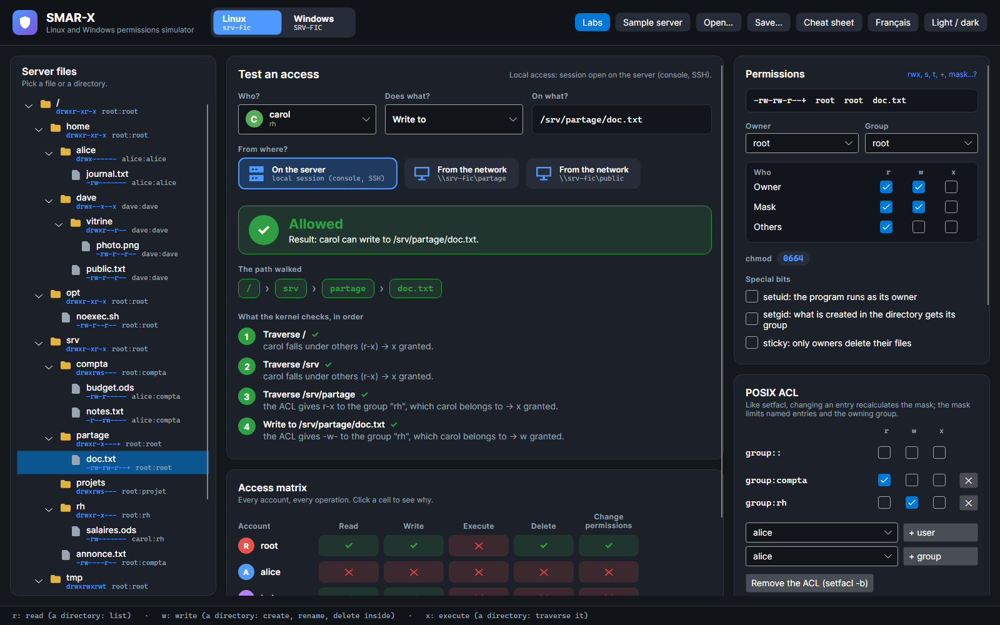
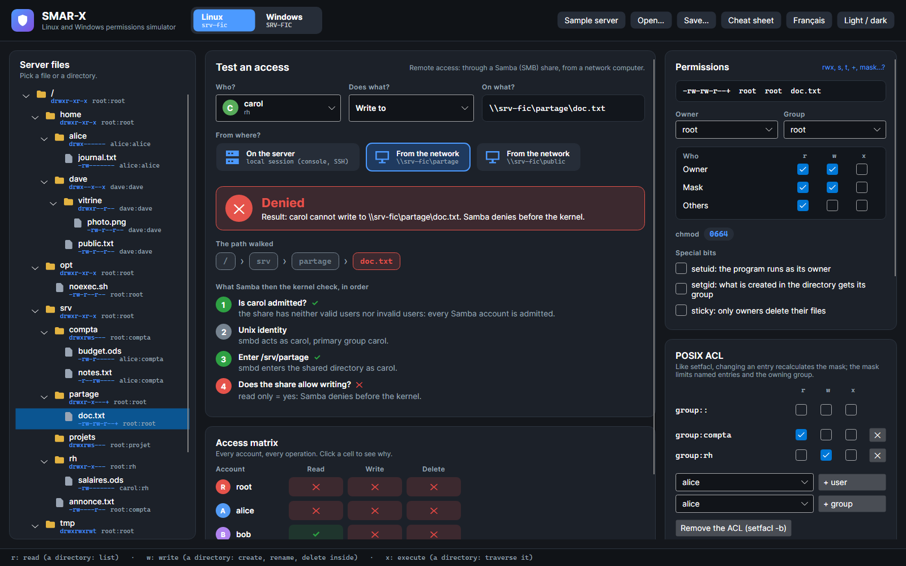
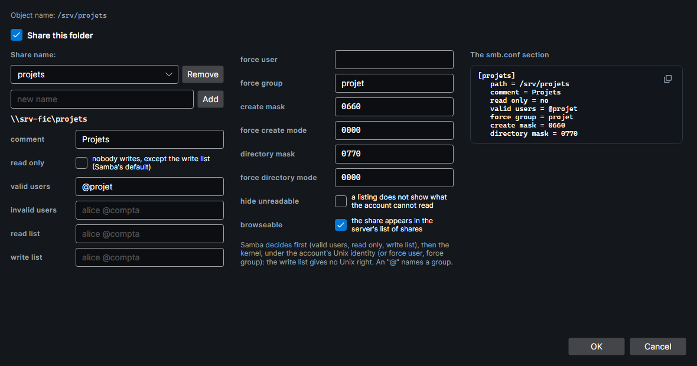

# Samba share

On Linux, a network computer reaches the files through a **Samba share**: `\\srv-fic\compta\budget.ods`. Samba decides first, then the kernel, under a Unix identity. Everything on this page was verified on a real Samba (see [How it is verified](#how-it-is-verified)).

## Testing an access through Samba

Under **From where?**, the tester offers **On the server** (server icon), for a session open on the server (console, SSH), then **From the network** (workstation icon) for each share that contains the object; the card gives the share (`\\srv-fic\partage`). When you pick another object, the tester keeps the chosen share if it contains the new object; otherwise, it goes back to **On the server**. Through a share, it offers what an SMB client does:
- for a file: read, write to, delete;
- for a directory: list, create in, delete.

The steps show what Samba checks, then the kernel. The verdict says which one denies. The access matrix follows the same route, and the **What a new item would get** card shows what Samba creates. In the sample, root has no Samba password (`smbpasswd -a`): it connects to no share.

The same access, on the server then from the network:

=== "On the server"

    

    *Screenshot: locally, carol writes to `doc.txt`: the ACL gives `-w-` to the rh group, which she belongs to, and the mask lets it through.*

=== "From the network"

    

    *Screenshot: through `\\srv-fic\partage`, the same access is denied. The share is read-only, and carol is not in its write list: Samba denies before the kernel.*

## Samba decides first

The sample server has five shares:

| Share | Directory | Settings | Idea |
|---|---|---|---|
| `compta` | `/srv/compta` | `valid users = @compta`, `read only = no`, `create mask = 0660`, `directory mask = 2770` | reserved to the group, writable |
| `partage` | `/srv/partage` | `read only = yes`, `write list = bob` | the write list against the directory's ACL |
| `projets` | `/srv/projets` | `valid users = @projet`, `read only = no`, `force group = projet` | everything created goes to the projet group |
| `public` | `/srv` | `read only = yes`, `hide unreadable = yes` | an overview that hides what you cannot read |
| `depot` | `/tmp` | `read only = no`, default masks | what Samba's defaults give |

1. **Connecting.** The account must be in `valid users`, if there are any, and not in `invalid users`. A name preceded by `@` names a Unix group. Then smbd enters the shared directory under the account's Unix identity: it needs `x` on that directory and on those leading to it. alice cannot connect to `partage`, where she has no right.
2. **The Unix identity.** smbd acts as the account, or as `force user`, with `force group` as primary group.
3. **Writing, creating, deleting.** The share must be writable for this account. `read list` wins, then `write list`, then `read only`.

**The write list gives no Unix right.** bob is in the write list of `partage`, but the directory's ACL, limited by the `r-x` mask, lets him create nothing: Samba lets it through, the kernel denies.

## Then the kernel

Once Samba lets it through, the kernel decides as it does locally, under the Unix identity. One difference comes from the client: **to write to a file, it opens it read-write**. So `r` and `w` are both needed, and with an ACL, **one** entry must give both. bob reads `doc.txt` through the compta group (`r--`) and writes it through rh (`-w-`): locally he can write to it; through Samba, he cannot.

## Hiding what you cannot read

With `hide unreadable = yes`, a directory listing does not show what the account cannot read. But Samba judges "readable" **like Windows**: the rights of every class that applies to the account add up. `annonce.txt` (`0604`, group compta) stays visible to alice, of the compta group: others can read it. Yet the kernel denies alice reading it, because the group class (`---`) applies to her.

A hidden file stays reachable by its path: opening it is simply denied by the kernel, if it should be. (smbclient's `del` command lists the directory first: it does not find a hidden file.)

## What a created file gets

Samba computes the requested mode, then the kernel creates:

| New item | Mode requested by Samba |
|---|---|
| file | (`0666`, plus `x` for the owner, because the DOS "archive" attribute gives it) `& create mask`, then the bits of `force create mode` added |
| directory | `0777 & directory mask`, then the bits of `force directory mode` added |

- **The account's umask does not count.** With the default masks (`0744`, `0755`), a file created in `depot` is `-rwxr--r--`, even for dave and his `077` umask.
- **The kernel does the rest.** A directory's setgid bit gives its group, and a subdirectory gets setgid: under `compta`, a directory is `2770`. A default ACL becomes the new item's ACL, limited by the requested mode: under `projets`, a file has the directory's ACL and the `rw-` mask.
- **The group** is the setgid directory's, otherwise `force group`, otherwise the account's primary group.

## The Samba sharing window

The **Samba sharing of …** card gives the object's network path and the shares that lead to it. For a directory, **Samba sharing…** opens the settings window:

- **Share this folder** creates a share with Samba's defaults: read-only, `create mask = 0744`, `directory mask = 0755`.
- A directory can have several shares: **Add** and **Remove**.
- Each smb.conf parameter has its row, and **The smb.conf section** writes it as Samba reads it.

**OK** keeps the changes; **Cancel** puts the shares back as they were.

## How it is verified

`tools/SmarxSambaCheck` writes a script run in a throwaway Debian 13 container (Samba 4.22). The script:
1. recreates the sample server and its shares, then starts smbd;
2. gives each account a random Samba password, which never leaves the container;
3. with smbclient, under each account and through each share, reads, writes and deletes each file, lists and deletes each directory, and creates a file and a directory, whose mode, owner, group and ACLs it reads back.

Result: **20 connections, 160 operations and 72 creations identical** to the simulator, frozen in `SMAR-X.Tests/Fidelity/linux-samba.txt`.
