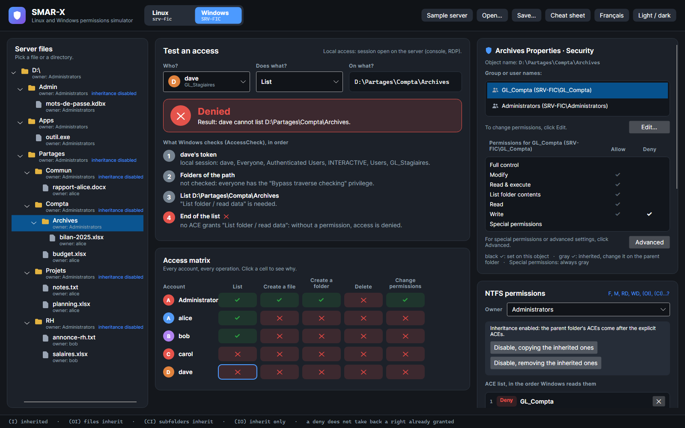
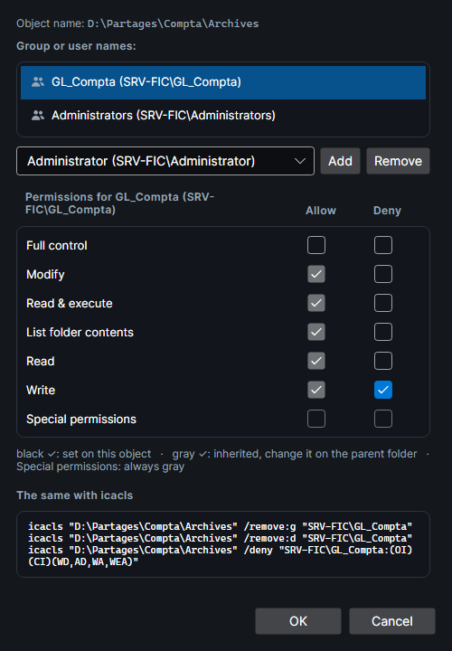
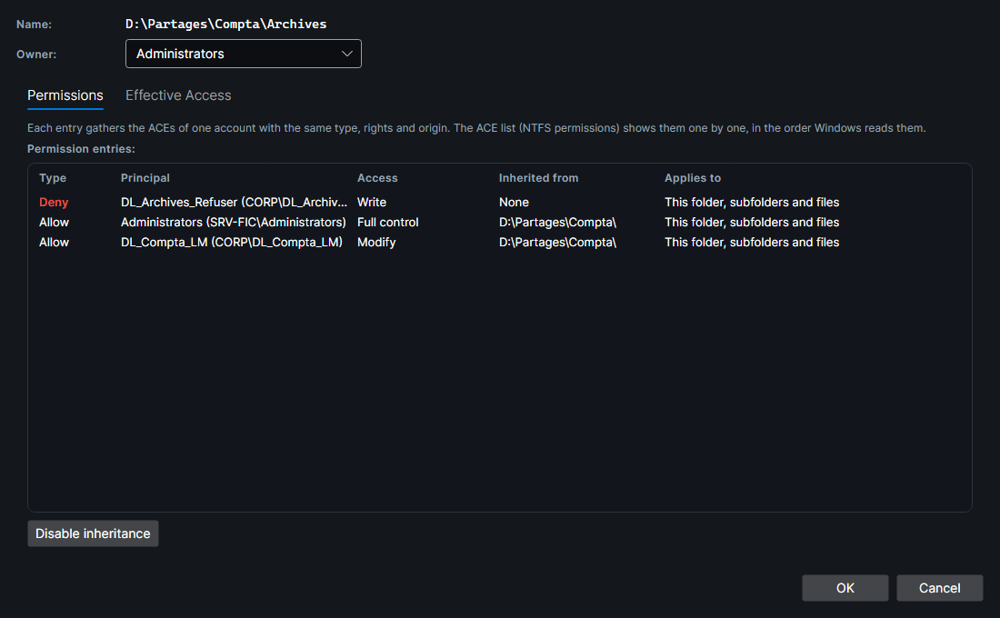

# The Security tab

On Windows, SMAR-X shows the **… Properties · Security** card at the top of the **Permissions** column, like the **Security** tab of the Explorer Properties. Its **Edit…** and **Advanced** buttons open the same windows as Windows. Everything on this page was measured on a real Windows 11 (see [How it is verified](#how-it-is-verified)).

*Screenshot: DL_Compta_LM gets Modify from Compta through inheritance (gray check marks). On Archives itself, an ACE denies Write to DL_Archives_Refuser.*

## The list of accounts

**Group or user names** lists every account named by an ACE of the object, explicit or inherited. Well-known identities show on their own (**Everyone**, **SYSTEM**, **Authenticated Users**); a built-in group, a local account or a local group comes with the server name: **Administrators (SRV-FIC\Administrators)**.

The order is the one Windows uses: accounts are **sorted by SID, written as text**. Everyone (`S-1-1-0`) thus comes before CREATOR OWNER (`S-1-3-0`), Authenticated Users (`S-1-5-11`) before SYSTEM (`S-1-5-18`), and server or domain accounts and groups (`S-1-5-21-…`) before the built-in Administrators and Users groups (`S-1-5-32-…`).

## The check marks

For the chosen account, each basic permission has an **Allow** and a **Deny** check mark:

| Row | Rights | Targets of a folder |
|---|---|---|
| Full control | `F` | this folder, subfolders, files |
| Modify | `M` | this folder, subfolders, files |
| Read & execute | `RX` | this folder, subfolders, files |
| List folder contents | `RX` | this folder and subfolders only (a folder has no files to read) |
| Read | `R` | this folder, subfolders, files |
| Write | `W` | this folder, subfolders, files |
| Special permissions | everything else | |

A file has no **List folder contents** row, and a single target: itself.

**A row is checked when the account's ACEs of one type give all its rights to each of its targets.** ACEs add up: `RX (OI)` (this folder and files) plus `RX (CI)` (this folder and subfolders) check **Read & execute**. Two details:

- **(NP)** changes nothing to the check marks: `RX (OI)(CI)(NP)` checks Read & execute on the folder that holds the ACE;
- **Synchronize** does not count: the deny `(DENY)(WD,AD,WEA,WA)` checks **Deny Write**, although Write includes Synchronize.

**Special permissions** is checked as soon as some rights are left that no checked row explains: an extra right, or an incomplete scope. Measured examples:

| The account's ACEs | Check marks |
|---|---|
| `M (OI)(CI)` | Modify, Read & execute, List folder contents, Read, Write |
| `RX (OI)(CI)` | Read & execute, List folder contents, Read |
| `RX (CI)` | List folder contents |
| `RX (OI)`, `RX` on this folder only, `RX (OI)(CI)(IO)` | Special permissions: a target is missing |
| `(RX,DC) (OI)(CI)` | Read & execute, List folder contents, Read, Special permissions (the extra DC right) |
| `(RX,W) (OI)(CI)` | Read & execute, List folder contents, Read, Write: not Modify, Delete is missing |
| `M (CI)` | List folder contents, Special permissions |
| `(RD) (OI)(CI)`, `(RC) (OI)(CI)` | Special permissions |
| `M` on this folder + `M (OI)(IO)` + `M (CI)(IO)` | same as `M (OI)(CI)`: the three ACEs cover the three targets |
| Deny `F (OI)(CI)` | every row, on the Deny side |

### Solid or gray

Inherited ACEs and explicit ACEs are read **separately**:

- a check mark that **inheritance** alone gives is **gray**: change it on the parent folder;
- a check mark that only the object's **explicit** ACEs give is **solid** (black, or light in the dark theme).

If inheritance and an explicit ACE both give the same row, the check mark stays gray. **Special permissions** is **always gray**, even for an explicit ACE.

## The Edit window

**Edit…** opens **Permissions for …**. Check marks become boxes there:

- a box that **only inheritance** checks is **grayed out**: it cannot be cleared here;
- a box that an explicit ACE checks stays enabled, even if inheritance gives it too;
- **Special permissions** can never be checked here.

*Screenshot: DL_Archives_Refuser; its Write deny, set on Archives, can still be changed. An inherited allow, for its part, has its boxes grayed out.*

Windows does not just add or remove rights: it **rewrites the account's explicit ACEs**. SMAR-X does the same:

1. **Clearing** a box also clears the boxes that contain it on the same scope. Clearing Read clears Read & execute, Modify and Full control; List folder contents stays checked, as it does not target files.
2. **Checking** a box in one column clears, in the other column, every box that shares rights with it: denying Read leaves only Write on the Allow side.
3. The account's explicit ACEs are **rewritten** in each column touched: **one ACE per scope**, with the rows that stay checked. A row contained in another adds nothing. The new ACEs go **at the end of the list**.
4. A deny **leaves Synchronize out**, except **Full control**.

Sequences measured on a folder where Users has an explicit Modify:

| Click | Windows writes for Users |
|---|---|
| Deny Write | Deny `(WD,AD,WEA,WA)`; Allow `RX` (Modify loses Write and Delete) |
| Deny Read | Deny `(RD,REA,RA,RC)`; Allow `W` |
| Deny List folder contents | Deny `(CI)(RD,REA,X,RA,RC)`; Allow `W` |
| Deny Full control | Deny `F`, Synchronize included; no allow left |
| clear Allow Write | Allow `RX` |
| clear Allow Read | Allow `(CI) RX` and `(OI)(CI) W` |
| clear Modify, then List folder contents | Allow `R` + `W` in one ACE |
| check Allow Full control | Allow `F` |

When a deny is checked, Windows warns: *"You are setting a deny permissions entry. Deny entries take precedence over allow entries"*. SMAR-X shows this warning with its nuance: an **explicit** allow is read before an **inherited** deny, and wins (see [Verified Windows rules](windows-rules.md#accesscheck-the-order-of-aces)).

**Add** gives the chosen account Read & execute (with List folder contents and Read), as Windows does. **Remove** deletes its explicit ACEs, unless it also has inherited ACEs: Windows then refuses, inheritance must be disabled first.

Below the boxes, **The same with icacls** gives the commands that write the same ACEs for this account: `/grant:r` (and `/grant` for a second scope), `/remove:d` then `/deny`. **OK** keeps the changes; **Cancel**, or the close button, puts the object back as it was.

## The Advanced window

**Advanced** opens **Advanced Security Settings for …**:

- **Owner**: change it in the list (`icacls … /setowner`).
- **Permission entries**: the ACEs of one account with the same type, rights and origin are **merged** into one entry, their scopes combined. `RX (OI)` + `RX (CI)` make one entry "This folder, subfolders and files". The ACE list of the Permissions column shows them one by one, in DACL order.
- **Access**: the name of a basic permission, **List folder contents** for `RX` on this folder and subfolders, **Read, write & execute** for `RX` + `W`, the name of a special right when it is alone (**List folder / read data**, **Read permissions**), otherwise **Special**.
- **Inherited from**: **None** for an explicit ACE, otherwise the folder that holds it, ending with `\`.
- **Applies to**: the scope, without (NP), which Windows shows only in an entry's details. A file has no such column.
- **Disable inheritance** asks the Windows question: **Convert inherited permissions into explicit permissions on this object** (`icacls … /inheritance:d`) or **Remove all inherited permissions from this object** (`/inheritance:r`). **Enable inheritance** brings them back (`/inheritance:e`).
- The **Effective Access** tab gives, for an account (in an elevated session or not), each of the 14 special rights when opening the object. When a right comes from the parent folder, SMAR-X says so: "(from the parent folder)".

Windows sorts the entries of this window in its own way; SMAR-X keeps the DACL order, the one AccessCheck reads.

## How it is verified

`tools/SmarxSecurityTabCheck` recreates on a Windows 11 a folder where each account has ACEs chosen for this check: a basic permission, an incomplete scope, (NP), (IO), an extra right, two complementary ACEs, a deny. It adds a subfolder that inherits them, with one more explicit ACE, and two files.

The tool opens the real Explorer Properties windows in the administrator's session and reads them through UI Automation and MSAA. Check marks are solid or gray according to the color of their pixels. It also clicks boxes in the Edit window, then reads back the DACL written.

The measurement is frozen in `SMAR-X.Tests/Fidelity/windows-security-tab.txt`, which the tests replay check mark by check mark, entry by entry and click by click.
