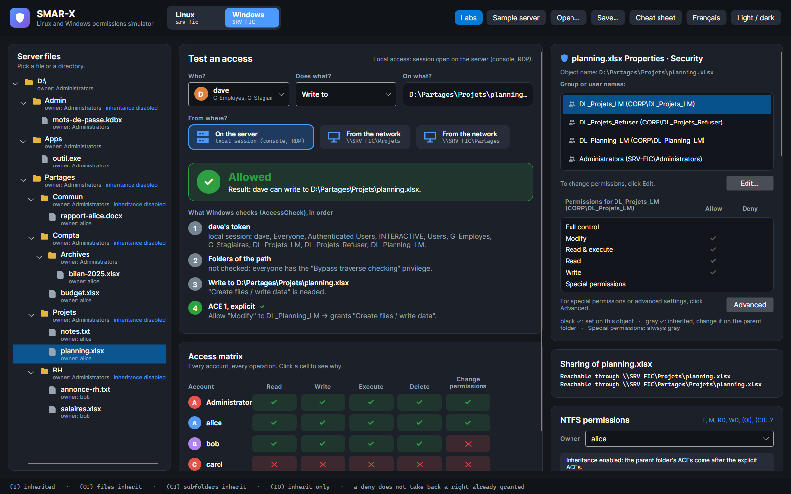
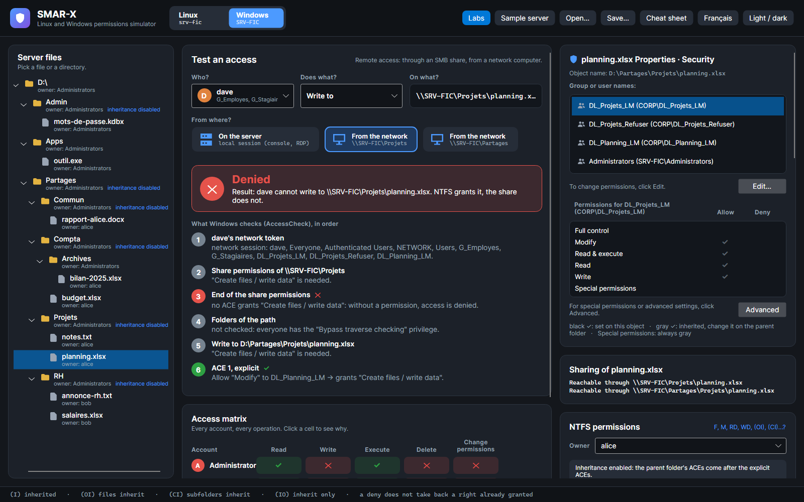
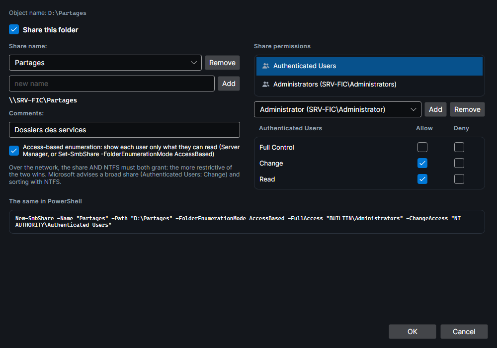

# Access through a share

From a network computer, you don't open `D:\Partages\Projets\planning.xlsx`: you open `\\SRV-FIC\Projets\planning.xlsx`. Windows then adds a layer to the NTFS permissions: those of the **share**. Everything on this page was verified on a real server (see [How it is verified](#how-it-is-verified)).

## Testing an access over the network

Under **From where?**, the tester shows where the access comes from, as cards: **On the server** (server icon), for a session open on the server, then **From the network** (workstation icon) for each share that contains the object, from the closest to the broadest; the card gives the share (`\\SRV-FIC\Projets`). The chosen card is framed, and its tooltip gives the full path. When you pick another object, the tester keeps the chosen share if it contains the new object; otherwise, it goes back to **On the server**. Through a share, the tester shows the network token, the share permissions, what access-based enumeration hides, then the usual NTFS steps; the verdict says which of the two denies. The access matrix follows the same route.

The same access, on the server then from the network:

=== "On the server"

    

    *Screenshot: locally, dave modifies `planning.xlsx`: the explicit Modify ACE of DL_Planning_LM, which he gets through G_Stagiaires, grants it. The token is that of an open session (INTERACTIVE).*

=== "From the network"

    

    *Screenshot: through `\\SRV-FIC\Projets`, the same access is denied. The token is a network one (NETWORK), NTFS still grants it, but the Projets share only grants Read.*

## The more restrictive wins

Over the network, each open goes through **two** AccessChecks: the share's DACL, then the file's or folder's. **Both** must grant the requested right.

| Share permission | Rights granted |
|---|---|
| Read | `RX`: read, execute, list |
| Change | `M`: Read, plus write and delete |
| Full Control | `F`: Change, plus change permissions and take ownership |

The sample server follows the practice Microsoft recommends, a broad share which NTFS narrows down, except for one narrower share, to compare:

| Share | Share permissions | Idea |
|---|---|---|
| `Partages` (`D:\Partages`) | Authenticated Users: Change; Administrators: Full Control; access-based enumeration | a broad share, as Microsoft advises: NTFS does the sorting |
| `Projets` (`D:\Partages\Projets`) | Everyone: Read | the counter-example: the same folder through another share, the same file, another result |
| `Compta$` (`D:\Partages\Compta`) | Authenticated Users: Change; Administrators: Full Control | a broad share; `$` hides it from the server's list |
| `Apps` (`D:\Apps`) | Authenticated Users: Change; Administrators: Full Control | a broad share: NTFS grants users only Read and execute |

dave can modify `planning.xlsx` locally and through `\\SRV-FIC\Partages\Projets`, but not through `\\SRV-FIC\Projets`.

## The network token

- The token of a network session holds **NETWORK** instead of **INTERACTIVE**, with the account, its groups, Everyone, Authenticated Users and Users.
- **UAC remote restrictions**: for a **local account** member of Administrators, the Administrators group is "deny only", and no elevation is possible remotely. The built-in **Administrator** account and a **domain account** are not filtered: they keep their privileges, and **Take ownership** works even through a share that only grants Read.
- If the share grants **no** right to the account, the **connection** to the share is denied.

## Access-based enumeration

With **access-based enumeration** (ABE), a folder listed through the share only shows what the account can read (**List folder / read data** on the entry). Through `\\SRV-FIC\Partages`, alice sees Commun, Compta and Projets, not RH.

ABE does more than hide:

- a hidden object, in a folder the account **can list**, is **not found** even by its path, whatever the right requested, including **Read attributes**, which NTFS would grant through the parent folder;
- if the account **cannot list** the folder, access is simply **denied**;
- a readable file stays reachable in a hidden folder: alice reads `\\SRV-FIC\Partages\RH\annonce-rh.txt`.

## A share's folder

A shared folder cannot be opened to be deleted while a client is connected to the share: the server keeps it open (sharing violation). Through its own share, that is therefore always the case.

## The Advanced Sharing window

The **Sharing of …** card gives the object's network path, if it is shared, and the broader shares that lead to it. For a folder, **Advanced Sharing…** opens the Windows window:

- **Share this folder** creates a share named after the folder, with **Read for Everyone**, as Windows does. A folder can have several share names: **Add** and **Remove**.
- **Comments** and **Access-based enumeration** (in Windows: Server Manager, or `Set-SmbShare -FolderEnumerationMode AccessBased`).
- **Share permissions**: for each account, Full Control, Change and Read, to allow or to deny. Each row contains the next one: checking Full Control checks Change and Read, clearing Read clears everything. As in the [Edit window](security-tab.md#the-edit-window), checking a box in one column clears the other column. **Add** grants Read.
- **The same in PowerShell**: `New-SmbShare` with the exact permissions (without an access parameter, Windows would grant Read to Everyone); `Block-SmbShareAccess` for a Full Control deny.

**OK** keeps the changes; **Cancel** puts the shares back as they were.

## How it is verified

`tools/SmarxWindowsCheck --network` runs on a Windows 11 computer of the domain, in a domain administrator's session. Through PowerShell remoting, it recreates the sample server, its accounts and its shares on a Windows Server 2025 domain controller. From the computer, it then opens each object of each share with each of the 14 special rights, under each account's network identity, and lists each folder through the share.

Result: **1,540 opens and 50 listings identical** to the simulator, frozen in `SMAR-X.Tests/Fidelity/windows-shares.txt`. The accounts of the measurement are domain accounts.

The measurement had to work around two behaviors of the Windows SMB **client**, worth knowing:

- an open that only asks for attributes (**Write attributes**, **Read attributes**), **Synchronize** or **Traverse** first succeeds **without asking the server**: the first real operation is what fails. The measurement therefore performs one, which changes nothing;
- the client caches the attributes it reads for about ten seconds and serves them even to **another account** on the same computer. The measurement waits between two accounts.

It also showed a rule SMAR-X applies: through a share, **Synchronize** alone is decided like **Read attributes**, over the 220 opens measured. Through `\\SRV-FIC\Compta$`, dave has no right on `D:\Partages\Compta`. He still reads its attributes, because he can list `D:\Partages`: the opens with Read attributes or Synchronize succeed, every other one fails.
