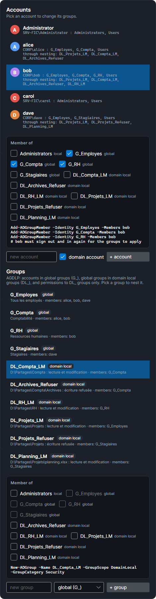

# Verified Windows rules

SMAR-X's Windows engine reproduces what a real Windows does. `tools/SmarxWindowsCheck` recreates the sample server on a Windows Server 2025 domain controller, reads its owners and ACLs in their real order, then opens each file and each folder with each of the 14 special rights, under each account's token: 1,512 opens, all identical to the simulator. This page gathers the rules SMAR-X applies, including those these measurements uncovered.

## AccessCheck: the order of ACEs

Windows reads the DACL **in order** and stops as soon as it can answer:

- an **Allow** ACE that applies to the token grants its rights; as soon as every requested right is granted, access is allowed;
- a **Deny** ACE blocks access if it covers a requested right **not yet granted**; a deny does not take back a right already granted;
- at the end of the DACL, what no ACE granted is denied.

The canonical order puts **explicit ACEs before inherited ones**, and among explicit ones, **denies before allows**. An explicit allow is therefore read before an inherited deny, and wins. The Windows warning ("deny entries take precedence") only holds for ACEs of the same rank.

## The token

- The token of a local session holds the account, its groups and, step by step, the groups of its groups, **Everyone**, **Authenticated Users**, **INTERACTIVE** and **Users**.
- **User Account Control (UAC)**: without elevation, an administrator's **Administrators** group is "deny only". It counts for denies, never for allows. The built-in **Administrator** account is not filtered.
- An administrator in an elevated session has the **Take ownership of files** privilege.
- The folders on the path are not checked: everyone has the **Bypass traverse checking** privilege.

## Groups: AGDLP

The sample server is a member of the **CORP** domain and follows **AGDLP**, the method Microsoft recommends:

- the domain **accounts** (alice, bob, dave) are in **global groups**, one per role: `G_Employes`, `G_Compta`, `G_RH`, `G_Stagiaires`;
- the global groups are members of **domain local groups**, one per resource and per right: `DL_<resource>_L` (read), `_LM` (read and modify), `_CT` (full control), `_Refuser` (deny);
- NTFS **permissions** name only domain local groups and the built-in identities (Administrators, SYSTEM, CREATOR OWNER, Authenticated Users…).

carol and Administrator are local accounts of the server. A domain account is written `CORP\alice`, a server account `SRV-FIC\carol`, as in `icacls`.

The token holds the account's groups **and the groups of those groups**: alice, a member of `G_Compta`, gets `DL_Compta_LM`, because `G_Compta` is a member of it. The tester shows it from the first step; the **Accounts** card writes it under each account ("through nesting: …").

Nesting follows Active Directory's rules. An impossible box is grayed out, and its tooltip says why:

| Group | Can contain |
|---|---|
| global (`G_`) | domain accounts, global groups |
| domain local (`DL_`) | domain accounts, global groups, domain local groups |
| local to the server (Administrators…) | any account, global and domain local groups, never another local group |

A local account of the server only joins a local group. A nesting that would loop is refused.

*Screenshot: bob, with his global groups, and the domain local groups he gets through nesting. A domain local group is selected: it cannot join a global group, so those boxes are grayed out.*

In the **Accounts** card, the **Groups** part lists each group, with its scope and its members. Picking a group lets you nest it in another one (**Member of**). The equivalent commands are the domain's, `New-ADGroup -GroupScope Global` or `DomainLocal` and `Add-ADGroupMember`, or the server's, `net localgroup`. A new account is a domain account, unless **domain account** is unchecked; a new group is global, domain local or local to the server.

The measurement on the domain controller creates these global and domain local groups and their nesting. Every open that goes through a nested group is identical to the simulator.

## The owner

The owner always has **Read permissions** and **Change permissions**, even without an ACE, unless the DACL holds an **OWNER RIGHTS** ACE: it then replaces these implicit rights.

## What the parent folder grants

Opening a file or a folder goes through AccessCheck on its DACL, then through two NTFS rules that look at the parent folder. The measurements confirmed them:

- **Delete** is granted if the parent folder grants **Delete subfolders and files**;
- **Read attributes** is granted if the parent folder grants **List folder**. Listing a folder already shows the attributes of what it contains. On the sample server, dave has no right on `D:\Partages\Compta`, yet he reads its attributes, because he can list `D:\Partages`.

SMAR-X's **Effective Access** tab (Advanced window) says so: "(from the parent folder)".

## Inheritance

- `(OI)`: files inherit; `(CI)`: subfolders inherit; `(IO)`: the ACE does not apply to the folder that holds it; `(NP)`: only direct children inherit.
- A subfolder keeps an `(OI)`-only ACE as "inherit only", to pass it on to its files.
- **CREATOR OWNER** becomes each child's owner, and is still passed on as "inherit only".
- **No duplicates among inherited ACEs.** An ACE already inherited is not copied again, and an ACE that would grant the object what an inherited ACE **read before it** already grants keeps only its inheritable part, as "inherit only". Under a folder created by an administrator:
    - if the root holds `Administrators (OI)(CI)(F)` **before** `CREATOR OWNER (OI)(CI)(IO)(F)`, the folder gets `Administrators (I)(OI)(CI)(F)` and `CREATOR OWNER (I)(OI)(CI)(IO)(F)`;
    - if CREATOR OWNER comes **first**, it gets `Administrators (I)(F)`, `CREATOR OWNER (I)(OI)(CI)(IO)(F)` and `Administrators (I)(OI)(CI)(IO)(F)`.

## Denies from the Security tab

Almost every file open asks for **Synchronize**. The Security tab therefore leaves it out of a deny. Denying Write there writes `(WD,AD,WA,WEA)`, whereas `icacls … /deny account:(W)` also denies Synchronize: the account could no longer open the file, not even to read it. Only the **Full control** deny keeps Synchronize. The rest of the boxes' behavior is described in [The Security tab](security-tab.md#the-edit-window).

## Through a share

Over the network come the share permissions, the network token (UAC remote restrictions) and access-based enumeration: see [Access through a share](shares.md). Through a share, **Synchronize** alone is decided like **Read attributes**.

## Comparing with a real server

To compare SMAR-X's output with a server's:

- `icacls` shows ACEs **in the order they are stored**, as SMAR-X does;
- `icacls … /grant` adds each ACE **at the head** of the explicit ones, and puts those that are not inherited before the others: commands given in another order give another order;
- `Get-Acl` **sorts explicit ACEs by SID**: its order is not the DACL order.
