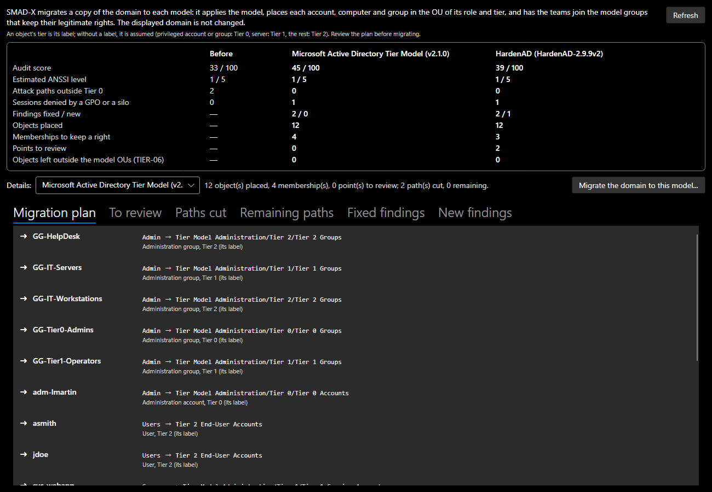

# Tiering models

SMAD-X classifies each object in a tier (see [Modeling](modeling.md#the-tier-model)). It can also apply a **published tiering model** to a domain, as its deployment script would: the OUs of each tier, the administration groups and accounts, the GPOs and their links, the delegations.

## The two models

| Model | What it creates | Specific features |
|---|---|---|
| [Microsoft Active Directory Tier Model](https://github.com/microsoft/ActiveDirectoryTierModel) (v2.1.0) | 31 OUs, 29 groups, 3 service accounts, 131 GPOs, 87 delegations | one OU per tier and role (member servers, accounts, groups, PAWs, service accounts), staging and quarantine OUs, "Account Restrictions" GPOs that deny logon from one tier to another |
| [HardenAD](https://github.com/LoicVeirman/HardenAD) (2.9.9) | 76 OUs, 292 groups, 10 administration accounts, 119 GPOs, 58 delegations | `_Administration`, `Harden_T0`, `Harden_T12` (Tier 1 and Tier 2), `Harden_TL` (Legacy tiers) and `Provisioning` branches; AGDLP groups (`G-S-…` into `L-S-…`); `HAD-LoginRestrictions`, `HAD-LocalAdmins` and `HAD-LocalRDU` GPOs per tier; an apply group and a deny group per GPO |

HardenAD adds two tiers, **Tier 1 Legacy** and **Tier 2 Legacy**, for isolated older systems: SMAD-X adds them to the document's tiers.

## Applying a model

- **When creating a domain**: **File > New Domain...**, **Tiering** list. *None* classifies nothing, *Tier 0, 1 and 2 labels* classifies the built-in objects (how previous versions worked), and each model also creates its structure. The source and license of the chosen model are shown under the list.
- **On the displayed domain**: **Settings > Apply a tiering model...** shows what the model creates, its source and what SMAD-X does not reproduce, then applies it.

Applying a model **adds** what is missing and neither moves nor changes any existing object: an imported domain keeps its OUs and accounts where they are. It can be replayed without creating duplicates, and is undone in one step (`Ctrl+Z`). The domain is seen once SDProp has run: an account or group that became a member of a protected group (HardenAD's Tier 0 managers are members of Enterprise Admins) receives `adminCount` and the permissions of AdminSDHolder.

The applied model and its version are shown in the domain's **Password policy** section.

## Simulating on a classic domain

Applying a model places nothing: an existing domain keeps its objects in its older OUs, where the model's GPOs do not apply. **Analysis > Simulate tiering...** shows what a real migration would change, without touching the displayed domain: SMAD-X migrates a copy of the domain to each of the two models and compares security before and after.



*Screenshot: on the sample domain, both models cut the two attack paths outside Tier 0: placed in the model's server OU, the server receives the restriction GPO, which denies the Tier 0 administrator's session.*

| Indicator | What it measures |
|---|---|
| **Audit score**, **estimated ANSSI level** | before, then after migrating to each model |
| **Attack paths outside Tier 0** | the paths to domain control that start from a source outside Tier 0 |
| **Sessions denied by a GPO** | the administrator sessions that the restriction GPOs make impossible |
| **Findings fixed / new** | the migration fixes some; it can also make some appear |
| **Objects placed**, **memberships**, **points to review** | the migration plan |
| **Objects left outside the model OUs** | what the plan could not place (TIER-06) |

The migration takes three steps:

1. **The model is applied**, as with **Settings > Apply a tiering model...**.
2. **Each account, computer and group is placed** in the model OU that matches its role (server, workstation, administration account, user, service account, administration group, group) and its tier. The tier is the object's label; without a label, it is assumed: Tier 0 for a privileged account or group, Tier 1 for a server (recognised by its name or its OU's: SRV, Server, Serveur), Tier 2 for the rest. An account or group that administers other objects (a delegation, local administration of a machine) goes with the administration accounts or groups; a disabled account, into the model's Disabled OU.
3. **Legitimate rights are kept.** A delegation set on an older OU no longer reaches the objects placed elsewhere, and the Microsoft model's restricted groups replace the machines' local administrators: the team that had this right joins the model group that holds it on the new OU (the service desk, for example, joins the model group in charge of user passwords). A group never joins a group of a more sensitive tier than its own. When the model has no equivalent, the lost right is reported under **To review**.

The **Migration plan** tab gives each step and its reason; **Paths cut** and **Remaining paths**, the attack paths before and after. **Migrate the domain to this model...** applies the chosen model's plan to the displayed domain, after confirmation; the migration is undone in one step (`Ctrl+Z`).

!!! warning "A simulation, not a production plan"
    The plan follows simple rules: review it. An assumed tier can be wrong, a kept right can be broader than needed, and a new finding can reveal a choice of the model. HardenAD, for example, puts the G-S-T0_Managers group in Enterprise Admins, which ANSSI recommends keeping empty (PRIV-03), and its administration account T0M-AHARDEN follows the domain password policy (PWD-09).

## GPO effects

The model's GPOs come with the settings that change attack paths. You read and change them in the GPO's **Security** section, and any SMAD-X GPO can receive them:

| Setting | What it changes |
|---|---|
| **Deny log on locally**, **Deny log on through Remote Desktop Services** | an account denied both ways opens no session on the computer: its credentials do not stay there, and the "Session" step disappears from attack paths |
| **Members of the local Administrators group** | the computer's local administrators; restricted groups (Microsoft model) replace the machine's own, preferences (HardenAD) are added to them |
| **WMI filter** | the GPO targets only servers or only workstations (this is how HardenAD links its server GPOs and its workstation GPOs to the same OU) |

A GPO applies to the computers of the OUs it is linked to, and of the OUs they contain. For the same setting, the GPO linked closest to the computer wins; on a tie, the first one in the list of linked GPOs. SMAD-X does not keep the operating system: for the WMI filter, a computer is a server or a workstation according to the model OU that contains it (servers, workstations, PAWs), otherwise according to its tier (Tier 0 and Tier 1: servers, Tier 2: workstations). A computer whose type nothing tells passes no filter.

In a computer's **Security** section, SMAD-X shows the local administrators the GPOs set on it and the sessions they deny it. The **Attack paths** window counts the denied sessions, and rule TIER-04 does not report them: they cannot happen.

## Compliance with the model

Once a model is applied, the audit checks that the domain follows it:

| Rule | What it reports |
|---|---|
| **TIER-05** | a model element missing: OU, group, account, GPO, GPO link, GPO setting (an account no longer denied, a local administrator removed) or delegation |
| **TIER-06** | an account, computer or group outside the model's classified OUs (in Users, Computers, an older OU) |
| **TIER-07** | an object left in a transit OU (Staging, Quarantine, Provisioning) |
| **TIER-08** | a privileged account or group placed in an OU of a tier less sensitive than Tier 0 |

The accounts and groups built into AD (Administrator, Domain Admins…) and the domain controllers are not concerned: no model moves them. Without an applied model, these rules report nothing.

On a domain where a model has just been applied, TIER-06 therefore lists everything left to place: this is the migration work towards the model.

## What SMAD-X does not reproduce

- **GPO settings**: apart from logon denials, local administrators and the WMI filter, they are not modelled (firewall, AppLocker, audit…). Neither are enforced links, inheritance blocking and GPO security filtering.
- **The Microsoft model**: its optional components (MSA, gMSA and dMSA, Windows LAPS, authentication silos) are not included. The "*- " prefix of GPO names is removed. Links the model creates disabled stay disabled.
- **HardenAD**: every task of its sequence is included, as if all were enabled (they are disabled by default). Administration accounts keep the names of the source (`T0M-AHARDEN`…). Redirecting the default containers to Provisioning is not modelled. PAWs shared by several tiers (`PawAccess`, `PawT12L`) and their logon groups have no tier. The local administration group specific to each computer (`L-S_LocalAdmins_%ComputerName%`) is not created.
- **Authentication silos**: neither model enforces them. HardenAD creates none; Microsoft offers them as an option, created in audit mode and with no administration account in them. SMAD-X lets you create them and measure their effect (see [Modeling](modeling.md#authentication-silos)).

## Fidelity

In the SMAD-X tests, the HardenAD model is compared with a new Windows Server 2025 domain hardened by HardenAD 2.9.9 (all tasks enabled) and exported by the import script. Identical: the 76 OUs, the 292 groups (names, locations, descriptions, memberships), the 119 GPOs and their settings (logon denials, local administrators), the additions to existing groups and the delegations. The names of the GPO filtering groups follow HardenAD's rule, abbreviations included (`L-S-T0-GPO_HAD-LocAdmins-T1_APPLY`).

This comparison corrected SMAD-X: WMI filters are now read in their queries (a name such as `Windows-x64-NoDC` does not say it targets both workstations and servers), full control limited to computers or to BitLocker recovery information is no longer read as control of the whole OU, and resetting the LAPS password does not give its reading.

## Sources and licenses

SMAD-X reproduces the **structure** of these models (names, locations, links and rights), not their code. Each model cites its source in SMAD-X:

| Model | Repository | Version | License | Copyright |
|---|---|---|---|---|
| Microsoft Active Directory Tier Model | [microsoft/ActiveDirectoryTierModel](https://github.com/microsoft/ActiveDirectoryTierModel) | v2.1.0 | MIT | Copyright (c) Microsoft Corporation |
| HardenAD | [LoicVeirman/HardenAD](https://github.com/LoicVeirman/HardenAD) | 2.9.9 | MIT | Copyright (c) 2021 HardenAD |

The license texts are in the `THIRD-PARTY-NOTICES.md` file of the SMAD-X repository.

## Updating a model

The models are data files (`SMAD-X.Core/TierModels/microsoft.json`, `hardenad.json`), produced from the official source by the `tools/TierModelGenerator` tool, for a published version:

```bash
dotnet run --project tools/TierModelGenerator -- microsoft v2.1.0 SMAD-X.Core/TierModels
dotnet run --project tools/TierModelGenerator -- hardenad HardenAD-2.9.9v2 SMAD-X.Core/TierModels
```

The tool downloads the source files at the version's commit (JSON configuration for Microsoft; XML task sequence and GPO backup reports for HardenAD), translates the rights of each delegation into SMAD-X categories and reports those it does not recognise. When a model evolves: run the tool again with the new version, review the diff and this report, then run the tests (consistency of each model, no attack path outside Tier 0 on a fresh domain, fidelity to a real domain).
