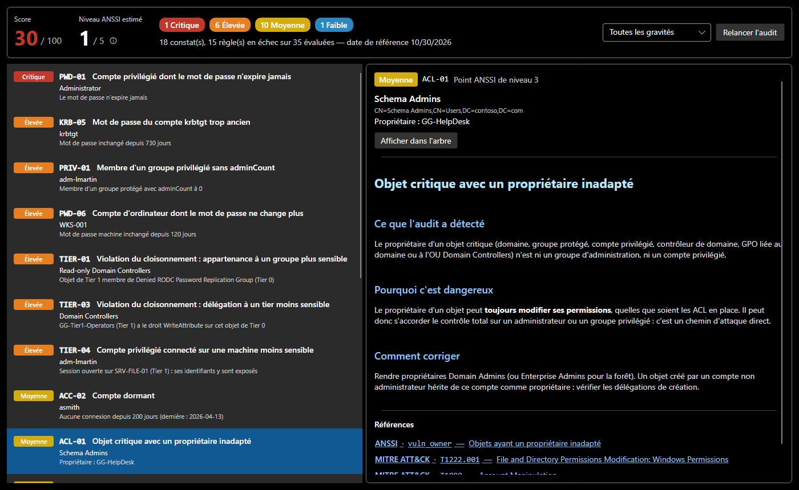

# Audit de sécurité

**Analyse > Audit de sécurité** (`Ctrl+Shift+A`) passe le domaine au crible de **35 règles**. Chacune s'appuie sur des sources reconnues :

- la [checklist Active Directory de l'ANSSI](https://cert.cyber.gouv.fr/uploads/ad_checklist.html), avec l'identifiant et le niveau officiels de chaque point de contrôle ;
- le **NIST** : SP 800-53 (contrôles de sécurité) et SP 800-63B (authentification) ;
- les **CIS Controls** v8 ;
- **MITRE ATT&CK**, pour les techniques d'attaque correspondantes ;
- la documentation **Microsoft** (modèle d'accès en tiers, comptes protégés, délégation).

## Lire le résultat

| Élément | Signification |
|---|---|
| **Score** | 100 moins une pénalité par règle en échec : 12 (critique), 6 (élevée), 3 (moyenne), 1 (faible). Une règle compte une fois, qu'elle touche un objet ou dix, pour qu'un problème répandu n'écrase pas un problème rare mais critique. |
| **Niveau ANSSI estimé** | le niveau du point de contrôle ANSSI le plus critique en échec, de 1 (le plus grave) à 5 (aucun point en échec). C'est une estimation à la manière de l'ANSSI, pas le calcul officiel de son outil ADS. |
| **Compteurs** | nombre de constats par gravité, et filtre par gravité |
| **Liste des constats** | règle, objet concerné et détail (par exemple « mot de passe inchangé depuis 730 jours ») |
| **Fiche** | ce que l'audit a détecté, pourquoi c'est dangereux, comment corriger, pour aller plus loin, et les références cliquables |

**Afficher dans l'arbre** sélectionne l'objet concerné ; l'arbre porte aussi un badge `AUDIT` sur chaque objet en défaut. Corrigez, puis **Relancer l'audit**.

La capture montre le domaine d'exemple, avec une faiblesse ajoutée pour la documentation : le groupe Schema Admins appartient au helpdesk (ACL-01).

## Les familles de règles

| Préfixe | Domaine | Exemples |
|---|---|---|
| `KRB` | Kerberos | comptes kerberoastables, AS-REP roasting, krbtgt trop ancien |
| `DLG` | délégation | délégation non contrainte hors DC, délégation contrainte vers un DC, comptes privilégiés délégables |
| `PWD` | mots de passe | expiration, mot de passe non requis, mots de passe inchangés (comptes privilégiés, DC, ordinateurs, comptes de service managés) |
| `ACC` | comptes | Guest activé, comptes dormants |
| `PRIV` | groupes privilégiés | groupes qui devraient rester vides, DnsAdmins, adminCount manquant ou orphelin, groupe protégé hors Tier 0 |
| `ACL` | propriétaires et permissions | propriétaire non administratif d'un objet critique (GPO des DC comprises), permissions dangereuses sur le domaine, AdminSDHolder ou les DC (DCSync, Shadow Credentials, RBCD), chemin de contrôle par les permissions depuis un compte ordinaire |
| `TIER` | cloisonnement | appartenance, GPO, délégation ou administration locale entre tiers, session d'un administrateur sur une machine moins sensible |
| `LAPS` | postes et serveurs | ordinateur dont le mot de passe d'administrateur local n'est pas géré par LAPS |
| `GRP` | groupes | boucles d'imbrication |

## Un domaine neuf, comme un vrai

Le domaine neuf de SMAD-X est celui qu'installe Windows Server : mêmes conteneurs, mêmes groupes et comptes intégrés, mêmes propriétaires, mêmes appartenances, mêmes SPN du contrôleur de domaine, même politique de mot de passe, et les mêmes permissions sur la racine et les conteneurs (Enterprise Admins, réplication des contrôleurs de domaine, Key Admins sur `msDS-KeyCredentialLink`, AdminSDHolder, Account Operators dans Users et Computers…) ; chaque ordinateur joint a Domain Admins pour administrateur local. Ce qui donne un contrôle va à des groupes privilégiés : l'audit ne le signale pas, comme il ne le signalerait pas sur un vrai domaine neuf. Ce qu'il y trouve (politique de mot de passe trop courte, quota de jonction de machines, administrateur intégré) est ce qu'il trouverait sur un AD sorti d'installation.

Le domaine neuf est celui de la version de Windows Server choisie à sa création : **2019**, **2022** (par défaut) ou **2025**. Les trois partagent les mêmes comptes et les mêmes permissions ; 2019 verrouille un compte 30 minutes au lieu de 10, 2022 ajoute le conteneur `System\SOA-Policies`, 2025 les groupes OpenSSH Users, External Trust Accounts et Forest Trust Accounts. Le domaine est vu tel qu'il est une fois SDProp passé, dans l'heure qui suit la promotion : SDProp a protégé les comptes et groupes sensibles : `adminCount`, propriétaire Domain Admins et permissions d'AdminSDHolder.

Les tests de SMAD-X le vérifient pour chaque version : ils comparent le domaine neuf à l'export d'un vrai domaine tout juste promu, objet par objet et permission par permission, et l'audit des deux.

La liste complète, avec la gravité, le niveau ANSSI et les références de chaque règle, est sur la page [Règles d'audit](reference/regles-audit.md), générée à partir du code.

## Débattre plutôt qu'appliquer

Les fiches signalent quand les référentiels divergent. Exemple : le NIST (SP 800-63B) déconseille d'imposer un changement périodique du mot de passe **aux utilisateurs**, alors que l'ANSSI exige l'expiration pour les **comptes privilégiés**. Les deux visions se rejoignent : un mot de passe long et unique, changé dès qu'une compromission est possible.
