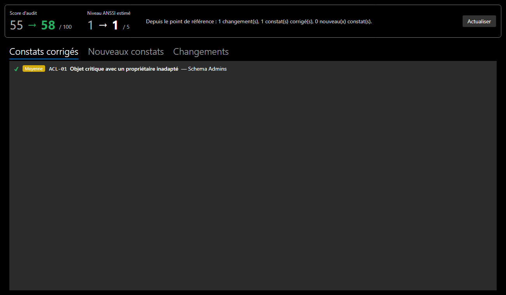

# Avant / après, annuler / rétablir

## Mesurer l'effet d'une correction

**Analyse > Avant / après...** (`Ctrl+Shift+B`) compare le domaine à son **point de référence** :

- par défaut, l'état du domaine à son ouverture ou à sa création ;
- ou l'état actuel, après **Analyse > Poser le point de référence ici**, juste avant de commencer une correction.

| Élément | Contenu |
|---|---|
| **Score d'audit** | avant → après, en vert s'il progresse, en rouge s'il recule |
| **Niveau ANSSI estimé** | avant → après |
| **Constats corrigés** | présents au point de référence, disparus depuis |
| **Nouveaux constats** | apparus depuis : une correction peut en créer un autre |
| **Changements** | objets ajoutés, supprimés ou modifiés, avec les champs changés |

*Capture : dans la démonstration de la documentation, rendre le groupe Schema Admins à Domain Admins corrige le constat ACL-01, et le score passe de 55 à 58.*

!!! tip "Une correction peut faire apparaître un constat"
    Regardez toujours l'onglet **Nouveaux constats** : corriger un objet peut en déplacer le problème. Un compte retiré d'un groupe protégé garde par exemple `adminCount = 1`, et l'audit le signale comme **adminCount orphelin** : dans un vrai AD, SDProp ne remet pas cet attribut à zéro.

**Actualiser** relance la comparaison après de nouvelles modifications, sans fermer la fenêtre.

## Annuler et rétablir

| Action | Raccourci |
|---|---|
| Annuler | `Ctrl+Z` (**Édition > Annuler**) |
| Rétablir | `Ctrl+Y` ou `Ctrl+Shift+Z` (**Édition > Rétablir**) |

- L'historique garde jusqu'à **100 états**. Chaque état est une copie complète du domaine, si bien qu'aucune modification n'échappe à l'annulation.
- Une modification faite dans le panneau de détails est enregistrée quand on change de sélection, ou au moment d'annuler.
- La sélection et les nœuds dépliés de l'arbre sont conservés, même quand on annule un renommage.
- L'historique repart de zéro à l'ouverture d'un fichier ou à la création d'un domaine.
