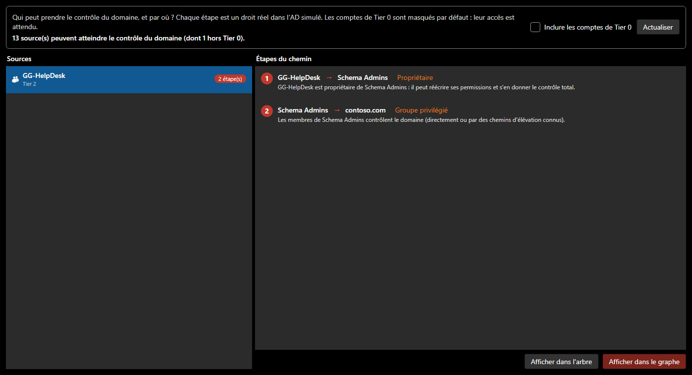

# Chemins d'attaque

L'audit liste des faiblesses une par une. Un attaquant, lui, les **enchaîne**. **Analyse > Chemins d'attaque** (`Ctrl+Shift+K`) répond à la question qui compte : *qui peut prendre le contrôle du domaine, et par quelles étapes ?*

*Capture : le domaine d'exemple, avec une faiblesse ajoutée pour la documentation. Le helpdesk est resté propriétaire du groupe Schema Admins.*

## Lire la fenêtre

- **À gauche, les sources** : chaque compte, groupe ou machine qui peut atteindre le contrôle du domaine, avec le nombre d'étapes. **N'importe quel utilisateur du domaine** représente un attaquant qui n'a qu'un compte ordinaire : un chemin depuis cette source est le plus grave, et il apparaît en tête.
- **À droite, les étapes** du chemin le plus court, chacune avec sa technique et son explication.
- **Inclure les comptes de Tier 0** : ces comptes contrôlent le domaine par définition, ils sont donc masqués par défaut. Ce qui reste est ce qu'il faut corriger.
- **Afficher dans l'arbre** sélectionne l'objet de l'étape ; **Afficher dans le graphe** surligne tout le chemin.

## Comment le graphe d'attaque est construit

SMAD-X construit un graphe « *X peut prendre le contrôle de Y* », à la manière de BloodHound en beaucoup plus simple, puis cherche le plus court chemin vers le domaine par un parcours en largeur.

| Technique | Arête | Pourquoi |
|---|---|---|
| **Membre de** | compte ou groupe → groupe | le membre hérite des droits du groupe |
| **Groupe privilégié** | groupe → domaine | Domain Admins, Enterprise Admins, Administrators, Schema Admins, Account / Server / Backup / Print Operators, DnsAdmins |
| **Contrôleur de domaine** | DC → domaine | compromettre un DC, c'est compromettre le domaine (DCSync, NTDS.dit) |
| **Propriétaire** | propriétaire → objet | un propriétaire peut toujours réécrire les permissions |
| **Contrôle total** | mandataire → OU et ses objets | délégation GenericAll |
| **Réinitialisation du mot de passe** | mandataire → utilisateurs de l'OU | il suffit de changer le mot de passe |
| **Modification des membres** | mandataire → groupes de l'OU | droit d'écrire l'attribut `member` |
| **GPO liée** | GPO → comptes de l'OU | qui contrôle la GPO exécute du code chez eux |
| **Kerberoasting** | tout utilisateur → compte avec SPN | ticket chiffré avec le mot de passe, cassé hors ligne |
| **AS-REP roasting** | tout utilisateur → compte sans préauthentification | réponse chiffrée avec le mot de passe |
| **Mot de passe vide** | tout utilisateur → compte PASSWD_NOTREQD | un mot de passe vide peut être accepté |
| **Délégation non contrainte** | serveur → domaine | un DC forcé à s'authentifier y laisse son TGT |
| **Délégation contrainte vers un DC** | compte → DC | usurpation d'un administrateur auprès d'un service du DC |

Les délégations accordées à **Domain Users**, **Authenticated Users** ou **Everyone** partent de « n'importe quel utilisateur ». Un compte désactivé n'est pas un point d'entrée.

!!! info "Ce que AdminSDHolder empêche"
    Une délégation posée sur une OU ne s'applique pas aux objets protégés (`adminCount = 1`) : SDProp a désactivé leur héritage. Un mandataire qui peut réinitialiser les mots de passe d'une OU ne peut donc pas réinitialiser celui d'un membre de Domain Admins rangé dans cette OU. Tous les groupes sensibles ne sont pas protégés pour autant : vérifiez la liste des groupes protégés de votre version de Windows Server.

## S'entraîner

Les [exercices de la série « Chemins d'attaque »](exercices/index.md) proposent douze situations réalistes, en français et en anglais, à résoudre avec cette fenêtre. Leurs solutions ne sont pas publiées : c'est à vous de trouver le chemin et la bonne correction.
