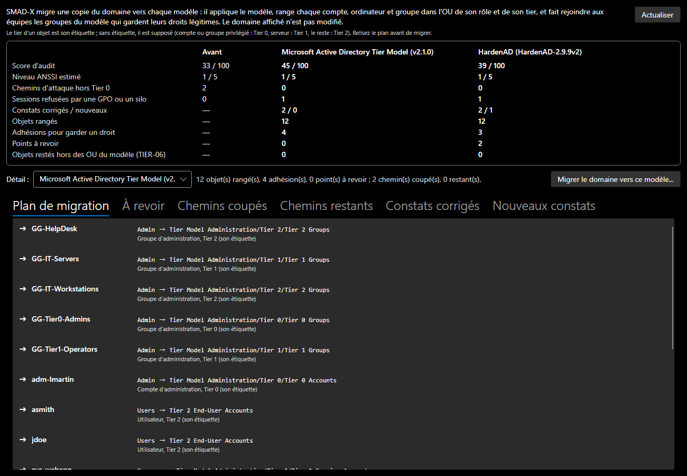

# Modèles de cloisonnement

SMAD-X classe chaque objet dans un tier (voir [Modéliser](modelisation.md#le-modele-en-tiers)). Il peut aussi appliquer à un domaine un **modèle de cloisonnement publié**, comme le ferait son script de déploiement : les OU de chaque tier, les groupes et les comptes d'administration, les GPO et leurs liens, les délégations.

## Les deux modèles

| Modèle | Ce qu'il crée | Particularités |
|---|---|---|
| [Microsoft Active Directory Tier Model](https://github.com/microsoft/ActiveDirectoryTierModel) (v2.1.0) | 31 OU, 29 groupes, 3 comptes de service, 131 GPO, 87 délégations | une OU par tier et par rôle (serveurs membres, comptes, groupes, PAW, comptes de service), OU de staging et de quarantaine, GPO « Account Restrictions » qui interdisent l'ouverture de session d'un tier sur un autre |
| [HardenAD](https://github.com/LoicVeirman/HardenAD) (2.9.9) | 76 OU, 292 groupes, 10 comptes d'administration, 119 GPO, 58 délégations | branches `_Administration`, `Harden_T0`, `Harden_T12` (Tier 1 et Tier 2), `Harden_TL` (tiers Legacy) et `Provisioning` ; groupes en AGDLP (`G-S-…` vers `L-S-…`) ; GPO `HAD-LoginRestrictions`, `HAD-LocalAdmins` et `HAD-LocalRDU` par tier ; un groupe d'application et un groupe d'exclusion par GPO |

HardenAD ajoute deux tiers, **Tier 1 Legacy** et **Tier 2 Legacy**, pour les systèmes anciens isolés : SMAD-X les ajoute aux tiers du document.

## Appliquer un modèle

- **À la création d'un domaine** : **Fichier > Nouveau domaine...**, liste **Cloisonnement en tiers**. *Aucun* ne classe rien, *Étiquettes Tier 0, 1 et 2* classe les objets intégrés (le fonctionnement des versions précédentes), et chaque modèle crée en plus sa structure. La source et la licence du modèle choisi s'affichent sous la liste.
- **Sur le domaine affiché** : **Configuration > Appliquer un modèle de cloisonnement...** montre ce que le modèle crée, sa source et ce que SMAD-X n'en reproduit pas, puis l'applique.

L'application **ajoute** ce qui manque et ne déplace ni ne modifie aucun objet existant : un domaine importé garde ses OU et ses comptes là où ils sont. Elle peut être rejouée sans créer de doublon, et s'annule d'un seul coup (`Ctrl+Z`). Le domaine est vu une fois SDProp passé : un compte ou un groupe devenu membre d'un groupe protégé (les gestionnaires du Tier 0 de HardenAD sont membres d'Enterprise Admins) reçoit `adminCount` et les droits d'AdminSDHolder.

Le modèle appliqué et sa version s'affichent dans la section **Politique de mot de passe** du domaine.

## Simuler sur un domaine classique

Appliquer un modèle ne range rien : un domaine existant garde ses objets dans ses anciennes OU, où les GPO du modèle ne s'appliquent pas. **Analyse > Simuler un cloisonnement...** montre ce que changerait une vraie migration, sans toucher au domaine affiché : SMAD-X migre une copie du domaine vers chacun des deux modèles et compare la sécurité avant et après.



*Capture : sur le domaine d'exemple, les deux modèles coupent les deux chemins d'attaque hors Tier 0 : rangé dans l'OU des serveurs du modèle, le serveur reçoit la GPO de restriction, qui refuse la session de l'administrateur du Tier 0.*

| Indicateur | Ce qu'il mesure |
|---|---|
| **Score d'audit**, **niveau ANSSI estimé** | avant, puis après la migration vers chaque modèle |
| **Chemins d'attaque hors Tier 0** | les chemins vers le contrôle du domaine qui partent d'une source hors Tier 0 |
| **Sessions refusées par une GPO** | les sessions d'administrateurs que les GPO de restriction rendent impossibles |
| **Constats corrigés / nouveaux** | la migration en corrige ; elle peut aussi en faire apparaître |
| **Objets rangés**, **adhésions**, **points à revoir** | le plan de migration |
| **Objets restés hors des OU du modèle** | ce que le plan n'a pas pu ranger (TIER-06) |

La migration se fait en trois temps :

1. **Le modèle est appliqué**, comme avec **Configuration > Appliquer un modèle de cloisonnement...**.
2. **Chaque compte, ordinateur et groupe est rangé** dans l'OU du modèle qui correspond à son rôle (serveur, poste, compte d'administration, utilisateur, compte de service, groupe d'administration, groupe) et à son tier. Le tier est l'étiquette de l'objet ; sans étiquette, il est supposé : Tier 0 pour un compte ou un groupe privilégié, Tier 1 pour un serveur (reconnu à son nom ou à celui de son OU : SRV, Server, Serveur), Tier 2 pour le reste. Un compte ou un groupe qui administre d'autres objets (une délégation, l'administration locale d'une machine) va avec les comptes ou les groupes d'administration ; un compte désactivé, dans l'OU Disabled du modèle.
3. **Les droits légitimes sont gardés.** Une délégation posée sur une ancienne OU n'atteint plus les objets rangés ailleurs, et les groupes restreints du modèle Microsoft remplacent les administrateurs locaux des machines : l'équipe qui avait ce droit rejoint le groupe du modèle qui le détient sur la nouvelle OU (le support rejoint par exemple le groupe du modèle chargé des mots de passe des utilisateurs). Un groupe ne rejoint jamais un groupe d'un tier plus sensible que le sien. Quand le modèle n'a pas d'équivalent, le droit perdu est signalé dans **À revoir**.

L'onglet **Plan de migration** donne chaque étape et sa raison ; **Chemins coupés** et **Chemins restants**, les chemins d'attaque avant et après. **Migrer le domaine vers ce modèle...** applique le plan du modèle choisi au domaine affiché, après confirmation ; la migration s'annule d'un seul coup (`Ctrl+Z`).

!!! warning "Une simulation, pas un plan de production"
    Le plan suit des règles simples : relisez-le. Un tier supposé peut être faux, un droit gardé peut être plus large que nécessaire, et un nouveau constat peut révéler un choix du modèle. HardenAD met par exemple le groupe G-S-T0_Managers dans Enterprise Admins, que l'ANSSI recommande de laisser vide (PRIV-03), et son compte d'administration T0M-AHARDEN suit la politique de mot de passe du domaine (PWD-09).

## Les effets des GPO

Les GPO du modèle sont reprises avec les paramètres qui changent les chemins d'attaque. On les lit et on les modifie dans la section **Sécurité** de la GPO, et toute GPO de SMAD-X peut en recevoir :

| Paramètre | Ce qu'il change |
|---|---|
| **Interdire l'ouverture d'une session locale**, **Interdire l'ouverture de session par les services Bureau à distance** | un compte refusé des deux façons n'ouvre pas de session sur l'ordinateur : ses identifiants n'y restent pas, et l'étape « Session ouverte » disparaît des chemins d'attaque |
| **Membres du groupe local Administrateurs** | les administrateurs locaux de l'ordinateur ; les groupes restreints (modèle Microsoft) remplacent ceux de la machine, les préférences (HardenAD) s'y ajoutent |
| **Filtre WMI** | la GPO ne vise que les serveurs ou que les postes de travail (HardenAD lie ainsi à la même OU les GPO de ses serveurs et celles de ses postes) |

Une GPO s'applique aux ordinateurs des OU où elle est liée, et des OU qu'elles contiennent. Pour un même paramètre, la GPO liée au plus près de l'ordinateur l'emporte ; à égalité, la première de la liste des GPO liées. SMAD-X ne garde pas le système d'exploitation : pour le filtre WMI, un ordinateur est un serveur ou un poste d'après l'OU du modèle qui le contient (serveurs, postes, PAW), sinon d'après son tier (Tier 0 et Tier 1 : serveurs, Tier 2 : postes). Un ordinateur dont rien ne dit le type ne passe aucun filtre.

Dans la section **Sécurité** d'un ordinateur, SMAD-X montre les administrateurs locaux que lui imposent les GPO et les sessions qu'elles lui interdisent. La fenêtre **Chemins d'attaque** compte les sessions refusées, et la règle TIER-04 ne les signale pas : elles ne peuvent pas avoir lieu.

## La conformité au modèle

Une fois un modèle appliqué, l'audit vérifie que le domaine le respecte :

| Règle | Ce qu'elle signale |
|---|---|
| **TIER-05** | un élément du modèle absent : OU, groupe, compte, GPO, lien de GPO, paramètre de GPO (un compte qui n'est plus refusé, un administrateur local retiré) ou délégation |
| **TIER-06** | un compte, un ordinateur ou un groupe rangé hors des OU classées du modèle (dans Users, Computers, une ancienne OU) |
| **TIER-07** | un objet resté dans une OU de transit (Staging, Quarantine, Provisioning) |
| **TIER-08** | un compte ou un groupe privilégié rangé dans une OU d'un tier moins sensible que le Tier 0 |

Les comptes et groupes intégrés à AD (Administrator, Domain Admins…) et les contrôleurs de domaine ne sont pas concernés : aucun modèle ne les déplace. Sans modèle appliqué, ces règles ne signalent rien.

Sur un domaine où l'on vient d'appliquer un modèle, TIER-06 liste donc tout ce qu'il reste à ranger : c'est le travail de migration vers le modèle.

## Ce que SMAD-X ne reproduit pas

- **Les paramètres des GPO** : en dehors des refus d'ouverture de session, des administrateurs locaux et du filtre WMI, ils ne sont pas modélisés (pare-feu, AppLocker, audit…). Les liens appliqués, le blocage de l'héritage et le filtrage de sécurité des GPO non plus.
- **Le modèle Microsoft** : ses composants optionnels (MSA, gMSA et dMSA, Windows LAPS, silos d'authentification) ne sont pas repris. Le préfixe « *- » des noms de GPO est retiré. Les liens que le modèle crée désactivés restent désactivés.
- **HardenAD** : toutes les tâches de sa séquence sont reprises, comme si elles étaient toutes activées (elles sont désactivées par défaut). Les comptes d'administration gardent les noms de la source (`T0M-AHARDEN`…). La redirection des conteneurs par défaut vers Provisioning n'est pas modélisée. Les PAW partagées par plusieurs tiers (`PawAccess`, `PawT12L`) et leurs groupes de connexion n'ont pas de tier. Le groupe d'administration locale propre à chaque ordinateur (`L-S_LocalAdmins_%ComputerName%`) n'est pas créé.
- **Les silos d'authentification** : aucun des deux modèles ne les applique. HardenAD n'en crée pas ; Microsoft les propose en option, créés en mode audit et sans y placer de compte d'administration. SMAD-X permet d'en créer et d'en mesurer l'effet (voir [Modéliser](modelisation.md#les-silos-dauthentification)).

## Fidélité

Le modèle HardenAD est comparé, dans les tests de SMAD-X, à un domaine Windows Server 2025 neuf durci par HardenAD 2.9.9 (toutes tâches activées) et exporté par le script d'import. Sont identiques : les 76 OU, les 292 groupes (noms, emplacements, descriptions, appartenances), les 119 GPO et leurs paramètres (refus d'ouverture de session, administrateurs locaux), les ajouts aux groupes existants et les délégations. Les noms des groupes de filtrage des GPO suivent la règle de HardenAD, abréviations comprises (`L-S-T0-GPO_HAD-LocAdmins-T1_APPLY`).

Cette comparaison a corrigé SMAD-X : les filtres WMI se lisent désormais dans leurs requêtes (un nom comme `Windows-x64-NoDC` ne dit pas qu'il vise postes et serveurs), un contrôle total limité aux ordinateurs ou aux informations de récupération BitLocker n'est plus lu comme le contrôle de toute l'OU, et la réinitialisation du mot de passe LAPS n'en donne pas la lecture.

## Sources et licences

SMAD-X reproduit la **structure** de ces modèles (noms, emplacements, liens et droits), pas leur code. Chaque modèle cite sa source dans SMAD-X :

| Modèle | Dépôt | Version | Licence | Copyright |
|---|---|---|---|---|
| Microsoft Active Directory Tier Model | [microsoft/ActiveDirectoryTierModel](https://github.com/microsoft/ActiveDirectoryTierModel) | v2.1.0 | MIT | Copyright (c) Microsoft Corporation |
| HardenAD | [LoicVeirman/HardenAD](https://github.com/LoicVeirman/HardenAD) | 2.9.9 | MIT | Copyright (c) 2021 HardenAD |

Le texte des licences est dans le fichier `THIRD-PARTY-NOTICES.md` du dépôt de SMAD-X.

## Mettre un modèle à jour

Les modèles sont des fichiers de données (`SMAD-X.Core/TierModels/microsoft.json`, `hardenad.json`), produits à partir de la source officielle par l'outil `tools/TierModelGenerator`, pour une version publiée :

```bash
dotnet run --project tools/TierModelGenerator -- microsoft v2.1.0 SMAD-X.Core/TierModels
dotnet run --project tools/TierModelGenerator -- hardenad HardenAD-2.9.9v2 SMAD-X.Core/TierModels
```

L'outil télécharge les fichiers de la source au commit de la version (configuration JSON pour Microsoft ; séquence de tâches XML et rapports des sauvegardes de GPO pour HardenAD), traduit les droits de chaque délégation en catégories de SMAD-X et signale ceux qu'il ne reconnaît pas. Quand un modèle évolue : relancer l'outil avec la nouvelle version, relire le diff et ce rapport, puis lancer les tests (cohérence de chaque modèle, absence de chemin d'attaque hors du Tier 0 sur un domaine neuf, fidélité à un vrai domaine).
