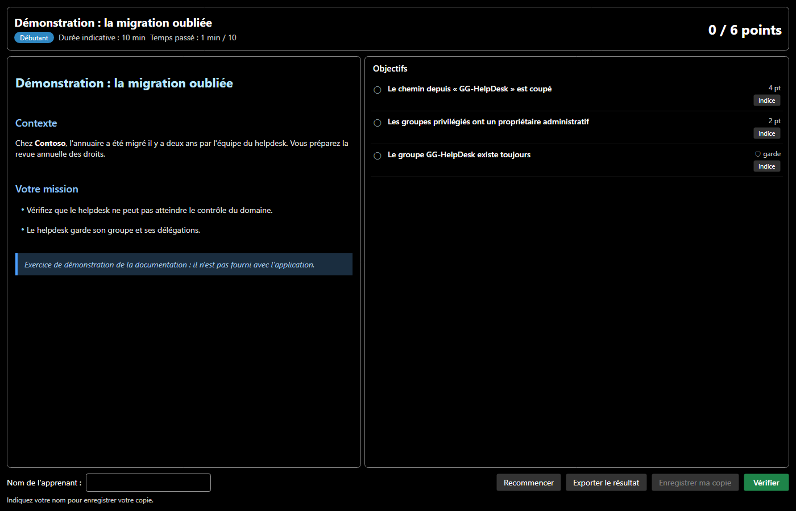
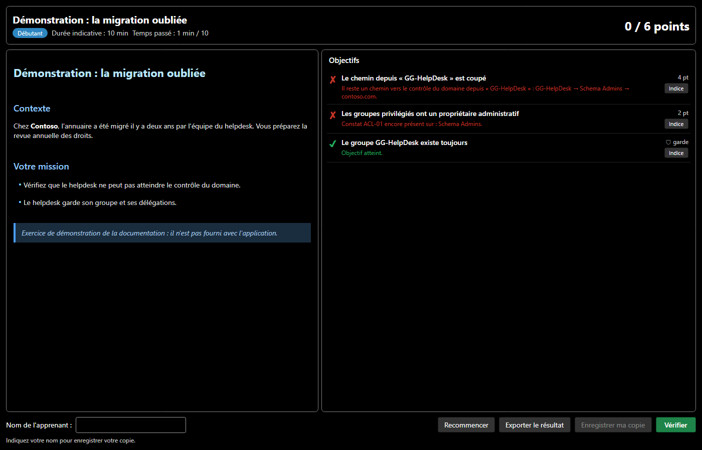
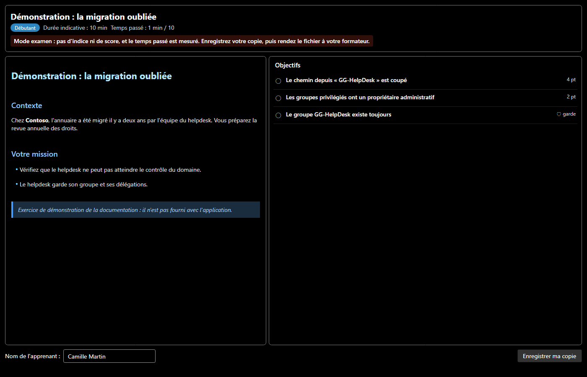

# Exercices

Un exercice place l'apprenant dans une situation réaliste (une organisation, un rôle, un événement déclencheur et des contraintes métier), puis **corrige automatiquement** son travail grâce à l'audit, aux chemins d'attaque et à la comparaison avec le domaine de départ.

## Ouvrir un exercice

| Comment | Contenu |
|---|---|
| **Exercices > Exercices fournis** | cinq exercices généraux, bilingues |
| **Exercices > Chemins d'attaque** | douze exercices, chacun dans la langue de l'interface, avec son propre domaine |
| **Exercices > Ouvrir un exercice...** | un fichier `.smadx-lab.json` reçu d'un formateur, ou une copie `.smadx-submission.json` à reprendre |
| Double-clic sur le fichier, ou `SMAD-X.exe exercice.smadx-lab.json` | le même fichier, ouvert directement en mode exercice (voir plus bas) |

La liste complète est dans le [catalogue](catalogue.md).

L'ouverture remplace le domaine actuel par le domaine de départ de l'exercice. Ses dates sont décalées pour que l'exercice se joue « aujourd'hui » : un compte connecté hier le reste, quel que soit le jour où l'on fait l'exercice.

## La fenêtre d'exercice

- **À gauche, l'énoncé** : le contexte, votre mission et vos outils. Il ne donne pas la réponse.
- **À droite, les objectifs**, avec leurs points.
- **Indice** révèle une piste pour l'objectif ; un indice consulté compte, même masqué ensuite.
- **Vérifier** corrige tous les objectifs sur l'état actuel du domaine.
- **Recommencer** recharge le domaine de départ.
- **Exporter le résultat** produit un compte rendu Markdown (objectifs, résultat, indices consultés, nom de l'apprenant).
- **Enregistrer ma copie** écrit votre travail dans un fichier `.smadx-submission.json`, à rendre au formateur (voir plus bas). Il faut d'abord indiquer votre nom.

Si la fenêtre est fermée, **Exercices > Afficher l'exercice** la rouvre.

## La correction

Chaque objectif est une vérification automatique. Un objectif non atteint explique ce qui manque. Pour un chemin d'attaque, il montre le **chemin restant**, étape par étape.

Les captures montrent un exercice de démonstration, construit pour la documentation et absent de l'application. Les solutions des exercices fournis ne sont pas publiées.

Les exercices contiennent aussi des **gardes**, déjà atteintes au départ et marquées 🛡, qui refusent les solutions brutales : supprimer le compte de service, retirer au support sa délégation légitime, vider un groupe métier… Une garde ne rapporte aucun point. Si vous la violez, les objectifs qui concernaient l'objet protégé ne comptent plus : supprimer le compte vulnérable coupe bien le chemin d'attaque, mais ce n'est pas une correction.

## Le mode exercice

Ouvert directement sur un exercice ou une copie (double-clic, ou nom du fichier après `SMAD-X.exe`), SMAD-X passe en **mode exercice** : le titre de la fenêtre nomme l'exercice, et les menus ne gardent que ce qui le sert. Rien ne peut remplacer votre domaine : **Nouveau domaine**, **Ouvrir**, les autres exercices et leurs raccourcis (`Ctrl+N`, `Ctrl+O`) sont désactivés, et `Ctrl+S` enregistre votre copie.

**Exercices > Quitter le mode exercice** rend tous les menus. Un exercice ouvert depuis le menu **Exercices** ne passe pas en mode exercice, sauf s'il s'agit d'un examen.

## Enregistrer et rendre sa copie

**Enregistrer ma copie** (ou **Exercices > Enregistrer ma copie...**, ou `Ctrl+S` en mode exercice) écrit un fichier `exercice_Prénom Nom.smadx-submission.json` qui contient :

- l'exercice tel que vous l'avez reçu ;
- votre domaine dans l'état où vous l'avez laissé ;
- les indices consultés et la date de votre travail.

Chaque enregistrement **scelle** la copie : une empreinte SHA-256 de tout son contenu (nom, dates, indices, domaine). Le domaine porte aussi la marque de **votre session de travail**, tirée au hasard à l'ouverture de l'exercice. Une copie retouchée à la main, rendue sous un autre nom ou dont le domaine vient d'un camarade est en général signalée au formateur (voir les limites de ces contrôles dans [SMAD-X Studio](studio.md)). Deux solutions identiques, faites chacun de son côté, ne le sont pas.

SMAD-X garde aussi une **copie de secours** : chaque minute en mode exercice, et à la fermeture, votre travail non enregistré est écrit dans un dossier de SMAD-X. S'il se ferme mal (coupure, plantage), la prochaine ouverture de l'exercice propose de reprendre ce travail. Fermer SMAD-X avec des modifications non enregistrées demande toujours d'enregistrer votre copie.

Les enregistrements suivants réécrivent le même fichier. Pour reprendre plus tard, ouvrez la copie : SMAD-X recharge votre domaine, votre nom et vos indices. Pour rendre le travail, donnez le fichier au formateur : il le corrige dans [SMAD-X Studio](studio.md), avec son propre exemplaire de l'exercice. Le score affiché dans votre fenêtre n'est jamais repris tel quel.

## Le mode examen

Le formateur peut marquer un exercice comme **examen** dans SMAD-X Studio. Un examen s'ouvre toujours en mode exercice et ne se quitte pas. Il n'a ni indice, ni score, ni **Recommencer** : l'apprenant fait son travail, enregistre sa copie et la rend. Le **temps passé** est affiché et écrit dans la copie ; le dépasser ne bloque rien, mais le formateur le voit.

Selon les réglages du formateur, le bouton **Vérifier** montre quels objectifs sont atteints, sans score ni explication, et certains outils peuvent être fermés : audit de sécurité, section « Comment corriger » des fiches, chemins d'attaque, comparaison avant / après. Par défaut, tout est ouvert.

!!! note "Ce que le mode examen garantit"
    Le mode examen retire les aides et empêche d'ouvrir un autre domaine depuis SMAD-X. Ce n'est pas un logiciel de surveillance : il ne verrouille ni l'ordinateur, ni les autres applications.

## Écrire ses propres exercices

Les exercices se créent et se corrigent dans [SMAD-X Studio](studio.md). Le [mode opératoire](creer.md) explique comment préparer un domaine dans SMAD-X et l'envoyer dans Studio, ou écrire un exercice avec les générateurs du dépôt.
