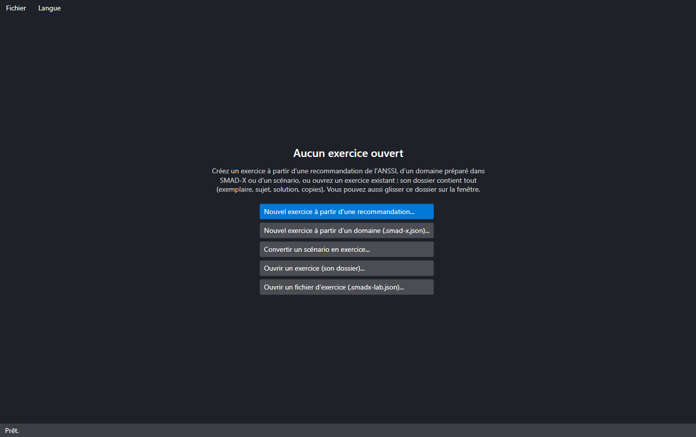
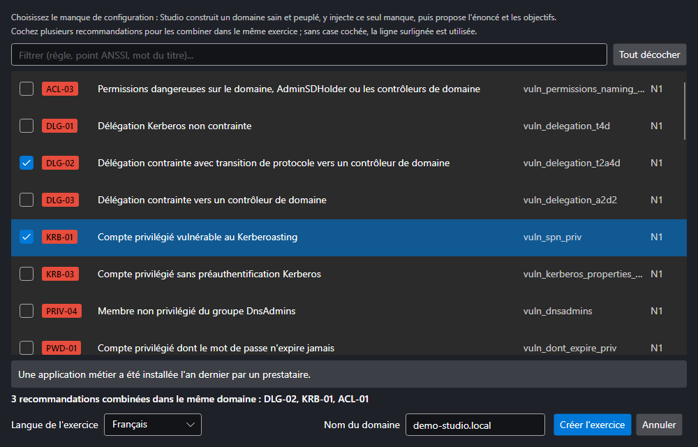
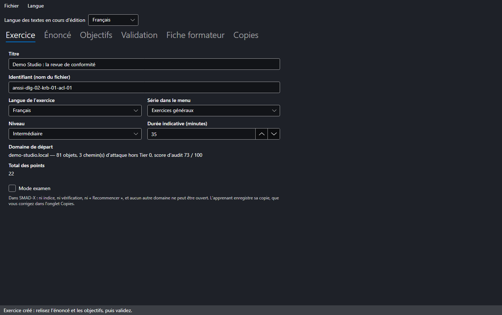
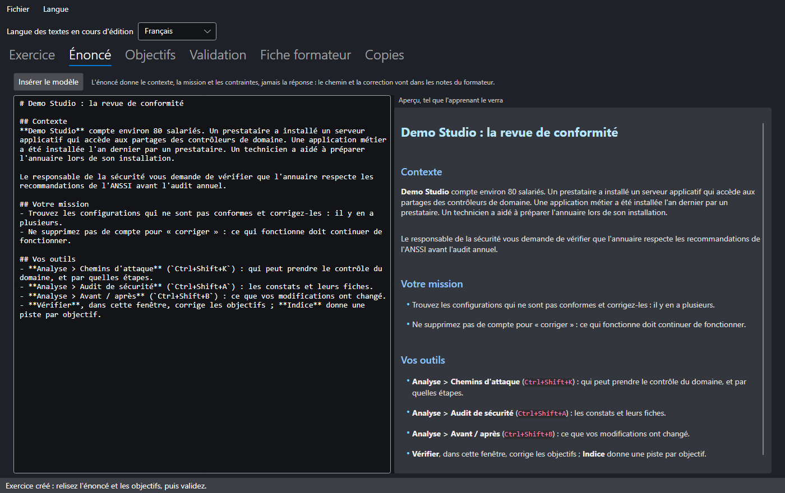
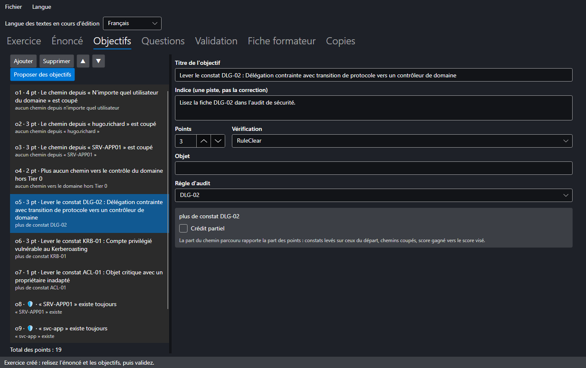
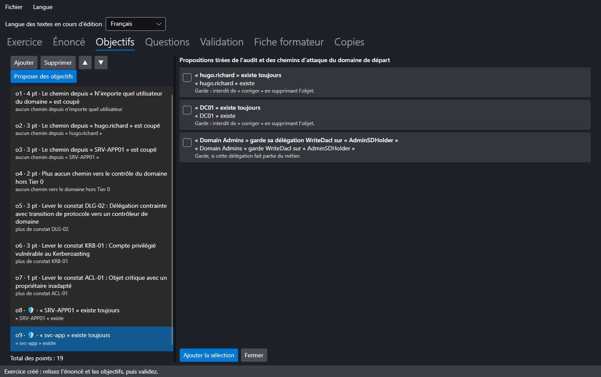
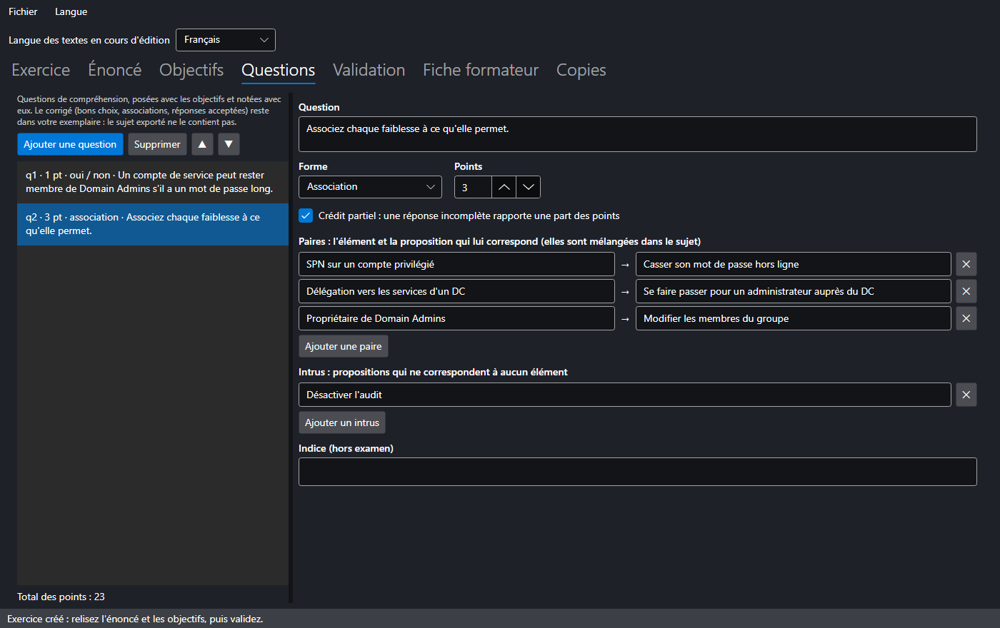
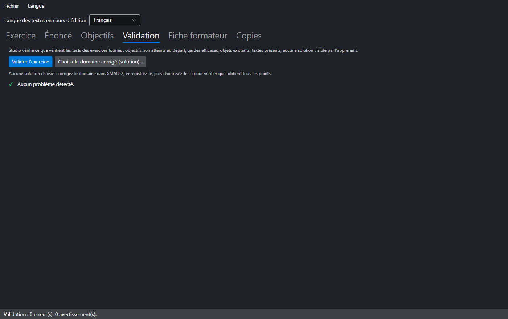
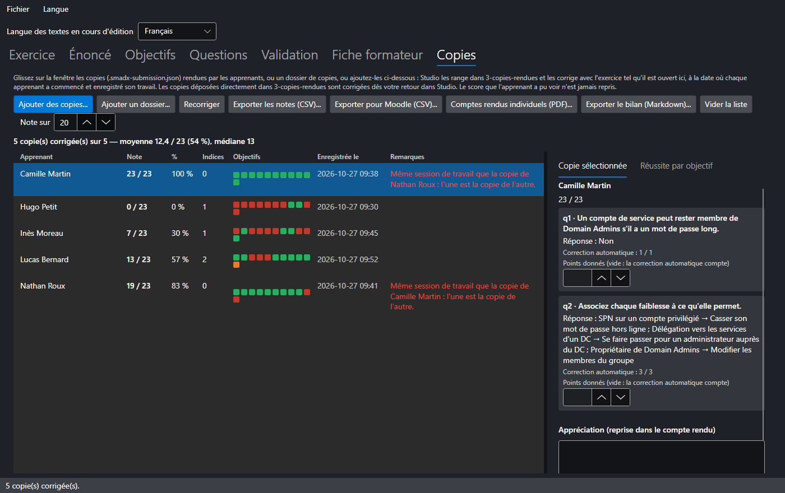

# SMAD-X Studio

**SMAD-X Studio** est l'outil du formateur : un second exécutable, livré dans la même archive que SMAD-X, qui crée des exercices, les vérifie et produit la fiche du formateur. Il fait, avec une fenêtre, ce que le [mode opératoire](creer.md) décrit à la main.

Studio ne remplace pas SMAD-X : le domaine se prépare et se corrige dans SMAD-X, l'exercice se met en forme dans Studio, l'apprenant le fait dans SMAD-X et rend sa **copie**, que Studio corrige avec celles de toute la classe.



---

## Trois façons de commencer

| Menu **Fichier** | Point de départ | Ce que Studio prépare |
|---|---|---|
| **Nouvel exercice à partir d'une recommandation...** | un manque de configuration, parmi les règles d'audit et les points de contrôle de l'ANSSI | un domaine sain et peuplé, avec ce seul manque, l'énoncé, les objectifs et les notes du formateur |
| **Nouvel exercice à partir d'un domaine (.smad-x.json)...** | un domaine préparé et enregistré dans SMAD-X | le modèle d'énoncé et les objectifs proposés par l'audit et les chemins d'attaque |
| **Convertir un scénario en exercice...** | un scénario `.smad-x.json` dont la description suit le plan *Contexte / Le chemin / Le corriger* | l'énoncé tiré du contexte ; le chemin et la correction passent dans les notes du formateur |

**Ouvrir un exercice (son dossier)...** (`Ctrl+O`) rouvre un exercice par son dossier, ou par l'un de ses dossiers par rôle : Studio y retrouve tout ce que la création a rangé (l'exemplaire, le sujet, le domaine corrigé, les notes) et corrige aussitôt les copies de `3-copies-rendues`. Glisser ce dossier sur la fenêtre de Studio fait de même, et l'écran d'accueil liste les **exercices récents**, rouverts d'un clic. **Ouvrir un fichier d'exercice (.smadx-lab.json)...** reprend un exercice enregistré seul, avec ses notes.

**Dès sa création**, Studio demande où ranger l'exercice, en proposant le dossier du précédent, et y crée son dossier, rangé par rôle (voir [Les fichiers](#les-fichiers)) : l'exemplaire, le sujet à distribuer et la fiche formateur sont déjà écrits. Chaque étape écrit ensuite à sa place, sans rien demander : le sujet dans `2-a-distribuer`, la fiche dans `1-formateur`, les copies ajoutées dans `3-copies-rendues`, les notes et les comptes rendus dans `4-resultats`. Si vous annulez le choix du dossier, l'exercice reste ouvert sans être enregistré : **Enregistrer** demandera où le ranger.

### À partir d'une recommandation



Chaque règle d'audit a sa recette, avec le point de contrôle ANSSI correspondant et son niveau (N1 à N4). La liste se filtre par identifiant de règle, par point ANSSI ou par mot du titre. Choisissez la langue de l'exercice et le nom du domaine : Studio construit un annuaire réaliste (services, utilisateurs, postes), vérifie qu'il est sain, puis y injecte **uniquement** le manque choisi. Ce domaine de départ part d'un AD neuf qu'il durcit : comptes intégrés corrigés, politique de mot de passe de 12 caractères avec verrouillage, quota de jonction à 0, groupes de délégation du support et de l'informatique.

#### Combiner plusieurs recommandations

Cochez plusieurs lignes pour réunir leurs manques **dans le même domaine** : l'exercice reçoit un objectif par règle visée, les objectifs proposés par l'audit et les chemins d'attaque, et les gardes de chaque recette. Le niveau et la durée augmentent avec le nombre de manques, et les notes du formateur ont une section par règle. Sans case cochée, c'est la ligne surlignée qui est utilisée ; **Tout décocher** revient à une seule recommandation.

Certaines recettes ne vont pas ensemble : deux recettes qui créent le même objet (KRB-01 et KRB-02 créent toutes deux le compte de service de l'application), ou une recette qui annule le manque d'une autre. Studio l'explique sous la liste et désactive **Créer l'exercice** tant que la combinaison n'est pas possible.

L'énoncé produit reste général (« vérifiez la conformité avant l'audit annuel ») : il ne nomme ni la règle ni l'objet à corriger. À vous de l'enrichir avec le contexte de votre organisation.

#### Le domaine corrigé

Studio produit aussi le **domaine corrigé** : le domaine de départ auquel il applique la correction attendue de chaque recommandation choisie, celle que décrit la fiche de la règle, sans rien supprimer. Il sert à la validation, qui vérifie qu'il obtient tous les points des objectifs, et la fiche formateur liste ce qu'il change. Il est enregistré avec l'exercice, dans `1-formateur/domaine-corrige.smad-x.json` (voir [Les fichiers](#les-fichiers)) : ouvrez-le dans SMAD-X pour montrer la correction, mais ne le donnez pas aux apprenants.

---

## Les onglets

### Exercice



Titre, identifiant (le nom du fichier), langue, série du menu (exercices généraux ou chemins d'attaque), niveau et durée. Le résumé du domaine de départ indique le nombre d'objets, les chemins d'attaque hors Tier 0 et le score d'audit.

Un exercice est **bilingue** ou n'existe que dans **une langue**. La liste *Langue des textes en cours d'édition*, en haut de la fenêtre, choisit les textes que vous modifiez.

**Mode examen** : dans SMAD-X, l'exercice n'a plus ni indice, ni score, ni « Recommencer », et aucun autre domaine ne peut être ouvert ; le temps passé est mesuré. L'apprenant enregistre sa copie et vous la rend. Deux réglages complètent le mode examen :

- **Autoriser « Vérifier »** : l'apprenant voit quels objectifs sont atteints, sans score ni explication ;
- **Outils fermés pendant l'examen** : audit de sécurité, section « Comment corriger » des fiches, chemins d'attaque, comparaison avant / après. Tous sont ouverts par défaut : ils aident à analyser, mais ils montrent aussi ce que la correction vérifie.

**Votre exemplaire et le sujet** : le fichier que Studio enregistre dans `1-formateur` est **votre exemplaire**, avec les indices et le corrigé des questions ; c'est avec lui que les copies se corrigent. On ne le distribue pas : pour un examen, SMAD-X refuse de l'ouvrir. À chaque enregistrement, Studio écrit aussi le **sujet**, sous le même nom, dans `2-a-distribuer` : sans le corrigé des questions et, pour un examen, sans les indices. C'est lui qu'on distribue. **Exporter le sujet pour les apprenants...** (menu **Fichier**, ou le bouton de l'onglet Exercice) enregistre l'exercice et réécrit le sujet dans `2-a-distribuer`, sans rien demander : le sujet et l'exemplaire qui corrigera les copies restent identiques. Pour un exercice enregistré seul par une version précédente, il demande où écrire le sujet, et refuse de l'écrire par-dessus votre exemplaire.

Fermer Studio avec un exercice ou des notes non enregistrés demande d'enregistrer.

### Énoncé



L'énoncé s'écrit en Markdown, avec un aperçu tel que l'apprenant le verra. **Insérer le modèle** pose le plan *Contexte / Votre mission / Vos outils*.

!!! warning "L'énoncé ne donne jamais la réponse"
    Il décrit la situation, la mission et les contraintes. Le chemin d'attaque et la correction vont dans les **notes du formateur**. La validation refuse un énoncé qui contient une section de solution.

### Objectifs



À gauche, la liste des objectifs et le total des points ; à droite, l'objectif sélectionné : titre, indice, points et vérification. Seuls les champs utiles à la vérification choisie s'affichent, et les noms d'objets se complètent à partir du domaine de départ. Les vérifications disponibles sont décrites dans le [mode opératoire](creer.md).

**Proposer des objectifs** analyse le domaine de départ et propose ce qui n'est pas encore dans l'exercice :



- un objectif par chemin d'attaque hors Tier 0, et « plus aucun chemin vers le contrôle du domaine » ;
- un objectif par règle d'audit en échec ;
- des **gardes** (case **Garde**, 🛡 dans la liste), déjà atteintes au départ, qui refusent une solution brutale (supprimer le compte au lieu de le corriger). Une garde ne rapporte aucun point ; violée, elle annule les objectifs qui concernaient l'objet protégé au départ : son constat d'audit, les chemins d'attaque qui le traversaient, les vérifications qui le nomment.

Les propositions recommandées sont cochées ; **Ajouter la sélection** les ajoute à la liste.

**Crédit partiel** (◐ dans la liste) : pour une vérification qui se compte, l'objectif rapporte la part du chemin parcouru depuis le départ. Il s'applique aux constats d'une règle sur tout le domaine (3 comptes corrigés sur 4 : 75 % des points), aux constats d'une gravité, au score d'audit (la part du chemin vers le score visé) et aux chemins d'attaque hors Tier 0 ou depuis n'importe quel utilisateur. Une garde violée annule aussi la part acquise.

### Questions



Des questions de compréhension, posées dans la fenêtre d'exercice avec les objectifs et notées avec eux. **Ajouter une question**, puis choisissez sa forme :

| Forme | L'apprenant… | Corrigé | Crédit partiel |
|---|---|---|---|
| **Choix unique** | coche une réponse | la bonne réponse | non |
| **Choix multiple** | coche plusieurs réponses | les bonnes réponses | chaque bonne réponse cochée compte, chaque mauvaise décompte |
| **Oui / non** | répond oui ou non à une affirmation | la bonne réponse | non |
| **Association** | associe chaque élément à une proposition, dans une liste | les paires ; des intrus sont possibles | la part des éléments bien associés |
| **Réponse écrite** | écrit sa réponse | les réponses acceptées, une par ligne (facultatif) | non |

Une réponse écrite est reconnue sans tenir compte des majuscules, des accents, des espaces superflus ni de la ponctuation finale. Une autre réponse, ou une question sans réponse acceptée, se note **à la main** dans l'onglet Copies.

Le corrigé reste dans votre exemplaire. Le sujet exporté ne contient ni les bons choix, ni les paires, ni les réponses acceptées, et les propositions d'une association y sont mélangées. En examen, SMAD-X enregistre les réponses dans la copie sans les corriger ; hors examen, l'exercice distribué contient le corrigé, et **Vérifier** corrige aussi les questions (la validation le signale).

### Validation



**Valider l'exercice** fait les vérifications des tests des exercices fournis :

- textes présents dans chaque langue de l'exercice, identifiants uniques, points positifs ;
- aucun objectif principal atteint au départ, toutes les gardes atteintes, chaque garde réellement efficace, et le raccourci qu'elle refuse ne rapporte pas plus de la moitié des points ;
- objets et règles cités qui existent dans le domaine de départ ;
- aucune solution visible par l'apprenant, ni dans l'énoncé, ni dans les descriptions du domaine ;
- questions complètes : textes, au moins deux choix, une bonne réponse (exactement une pour un choix unique ou un oui / non), chaque élément d'une association relié à une proposition.

#### La solution

La validation vérifie aussi la solution, le **domaine corrigé** : il doit obtenir tous les points des objectifs. Il y a trois façons de l'avoir :

| Comment | Ce que fait Studio |
|---|---|
| l'exercice vient de recommandations | il produit le domaine corrigé avec l'exercice : la correction attendue de chaque recommandation |
| **Proposer une solution** | pour n'importe quel exercice : il corrige chaque constat de l'audit du départ comme le décrit la fiche de sa règle, sans rien supprimer (il désactive, retire une appartenance ou une délégation, renouvelle un mot de passe), la plus grave d'abord ; puis il remplit les objectifs que l'audit ne voit pas : une délégation à donner, une appartenance, une option de compte, un tier. Une correction qui ferait tomber une garde est écartée. |
| **Choisir le domaine corrigé (solution)...** | votre propre correction, faite dans SMAD-X comme le ferait un apprenant et enregistrée en `.smad-x.json` : Studio la ramène aux dates du départ |

Dans les trois cas, le domaine corrigé est gardé avec l'exercice, dans `1-formateur`, et la fiche formateur liste ce qu'il change. Ce qu'une solution proposée n'atteint pas s'affiche dans la validation (« La solution échoue »). Pour la terminer : enregistrez, ouvrez `1-formateur/domaine-corrige.smad-x.json` dans SMAD-X, faites le reste, enregistrez, puis **Choisir le domaine corrigé (solution)...**.

### Fiche formateur

Les **notes du formateur** (la solution, les points de vigilance) et l'aperçu de la fiche formateur : objectifs, gardes, questions et leur corrigé, chemins d'attaque et audit du domaine de départ, ce que change le domaine corrigé, puis les notes. **Exporter la fiche formateur...** enregistre l'exercice et écrit la fiche en Markdown dans `1-formateur`.

---

## Corriger les copies d'une classe



Chaque apprenant enregistre son travail dans SMAD-X avec **Enregistrer ma copie** : un fichier `.smadx-submission.json` qui contient l'exercice reçu, son domaine, ses réponses aux questions et les indices consultés. Le plus simple : l'exercice ouvert, **glissez les copies sur la fenêtre de Studio**, ou un dossier de copies (une clé USB, le téléchargement d'un devoir de l'ENT) : Studio les range dans `3-copies-rendues`, avec vos notes à la main qui les accompagnent, et les corrige aussitôt. Une copie déjà rangée n'est pas recopiée ; un autre fichier du même nom reçoit un numéro. Vous pouvez aussi déposer les copies vous-même dans `3-copies-rendues`, depuis l'explorateur : elles sont corrigées à l'ouverture de l'exercice, ou dès votre retour dans Studio s'il est déjà ouvert. Ouvert par son dossier, l'exercice est toujours **votre exemplaire** (`1-formateur`), pas le sujet, qui n'a pas le corrigé. Dans l'onglet **Copies**, les mêmes copies s'ajoutent aussi par des boutons :

- **Ajouter des copies...** : choisissez une ou plusieurs copies à la fois ;
- **Ajouter un dossier...** : toutes les copies du dossier et de ses sous-dossiers, rangées avec leurs sous-dossiers (un téléchargement Moodle a un dossier par apprenant, et les copies peuvent y porter le même nom).

Studio corrige chaque copie avec **votre** exemplaire de l'exercice, tel qu'il est ouvert : le domaine de départ est repréparé à la date où l'apprenant a commencé, et la vérification se fait à la date de sa copie. Le score que l'apprenant a pu voir n'est jamais repris. Après avoir changé des objectifs ou des points, **Recorriger** refait toutes les notes.

Chaque ligne donne la note (au centième près avec le crédit partiel ; suivie d'une `*` s'il reste des réponses à noter), le pourcentage, le nombre d'indices consultés, le temps passé, une pastille par objectif puis par question (verte atteint, orange en partie, rouge non atteint, grise à noter ; le détail s'affiche au survol) et les remarques :

| Remarque | Signification |
|---|---|
| copie d'un autre exercice | elle n'est pas corrigée |
| copie modifiée en dehors de SMAD-X | son sceau ne correspond plus à son contenu : nom, dates, indices ou domaine retouchés à la main |
| même session de travail que la copie de… | une même copie rendue sous plusieurs noms : l'une est la copie de l'autre |
| le domaine ne vient pas de la session de cette copie | le travail d'un autre, rendu dans sa propre copie ; Studio nomme l'apprenant d'origine s'il a sa copie |
| copie sans sceau, sans session | la copie n'a pas été enregistrée par SMAD-X : ces contrôles sont impossibles |
| domaine de départ remplacé, contrôle de session impossible | l'exercice reçu, dans la copie, a été remplacé par un autre domaine pour échapper au contrôle de session |
| copie d'examen faite hors mode examen, réglages d'examen modifiés | l'exercice reçu a été modifié pour retrouver la vérification, « Recommencer » ou des outils fermés |
| indices consultés pendant l'examen | la copie porte des indices alors que l'examen n'en a pas |
| l'apprenant a reçu votre exemplaire au lieu du sujet | l'exercice reçu contenait les indices ou le corrigé des questions |
| question sans corrigé : ouvrez votre exemplaire | l'exercice ouvert dans Studio est le sujet : les questions ne peuvent pas être corrigées |
| la réponse a changé depuis votre note | l'apprenant a rendu une nouvelle copie : sa réponse est à noter de nouveau |
| temps dépassé | l'apprenant a passé plus que la durée prévue (rien n'a été bloqué) |
| copie faite avec une autre version de SMAD-X | ses règles d'audit diffèrent de celles de votre Studio : la note peut différer de celle de l'apprenant ; corrigez une classe avec une seule version |
| autre domaine de départ | la copie a été faite sur une autre version de l'exercice : la note peut être fausse |
| pas de nom, plusieurs copies | à vérifier avant de reporter la note |
| copie illisible | le fichier est abîmé ou n'est pas une copie SMAD-X |

Les remarques en rouge demandent votre attention ; la note reste affichée. Deux solutions identiques, faites chacun de son côté, ne sont pas signalées : ce qui trahit une copie n'est pas la solution, c'est la session de travail. SMAD-X la tire au hasard à l'ouverture de l'exercice, en dérive les identifiants internes de tous les objets du domaine de l'apprenant, et scelle chaque copie d'une empreinte SHA-256 de tout son contenu.

!!! note "Ce que ces contrôles garantissent"
    Ils repèrent les cas courants : une copie retouchée dans un éditeur de texte, la copie d'un camarade rendue sous son nom, un domaine récupéré chez un autre. Le format est public et SMAD-X tourne sur le poste de l'apprenant : ils n'arrêtent pas un faussaire déterminé qui réécrirait tout le fichier de façon cohérente. Une garantie absolue demanderait de collecter les copies sur une machine que l'apprenant ne contrôle pas.

### Noter à la main et apprécier

Sélectionnez une copie : le panneau **Copie sélectionnée** montre chaque réponse, la correction automatique et un champ **Points donnés**. Laissé vide, c'est la correction automatique qui compte ; rempli, il la remplace, par exemple pour une réponse écrite que Studio n'a pas reconnue. L'**appréciation** est reprise dans le compte rendu de l'apprenant. **Enregistrer la note** écrit le tout à côté de la copie, dans `<copie>.smadx-marks.json` : la copie elle-même, scellée, n'est jamais modifiée. Si l'apprenant rend une nouvelle copie avec une autre réponse, la note donnée à la main ne s'applique plus.

### Exporter les notes

L'onglet **Réussite par objectif** montre ce que la classe a compris et ce qu'il faut reprendre, objectif par objectif et question par question. Les exports utilisent le barème **Note sur** (20 par défaut) et s'écrivent, sans rien demander, dans le dossier `4-resultats` de l'exercice :

| Bouton | Produit |
|---|---|
| **Exporter les notes (CSV)...** | un tableau pour Excel : nom, identifiant, points, note sur le barème, indices, temps, réponses à noter, points de chaque objectif et de chaque question, remarques. La colonne de la note se copie dans l'ENT (Pronote, par exemple). |
| **Exporter pour Moodle (CSV)...** | le fichier d'import des notes de Moodle (*Notes > Importer > Fichier CSV*) : l'identifiant de l'apprenant, son nom et sa note sur le barème. Dans Moodle, associez la colonne de l'identifiant à l'adresse ou au numéro d'identification des étudiants, et la note à l'élément d'évaluation, dont la note maximale doit être le barème. |
| **Comptes rendus individuels (PDF)...** | un PDF par copie corrigée, dans `4-resultats/comptes-rendus` : la note, chaque objectif avec son explication, les réponses aux questions et l'appréciation. Il ne contient ni le corrigé des questions, ni les remarques réservées au formateur. |
| **Exporter le bilan (Markdown)...** | le bilan de la classe : moyenne, médiane, notes de chacun, réussite par objectif et par question. |

Dans SMAD-X, l'apprenant peut indiquer un **identifiant** (son numéro ou son adresse) à côté de son nom : c'est lui que reprennent les exports.

---

## Les fichiers

Studio range chaque nouvel exercice dans un dossier à son nom, créé dans le dossier choisi (ou dans le dossier choisi lui-même, s'il est vide ; un exercice du même nom n'est jamais écrasé : le nouveau dossier est numéroté), avec un sous-dossier par rôle. **Fichier > Enregistrer dans un dossier...** le range ailleurs. Les dossiers et les fichiers ont des noms français ou anglais, selon la langue de l'interface au moment de la création :

```
revue-ad/
├── LISEZMOI.md              le rôle de chaque dossier
├── 1-formateur/             à garder pour vous
│   ├── revue-ad.smadx-lab.json     votre exemplaire : énoncé, domaine de départ, objectifs, questions, indices et corrigé
│   ├── notes-formateur.md          les notes du formateur (la solution)
│   ├── domaine-corrige.smad-x.json le domaine corrigé, pour un exercice créé à partir de recommandations
│   └── fiche-formateur.md          la fiche formateur
├── 2-a-distribuer/
│   └── revue-ad.smadx-lab.json     le sujet : le seul fichier à donner aux apprenants
├── 3-copies-rendues/        les copies rendues (<id>_<nom>.smadx-submission.json)
│                            et, à côté de chacune, vos notes à la main (<id>_<nom>.smadx-marks.json)
└── 4-resultats/             notes.csv, notes-moodle.csv, bilan-classe.md, comptes-rendus/ (un PDF par apprenant)
```

À chaque **Enregistrer**, Studio réécrit l'exemplaire, les notes, le domaine corrigé, la fiche, le sujet et le LISEZMOI. L'exemplaire et le sujet portent le même nom : c'est le dossier qui dit lequel distribuer. Les notes et le domaine corrigé ne sont jamais écrits dans l'exercice, et le sujet n'a pas le corrigé des questions : distribuer `2-a-distribuer` ne révèle pas la solution.

Changez l'identifiant de l'exercice (onglet **Exercice**) : à l'enregistrement suivant, l'exemplaire et le sujet prennent le nouveau nom, et le dossier aussi s'il portait l'ancien. Faites-le avant de distribuer le sujet : une copie porte l'identifiant de l'exercice reçu, et Studio refuse de la corriger avec un autre. **Fichier > Ouvrir le dossier de l'exercice** (ou le bouton à côté de son chemin) l'ouvre dans l'explorateur de fichiers.

Un exercice enregistré par une version précédente, seul dans son dossier, s'ouvre toujours, avec ses notes à côté (`<id>.smadx-lab.notes.md`) ; **Enregistrer dans un dossier...** le range par rôle.

---

## En ligne de commande

Studio produit aussi des exercices en série et corrige une classe, sans fenêtre :

```bash
SMAD-X.Studio list-recipes --lang fr
```

```bash
SMAD-X.Studio recipe KRB-01 DLG-02 --lang fr --domain formation.local --out exercices
```

```bash
SMAD-X.Studio recipe KRB-01 DLG-02 ACL-01 --combine --lang fr --out exercices
```

```bash
SMAD-X.Studio recipe all --lang en --out labs
```

```bash
SMAD-X.Studio convert scenarios --lang fr --out exercices
```

```bash
SMAD-X.Studio validate exercices --solution corrige.smad-x.json
```

```bash
SMAD-X.Studio grade exercices/anssi-krb-01 --lang fr
```

```bash
SMAD-X.Studio grade exercices/anssi-krb-01/1-formateur/anssi-krb-01.smadx-lab.json copies-groupe-a copies-groupe-b --lang fr --csv notes.csv --moodle moodle.csv --reports comptes-rendus --report bilan.md
```

| Commande | Rôle |
|---|---|
| `list-recipes` | liste les recettes : règle, gravité, point ANSSI, titre |
| `recipe <règle>...` ou `recipe all` | crée un exercice par recette, chacun dans son dossier rangé par rôle (exemplaire, notes, domaine corrigé, fiche, sujet) ; avec `--combine`, un seul exercice qui les réunit |
| `convert <fichier ou dossier>...` | convertit des scénarios `.smad-x.json`, chacun dans son dossier |
| `validate <fichier ou dossier>...` | valide des exercices (tous ceux d'un dossier, sous-dossiers compris, sauf les sujets), avec leur domaine corrigé, ou celui de `--solution` |
| `export-subject <fichier ou dossier>...` | réécrit le sujet de chaque exercice dans son dossier `2-a-distribuer`, ou dans `--out` |
| `grade <dossier de l'exercice>` | corrige les copies de `3-copies-rendues` et écrit tous les résultats dans `4-resultats` |
| `grade <exercice> <copie ou dossier>...` | corrige les copies données, où qu'elles soient ; les options `--csv`, `--moodle`, `--reports` et `--report` choisissent les fichiers. `+` atteint, `~` en partie, `-` non atteint, `?` à noter à la main dans Studio |

| Option | Effet |
|---|---|
| `--lang fr` ou `--lang en` | langue de l'exercice et des messages |
| `--domain <nom>` | nom du domaine créé par une recette (`corp.example.lab` par défaut) |
| `--out <dossier>` | dossier où ranger les dossiers d'exercices (le dossier courant par défaut) |
| `--date aaaa-mm-jj` | date de référence : la même date donne le même fichier, octet pour octet |
| `--solution <fichier>` | domaine corrigé à noter pendant la validation |
| `--combine` | `recipe` : un seul exercice avec tous les manques dans le même domaine |
| `--exam` | `recipe`, `convert` : exercice en mode examen |
| `--exam-check` | avec `--exam` : « Vérifier » permis (objectifs atteints, sans score) |
| `--exam-close audit,fixes,paths,comparison` | avec `--exam` : outils fermés pendant l'examen |
| `--csv <fichier>` | `grade` : tableau des notes pour Excel |
| `--moodle <fichier>` | `grade` : fichier d'import des notes de Moodle |
| `--reports <dossier>` | `grade` : un compte rendu PDF par apprenant |
| `--scale <n>` | `grade` : barème des notes exportées (20 par défaut) |
| `--report <fichier>` | `grade` : bilan de la classe en Markdown |
| `--verbose` | affiche aussi les vérifications réussies |

Chaque exercice écrit est validé aussitôt. Le code de sortie vaut **0** si tout va bien, **1** si un exercice a des erreurs (il est quand même écrit, pour être corrigé dans Studio), si les recettes ne peuvent pas être combinées ou si une copie est à revoir (non corrigée, modifiée ou recopiée), et **2** pour une commande incorrecte.
