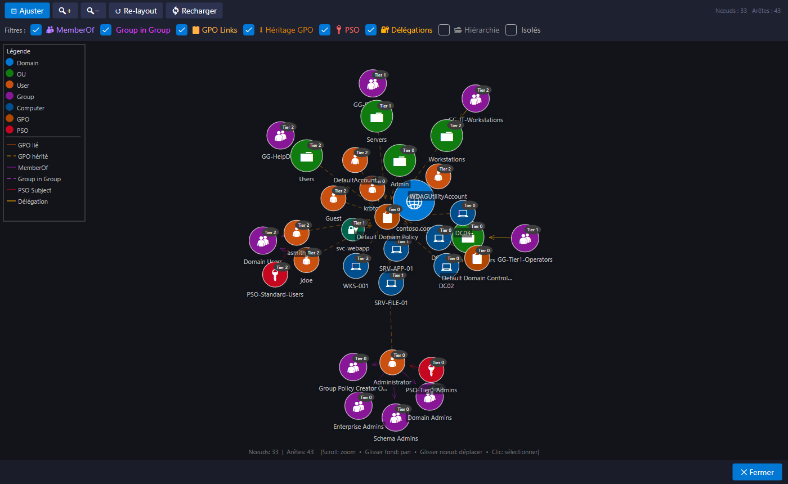
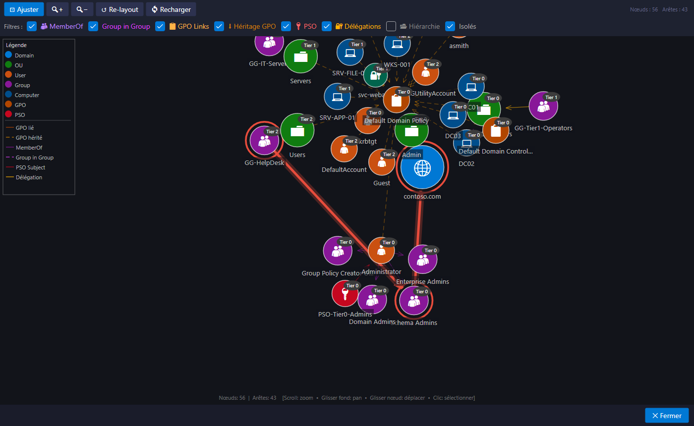

# Le graphe des relations

**Affichage > Vue graphique des relations...** (ou le bouton **Graphe**) dessine les objets et leurs liens dans une disposition dirigée par les forces : les objets liés se rapprochent, les autres s'écartent.

## Ce qui est dessiné

| Lien | Signification |
|---|---|
| MemberOf | un compte est membre d'un groupe |
| Group in Group | un groupe est imbriqué dans un autre |
| GPO lié / GPO hérité | une GPO s'applique à une OU, directement ou par héritage |
| PSO Subject | une PSO s'applique à un compte ou à un groupe |
| Délégation | un mandataire a des droits délégués sur un objet |
| Hiérarchie | les liens parent-enfant de l'arbre (désactivés par défaut) |

Les cases à cocher filtrent les types de liens, et **Isolés** affiche ou masque les objets sans lien.

## Naviguer

| Geste | Effet |
|---|---|
| Molette | zoom |
| Glisser le fond | déplacer la vue |
| Glisser un nœud | le déplacer |
| Clic sur un nœud | le sélectionner et afficher ses informations |
| **Ajuster** | cadrer tout le graphe, ou le chemin d'attaque surligné |
| **Re-layout** | relancer la disposition |

## Un chemin d'attaque dans le graphe

Depuis la fenêtre [Chemins d'attaque](chemins-d-attaque.md), **Afficher dans le graphe** ouvre le graphe avec le chemin surligné en rouge : flèches dans le sens de l'attaque et cercles autour des objets traversés. Une fois la disposition stabilisée, la vue se cadre automatiquement sur le chemin.

