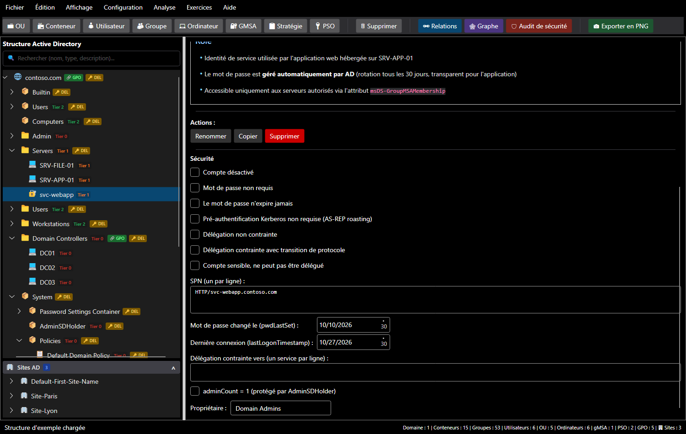
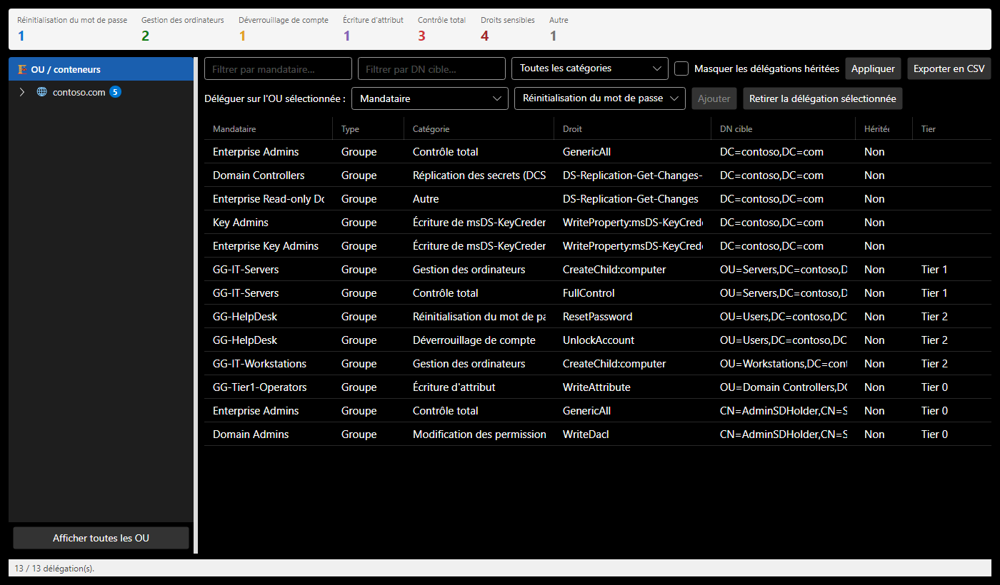

# Modéliser un domaine

SMAD-X ne se contente pas de dessiner un annuaire : il en modélise les **attributs de sécurité**, ceux-là mêmes qu'un attaquant exploite et que l'audit vérifie.

## Les objets

| Type | Rôle | Remarques |
|---|---|---|
| **Domaine** | racine, porte les délégations et les GPO liées au domaine | |
| **OU** | unité d'organisation : délégations, GPO, classement en tier | peut contenir des OU |
| **Conteneur** | `CN=` comme Users, Computers, System | ne peut pas contenir d'OU, comme dans un vrai AD |
| **Utilisateur**, **Ordinateur**, **gMSA** | comptes | options de compte, SPN, délégation Kerberos |
| **Groupe** | portée (domaine local, global, universel) et type (sécurité, distribution) | imbrication de groupes |
| **Stratégie (GPO)** | créée sous `System\Policies` | liée aux OU, au domaine ou aux sites |
| **PSO** | stratégie de mot de passe affinée | appliquée à des utilisateurs ou des groupes |

## La section Sécurité

Elle reprend les attributs réels d'Active Directory :

| Champ | Attribut AD | Ce qu'il permet de montrer |
|---|---|---|
| Compte désactivé | `userAccountControl` (ACCOUNTDISABLE) | un compte désactivé n'est pas un point d'entrée |
| Mot de passe non requis | `userAccountControl` (PASSWD_NOTREQD) | un mot de passe vide accepté |
| Le mot de passe n'expire jamais | `userAccountControl` (DONT_EXPIRE_PASSWORD) | point ANSSI pour les comptes privilégiés |
| Pré-authentification Kerberos non requise | `userAccountControl` (DONT_REQ_PREAUTH) | AS-REP roasting |
| Délégation non contrainte | `userAccountControl` (TRUSTED_FOR_DELEGATION) | vol de TGT |
| Délégation contrainte avec transition de protocole | `userAccountControl` (TRUSTED_TO_AUTH_FOR_DELEGATION) | usurpation vers un service |
| Compte sensible, ne peut pas être délégué | `userAccountControl` (NOT_DELEGATED) | protège un administrateur |
| SPN | `servicePrincipalName` | Kerberoasting |
| Mot de passe changé le, dernière connexion | `pwdLastSet`, `lastLogonTimestamp` | comptes dormants, krbtgt ancien |
| Délégation contrainte vers | `msDS-AllowedToDelegateTo` | délégation vers un contrôleur de domaine |
| adminCount | `adminCount` | objet protégé par AdminSDHolder |
| Propriétaire | propriétaire du descripteur de sécurité | un propriétaire peut réécrire les permissions |

Les options utilisent les vrais bits de `userAccountControl` : l'import PowerShell les reprend tels quels.

!!! tip "AdminSDHolder"
    Les membres des groupes protégés (Domain Admins, Account Operators, Backup Operators…) ont `adminCount = 1` : le processus SDProp leur applique les permissions d'AdminSDHolder et **coupe l'héritage**. SMAD-X en tient compte : une délégation posée sur une OU ne s'applique pas à ces objets. C'est ce qui explique pourquoi certains chemins d'attaque n'existent pas.

## Appartenances et relations

**Affichage > Gérer les relations...** (ou le bouton **Relations**) ouvre quatre onglets :

| Onglet | Usage |
|---|---|
| Utilisateur → Groupe | appartenance des comptes |
| Groupe → Groupe | imbrication des groupes |
| GPO → OU | liens de GPO vers les OU et le domaine |
| PSO | comptes et groupes soumis à une PSO |

L'audit et les chemins d'attaque calculent l'**appartenance effective** : un compte membre d'un groupe lui-même membre de Domain Admins est administrateur du domaine.

## Les délégations

**Analyse > Delegations** (`Ctrl+D`) liste les délégations : mandataire, droit, catégorie, DN cible, héritage, tier. On filtre par mandataire, cible ou catégorie, on masque les délégations héritées, et on exporte en CSV.

Pour **déléguer**, sélectionnez une OU à gauche, choisissez le mandataire et la catégorie (réinitialisation de mot de passe, gestion des ordinateurs, déverrouillage, écriture d'attribut, contrôle total), puis **Ajouter**. **Retirer la délégation sélectionnée** la supprime.

## Le modèle en tiers

Chaque objet est classé dans un tier, selon le modèle d'administration de Microsoft :

| Tier | Contenu |
|---|---|
| **Tier 0** | contrôleurs de domaine, comptes et groupes qui contrôlent l'annuaire |
| **Tier 1** | serveurs et applications |
| **Tier 2** | postes de travail et utilisateurs |

**Configuration > Gérer les tiers...** change les noms, les niveaux et les couleurs. L'audit vérifie le cloisonnement : un objet ne doit pas être membre d'un groupe plus sensible que lui (TIER-01), ni recevoir une délégation sur un objet plus sensible (TIER-03).
