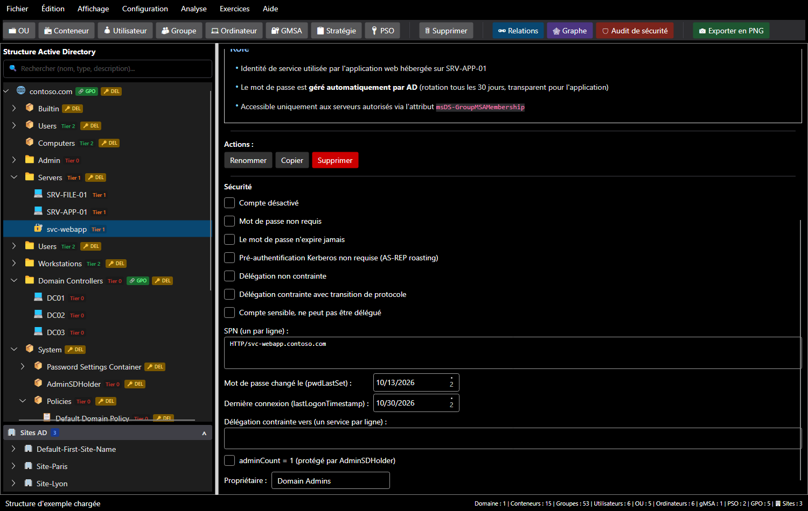
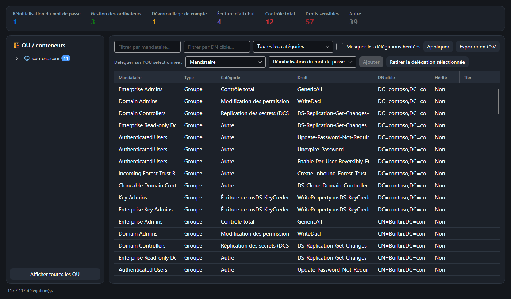
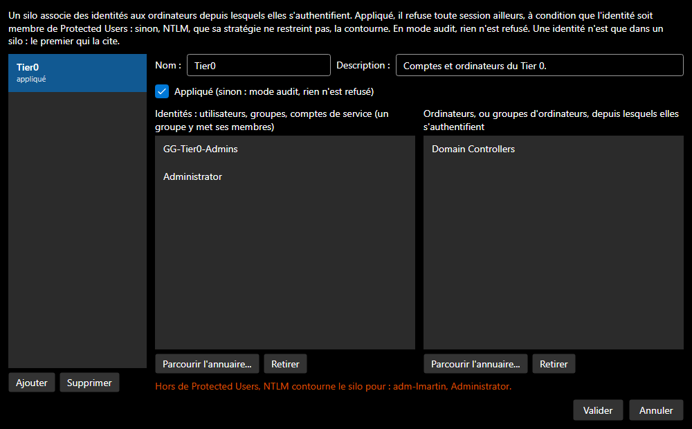
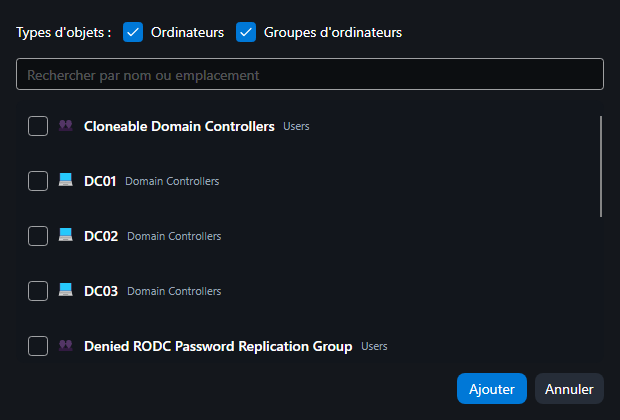

# Modéliser un domaine

SMAD-X ne se contente pas de dessiner un annuaire : il en modélise les **attributs de sécurité**, ceux-là mêmes qu'un attaquant exploite et que l'audit vérifie.

## Les objets

| Type | Rôle | Remarques |
|---|---|---|
| **Domaine** | racine, porte les délégations, les GPO liées et la politique de mot de passe par défaut | |
| **OU** | unité d'organisation : délégations, GPO, classement en tier | sous le domaine ou une autre OU |
| **Conteneur** | `CN=` comme Users, Computers, System | sous le domaine, une OU ou un conteneur ; ne contient jamais d'OU |
| **Utilisateur**, **Ordinateur**, **gMSA** | comptes | options de compte, SPN, délégation Kerberos ; pour un ordinateur, LAPS, administrateurs locaux et sessions |
| **Groupe** | portée (domaine local, global, universel) et type (sécurité, distribution) | imbrication selon la portée |
| **Stratégie (GPO)** | créée dans `CN=Policies,CN=System`, nulle part ailleurs | liée aux OU, au domaine ou aux sites |
| **PSO** | stratégie de mot de passe affinée, créée dans le Password Settings Container | appliquée à des utilisateurs ou des groupes |

Ces règles de placement sont celles du schéma d'AD : SMAD-X refuse une OU dans un conteneur, et les boutons **Stratégie** et **PSO** créent toujours l'objet dans son conteneur de System, quel que soit l'objet sélectionné.

## La politique de mot de passe

Sélectionnez le **domaine** : la section **Politique de mot de passe** du panneau donne la politique par défaut (Default Domain Policy), qui s'applique à tous les comptes sans PSO. Un **PSO** a la même section, avec sa priorité. Comme dans AD, la politique effective d'un compte est le PSO de plus petite priorité appliqué au compte lui-même, sinon à l'un de ses groupes, sinon celle du domaine. Domain Users compte parmi les groupes de tout utilisateur : c'est son groupe principal, même si l'attribut `member` du groupe ne le cite pas.

Le domaine porte aussi **ms-DS-MachineAccountQuota** : le nombre d'ordinateurs que tout utilisateur peut joindre au domaine (10 par défaut, à mettre à 0), et la version de Windows Server qui l'a promu, quand elle est connue.

Un domaine neuf garde les valeurs d'une installation (7 caractères, quota de 10) : l'audit le signale (règles PWD-08, PWD-09 et ACC-03).

## La section Sécurité

Elle reprend les attributs réels d'Active Directory :

| Champ | Attribut AD | Ce qu'il permet de montrer |
|---|---|---|
| Compte désactivé | `userAccountControl` (ACCOUNTDISABLE) | un compte désactivé n'est pas un point d'entrée |
| Mot de passe non requis | `userAccountControl` (PASSWD_NOTREQD) | un mot de passe vide accepté |
| Le mot de passe n'expire jamais | `userAccountControl` (DONT_EXPIRE_PASSWORD) | point ANSSI pour les comptes privilégiés |
| Pré-authentification Kerberos non requise | `userAccountControl` (DONT_REQ_PREAUTH) | AS-REP roasting |
| Délégation non contrainte | `userAccountControl` (TRUSTED_FOR_DELEGATION) | vol de TGT |
| Délégation contrainte avec transition de protocole | `userAccountControl` (TRUSTED_TO_AUTH_FOR_DELEGATION) | usurpation vers un service |
| Compte sensible, ne peut pas être délégué | `userAccountControl` (NOT_DELEGATED) | protège un administrateur |
| SPN | `servicePrincipalName` | Kerberoasting |
| Mot de passe changé le, dernière connexion | `pwdLastSet`, `lastLogonTimestamp` | comptes dormants, krbtgt ancien |
| Délégation contrainte vers | `msDS-AllowedToDelegateTo` | délégation vers un contrôleur de domaine |
| adminCount | `adminCount` | objet protégé par AdminSDHolder |
| Propriétaire | propriétaire du descripteur de sécurité | un propriétaire peut réécrire les permissions |

Pour un **ordinateur**, la partie **Ordinateur** ajoute :

| Champ | D'où il vient | Ce qu'il permet de montrer |
|---|---|---|
| LAPS gère le mot de passe de l'administrateur local, expiration | `msLAPS-PasswordExpirationTime` (Windows LAPS) ou `ms-Mcs-AdmPwdExpirationTime` (ancien LAPS) | sans LAPS, le même mot de passe sur toutes les machines (LAPS-01) ; qui peut lire le mot de passe LAPS en devient administrateur |
| Administrateurs locaux | groupe local Administrateurs, hors de l'annuaire | Domain Admins par défaut, Builtin Administrators sur un DC ; un groupe ajouté (par GPO) administre la machine |
| Sessions ouvertes | hors de l'annuaire (BloodHound les collecte sur les machines) | un administrateur connecté laisse ses identifiants en mémoire : son compte est à portée de tout administrateur de la machine (TIER-04) |

Pour une **GPO**, la partie **Effets sur les ordinateurs** reprend les paramètres qui changent les chemins d'attaque : les comptes et groupes à qui elle interdit d'ouvrir une session (en local, par le Bureau à distance), les membres qu'elle met dans le groupe local Administrateurs (en remplacement ou en ajout) et son filtre WMI (serveurs ou postes). Un compte refusé des deux façons n'ouvre pas de session sur les ordinateurs où la GPO s'applique. La section **Sécurité** d'un ordinateur montre ce que lui imposent les GPO (voir [Modèles de cloisonnement](cloisonnement.md#les-effets-des-gpo)).

Les options utilisent les vrais bits de `userAccountControl` : l'import PowerShell les reprend tels quels.

!!! tip "AdminSDHolder"
    Les membres des groupes protégés (Domain Admins, Account Operators, Backup Operators…) ont `adminCount = 1` : le processus SDProp leur applique les permissions d'AdminSDHolder et **coupe l'héritage**. SMAD-X en tient compte : une délégation posée sur une OU ne s'applique pas à ces objets. C'est ce qui explique pourquoi certains chemins d'attaque n'existent pas. Les contrôleurs de domaine, eux, ne sont pas protégés : ils ne sont membres de Domain Controllers que par leur groupe principal, que SDProp ignore.

## Appartenances et relations

**Affichage > Gérer les relations...** (ou le bouton **Relations**) ouvre quatre onglets :

| Onglet | Usage |
|---|---|
| Utilisateur → Groupe | appartenance des comptes |
| Groupe → Groupe | imbrication des groupes |
| GPO → OU | liens de GPO vers les OU et le domaine |
| PSO | comptes et groupes soumis à une PSO |

L'audit et les chemins d'attaque calculent l'**appartenance effective** : un compte membre d'un groupe lui-même membre de Domain Admins est administrateur du domaine.

Les imbrications suivent les portées d'AD (modèle AGDLP) : un groupe **global** ne contient que des comptes et des groupes globaux, un groupe **universel** accepte aussi des universels mais pas de domaine local, un groupe de **domaine local** accepte les trois. Une imbrication impossible est refusée avec son explication. Un gMSA peut être membre d'un groupe, comme un compte.

## Les délégations

**Analyse > Délégations...** (`Ctrl+D`) liste les délégations : mandataire, droit, catégorie, DN cible, héritage, tier. On filtre par mandataire, cible ou catégorie, on masque les délégations héritées, et on exporte en CSV. Les compteurs regroupent les catégories ; **Droits sensibles** compte celles qui donnent un objet ou ses secrets sans en avoir l'air.

| Catégorie | Droit AD | Ce qu'il donne |
|---|---|---|
| Réinitialisation du mot de passe | `ResetPassword` | le compte, en changeant son mot de passe |
| Gestion des ordinateurs | `CreateChild:computer` | joindre des machines au domaine |
| Déverrouillage de compte | `WriteProperty:lockoutTime` | débloquer un compte |
| Écriture d'attribut | `WriteProperty:<attribut>` | selon l'attribut |
| Modification des membres | `WriteProperty:member` | les droits du groupe |
| Contrôle total | `GenericAll` | tout |
| Écriture de tous les attributs | `GenericWrite` | SPN, msDS-KeyCredentialLink, membres, délégation : le contrôle de l'objet |
| Modification des permissions, changement de propriétaire | `WriteDacl`, `WriteOwner` | le contrôle total, en une étape |
| Réplication des secrets (DCSync) | `DS-Replication-Get-Changes-All` | sur la racine du domaine, les secrets de tous les comptes |
| Écriture de msDS-KeyCredentialLink | `WriteProperty:msDS-KeyCredentialLink` | s'authentifier comme le compte (Shadow Credentials) |
| Écriture de la délégation basée sur la ressource | `WriteProperty:msDS-AllowedToActOnBehalfOfOtherIdentity` | un ticket vers la machine au nom de n'importe qui (RBCD) |
| Écriture des SPN | `WriteProperty:servicePrincipalName` | Kerberoasting ciblé |
| Lecture du mot de passe LAPS, gMSA | `ReadProperty:msLAPS-Password`, `msDS-ManagedPassword` | l'administrateur local de la machine, le compte de service |
| Liaison de GPO | `WriteProperty:gPLink` | lier une GPO à l'OU ou au domaine |
| Tous les droits étendus | `AllExtendedRights` | réinitialiser les mots de passe, lire LAPS et, sur le domaine, répliquer |

Pour **déléguer**, sélectionnez une OU (ou le domaine) à gauche, choisissez le mandataire et la catégorie, puis **Ajouter**. **Retirer la délégation sélectionnée** la supprime, sur n'importe quel objet : une délégation posée sur un compte ou un ordinateur, lue par l'import, se retire aussi d'ici.

## Le modèle en tiers

Chaque objet est classé dans un tier, selon le modèle d'administration de Microsoft :

| Tier | Contenu |
|---|---|
| **Tier 0** | contrôleurs de domaine, comptes et groupes qui contrôlent l'annuaire |
| **Tier 1** | serveurs et applications |
| **Tier 2** | postes de travail et utilisateurs |

**Configuration > Gérer les tiers...** change les noms, les niveaux et les couleurs. L'audit vérifie le cloisonnement : un objet ne doit pas être membre d'un groupe plus sensible que lui (TIER-01), ni recevoir une délégation sur un objet plus sensible (TIER-03).

**Configuration > Appliquer un modèle de cloisonnement...** applique au domaine le modèle de Microsoft ou celui de HardenAD : ses OU par tier, ses groupes et comptes d'administration, ses GPO et ses délégations. L'audit vérifie ensuite que le domaine le respecte (TIER-05 à TIER-08). Voir [Modèles de cloisonnement](cloisonnement.md).

## Les silos d'authentification

Un silo de stratégies d'authentification associe des identités aux ordinateurs depuis lesquels elles s'authentifient : un administrateur du Tier 0 placé dans le silo du Tier 0 ne s'authentifie que depuis les contrôleurs de domaine et les postes d'administration du silo. Même volés, ses identifiants ne servent pas ailleurs, et il ne peut pas ouvrir de session sur un poste de travail. **Configuration > Silos d'authentification...** les gère :

| Champ | Ce qu'il change |
|---|---|
| **Appliqué** | coché, le silo refuse les sessions hors de ses ordinateurs ; décoché, il est en mode audit et ne refuse rien |
| **Identités** | les utilisateurs, groupes et comptes de service du silo ; un groupe y met ses membres (dans AD, chaque compte est ajouté un à un) |
| **Ordinateurs** | les ordinateurs, ou groupes d'ordinateurs, depuis lesquels les identités s'authentifient : ceux du silo, et ceux que sa stratégie autorise en plus |

**Parcourir l'annuaire...** ouvre la liste des objets du domaine qui peuvent rejoindre la liste : des cases pour n'afficher que certains types d'objets (utilisateurs, groupes et comptes de service, ou ordinateurs et groupes d'ordinateurs, ceux qui en contiennent), une recherche sur le nom ou l'emplacement, une case par objet.

La stratégie d'un silo ne restreint que Kerberos. Une identité qui peut encore s'authentifier par NTLM la contourne : SMAD-X ne refuse la session que pour un membre de **Protected Users**, qui n'utilise que Kerberos, et la fenêtre signale les identités du silo qui n'y sont pas.

Une identité n'est que dans un silo : le premier de la liste qui la cite. La section **Sécurité** d'un compte indique son silo et son mode ; celle d'un ordinateur, les sessions qu'un silo y refuse. Dans les chemins d'attaque, une session refusée par le silo du compte n'ouvre aucun chemin, comme une session qu'une GPO interdit. Dans un domaine qui a des silos, la règle TIER-09 signale un compte privilégié qui n'est dans aucun silo appliqué, ou qui n'est pas membre de Protected Users.
