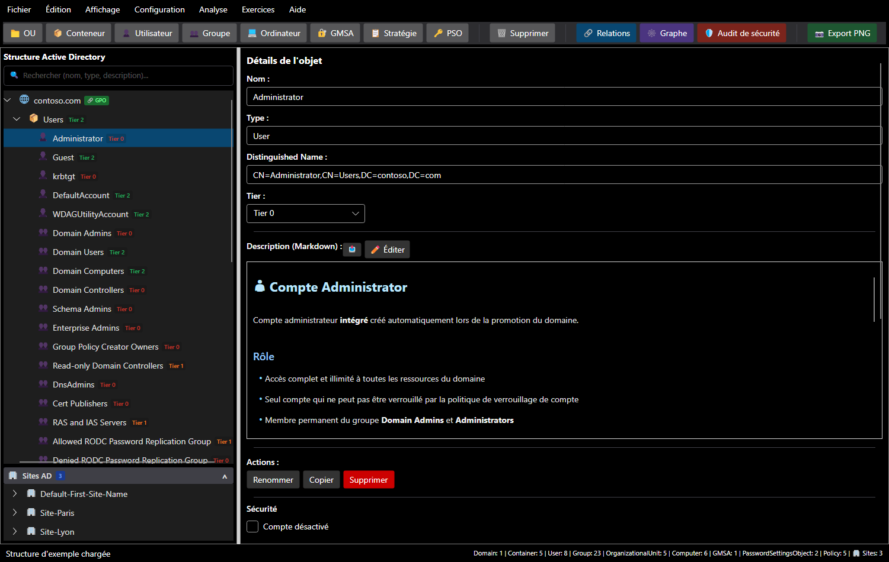
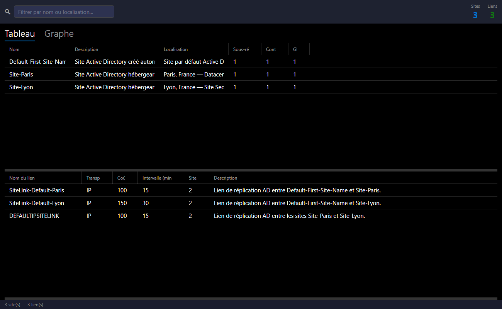

# Prise en main

## L'écran principal

| Zone | Rôle |
|---|---|
| **Menus** | Fichier, Édition, Affichage, Configuration, **Analyse**, **Exercices**, Aide |
| **Barre d'outils** | créer un objet (OU, conteneur, utilisateur, groupe, ordinateur, gMSA, stratégie, PSO) sous l'objet sélectionné ; Relations, Graphe, Audit de sécurité, Export PNG |
| **Structure Active Directory** | l'arbre du domaine, avec une barre de recherche (nom, type ou description) et des badges : tier, `GPO` liée, `DEL` délégation, `AUDIT` constat |
| **Sites AD** | sous l'arbre : les sites, leurs sous-réseaux et leurs contrôleurs de domaine |
| **Détails de l'objet** | nom, type, DN, tier, fiche Markdown, actions, section **Sécurité** |
| **Barre d'état** | dernier message et nombre d'objets par type |

## Un premier domaine

=== "Partir de l'exemple"

    Au démarrage, SMAD-X charge `contoso.com` : une structure d'AD complète, trois sites (Paris, Lyon et le site par défaut), des GPO et des PSO. **Fichier > Nouvelle structure (exemple)** (`Ctrl+Shift+N`) la recharge à tout moment.

=== "Créer un domaine"

    **Fichier > Nouveau domaine...** (`Ctrl+N`), saisissez le nom DNS (par exemple `corp.local`) et choisissez d'appliquer ou non le classement en tiers. SMAD-X crée ce qu'un AD contient juste après la promotion du premier contrôleur de domaine : Builtin, Users, Computers, Domain Controllers avec DC01, System (Policies, Password Settings Container), ForeignSecurityPrincipals.

=== "Ouvrir un fichier"

    **Fichier > Ouvrir...** (`Ctrl+O`) charge un `.smad-x.json`. Un fichier d'une ancienne version est converti à la lecture ; un fichier écrit par une version plus récente de SMAD-X est refusé avec un message clair.

## Ajouter et modifier des objets

1. Sélectionnez le conteneur parent dans l'arbre.
2. Cliquez sur le type d'objet dans la barre d'outils, ou faites un clic droit sur le parent.
3. Renseignez le panneau de détails. Le DN est calculé automatiquement.

| Action | Raccourci |
|---|---|
| Renommer | `F2` |
| Copier / coller (avec les enfants) | `Ctrl+C` / `Ctrl+V` |
| Supprimer | `Suppr` |
| Annuler / rétablir | `Ctrl+Z` / `Ctrl+Y` |

SMAD-X applique les règles d'AD : caractères interdits, longueur, unicité des noms, et types d'enfants autorisés (un conteneur ne peut pas contenir d'OU, par exemple).

## La fiche de chaque objet

Chaque objet porte une **description en Markdown**. Celles des objets intégrés sont déjà rédigées, en français et en anglais : rôle, points de sécurité, recommandations. Le bouton **Éditer** passe en édition, et **Fichier > Importer une description (.md)...** remplace la fiche par un fichier.

## Les sites AD

**Analyse > Voir les sites...** (`Ctrl+Shift+S`) gère la topologie : sites, sous-réseaux, contrôleurs de domaine, liens de réplication, avec un tableau et une vue graphique.

## Langue et thème

**Affichage > Langue** et **Affichage > Thème** changent la langue (français, anglais) et le thème (sombre, clair) sans redémarrer.

## Pour aller plus loin

- [Modéliser la sécurité d'un domaine](modelisation.md) : options de compte, délégations, propriétaires, tiers.
- [Auditer le domaine](audit.md).
- [Faire un premier exercice](exercices/index.md).
