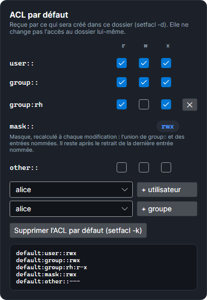

# Droits Linux

Sous Linux, la colonne de droite de SMAR-X modifie les droits du fichier ou du dossier choisi, comme le feraient `chown`, `chmod` et `setfacl`. Chaque modification s'applique aussitôt : le testeur, la matrice d'accès et la carte **Ce que recevrait un nouvel élément** se recalculent, et la carte **Commandes équivalentes** donne les commandes qui recréent l'état affiché.

## Le mode

La carte **Droits** donne la ligne `ls -l`, le propriétaire et le groupe, puis une grille **qui × r w x** : propriétaire, groupe, autres. Le mode octal (`chmod`) suit chaque case cochée. Les droits spéciaux sont en dessous :

- **setuid** : le programme s'exécute sous l'identité de son propriétaire ;
- **setgid** : ce qui est créé dans le dossier prend son groupe ;
- **sticky** : dans le dossier, seuls les propriétaires suppriment leurs fichiers.

## L'ACL POSIX

La carte **ACL POSIX** ajoute des entrées nommées (`user:bob`, `group:rh`) au mode. Comme `setfacl -m` :

- la première entrée crée l'ACL : les droits du groupe du mode deviennent ceux du groupe propriétaire (`group::`) ;
- chaque modification recalcule le **masque** : l'union de `group::` et des entrées nommées ;
- le masque limite les entrées nommées et le groupe propriétaire : une entrée qu'il réduit affiche son droit **effectif** en rouge ;
- avec une ACL, la ligne du groupe dans la grille du mode est le masque, comme dans `ls -l` ;
- **Supprimer l'ACL** fait comme `setfacl -b` : les droits du groupe propriétaire reviennent dans le mode.

## L'ACL par défaut

Pour un dossier, la carte **ACL par défaut** règle ce que recevra ce qui **sera créé** dans ce dossier (`setfacl -d`). Elle ne change rien à l'accès au dossier lui-même.

*Capture : `/srv/projets` donne à ce qui y sera créé `rwx` au propriétaire et au groupe projet, `r-x` au groupe rh, et rien aux autres.*

Elle se modifie comme avec `setfacl -d` :

- **Sans ACL par défaut**, ce qui est créé reçoit le mode demandé (`666` pour un fichier, `777` pour un dossier), moins l'umask du compte.
- **La première entrée** ajoutée crée l'ACL par défaut, avec une copie des droits du dossier : `user::` ceux du propriétaire, `group::` ceux du groupe propriétaire (celui de l'ACL d'accès, s'il y en a une), `other::` ceux des autres.
- **Le masque** est recalculé à chaque modification : l'union de `group::` et des entrées nommées. Il **reste** après le retrait de la dernière entrée nommée : ce qui est créé reçoit alors une ACL réduite à `group::` et au masque.
- **Supprimer l'ACL par défaut** fait comme `setfacl -k` : ce qui sera créé suit de nouveau l'umask.

Ce qui est créé reçoit l'ACL par défaut, limitée par le mode demandé : un fichier créé avec `666` n'a jamais `x`. L'umask ne compte pas. La carte **Ce que recevrait un nouvel élément** montre le résultat pour le compte choisi.

## Comment c'est vérifié

Le moteur Linux est comparé au vrai noyau (voir [Fidèle aux vrais systèmes](index.md#fidele-aux-vrais-systemes)). Les règles de l'ACL par défaut ci-dessus ont été relevées avec `setfacl` et `getfacl` dans un Debian 13 (paquet `acl` 2.3.2) : dossiers `0755` sans ACL et `0750` avec une ACL d'accès, ajout et retrait d'entrées, `setfacl -k`, puis un fichier créé. Le test `Linux_DefaultAcl_IsEditedLikeSetfaclD` rejoue ces cas dans l'éditeur et compare chaque ligne de `getfacl`.
