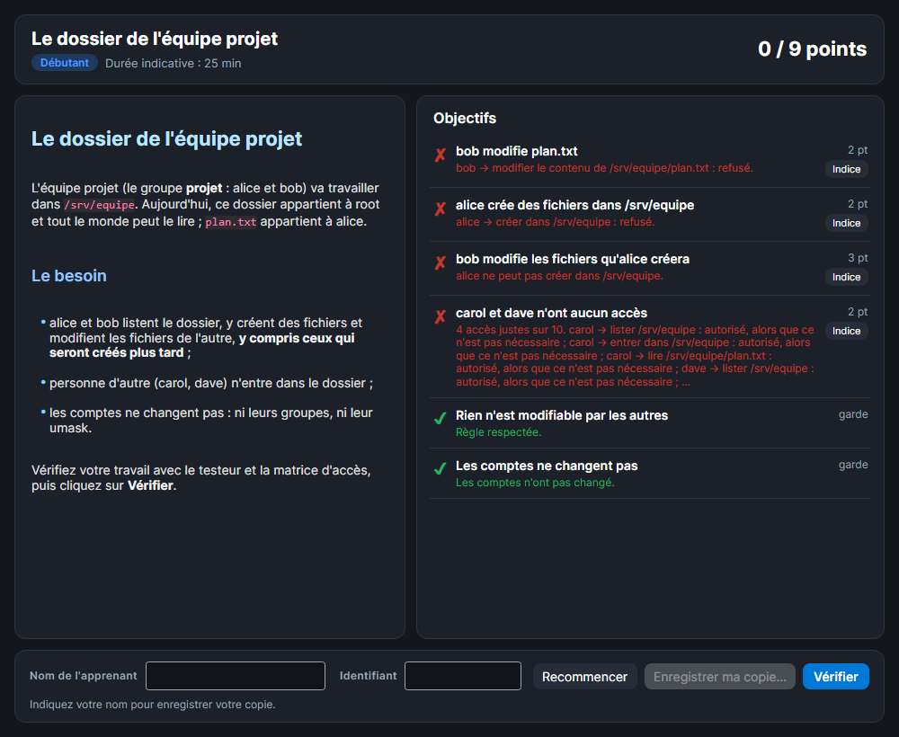

# Exercices

Un exercice SMAR-X décrit un besoin : qui doit pouvoir faire quoi, sur quoi, et rien de plus. L'apprenant règle les droits dans SMAR-X, puis **Vérifier** corrige son travail avec les moteurs du testeur, ceux qui sont comparés aux vrais systèmes.

*Capture : un exercice fourni, vérifié au départ. Rien n'est encore fait : aucun objectif n'est atteint, les gardes tiennent.*

## Ouvrir un exercice

Le bouton **Exercices** de l'en-tête propose :

- les exercices fournis avec SMAR-X ;
- **Ouvrir un fichier d'exercice (.smarx-lab.json)…**, pour un exercice donné par le formateur ;
- **Afficher l'exercice en cours** et **Quitter l'exercice**, pendant un exercice.

L'exercice remplace les serveurs de l'espace qu'il utilise (Linux, Windows ou les deux) par ses serveurs de départ, et l'arbre s'ouvre sur l'objet du premier objectif. La fenêtre de l'exercice s'ouvre à côté : l'apprenant travaille dans la fenêtre principale, comme d'habitude.

Pendant un exercice, **Serveur d'exemple** et **Ouvrir…** sont masqués : ils remplaceraient le travail de l'apprenant. **Quitter l'exercice** recharge les serveurs d'exemple.

## Les objectifs

| Objectif | Ce qui est vérifié |
|---|---|
| Accès autorisé | un compte peut faire une opération sur un objet, en local ou par un partage |
| Accès refusé | un compte ne peut pas la faire |
| Exactement les accès nécessaires | pour quelques comptes, objets et opérations : chaque accès est permis **si et seulement si** il est nécessaire. Sans crédit partiel, il faut que toutes les cases soient justes ; avec, chaque case juste rapporte sa part des points |
| Ce que reçoit un nouveau fichier | ce qu'un compte créera dans un dossier, un autre compte pourra le lire ou le modifier |
| Règle d'hygiène | une bonne pratique, voir plus bas |
| Garde | voir plus bas |

**Les règles d'hygiène :**

- Linux : rien n'est modifiable par les autres (`o+w`), sauf un dossier sticky comme `/tmp` ; aucun programme setuid ou setgid.
- Windows : ni Modification ni Contrôle total pour Tout le monde, Utilisateurs authentifiés ou Utilisateurs.
- Partage Windows : ni Modifier ni Contrôle total pour ces mêmes groupes, et Contrôle total aux seuls Administrateurs.

**Une garde** est marquée « garde ». Elle est respectée au départ et ne rapporte aucun point : elle interdit une solution de facilité, comme ouvrir un dossier à tous, ajouter un compte à un groupe ou changer des droits qui étaient justes. Violée, elle **annule** les objectifs qui portent sur le même compte ou le même chemin. Une garde « les comptes ne changent pas » porte sur leurs groupes, leur groupe principal et leur umask.

## Vérifier

**Vérifier** corrige tous les objectifs et les questions sur les serveurs tels qu'ils sont :

| Signe | Sens |
|---|---|
| ✔ | atteint |
| ◐ | atteint en partie : une part des points est acquise |
| ✘ | pas atteint |
| ○ | pas encore vérifié |

Chaque objectif dit pourquoi : l'accès testé et son résultat, les accès en trop ou qui manquent, la règle qui n'est pas respectée. Le score s'affiche en haut à droite.

- **Indice** ouvre l'indice d'un objectif ou d'une question. Les indices consultés sont notés dans la copie.
- **Recommencer** remet les serveurs de départ.
- Les **questions** de compréhension (choix, association, réponse écrite) sont corrigées avec les objectifs.

## La copie

Avec son nom, l'apprenant enregistre sa copie : **Enregistrer ma copie…** écrit un fichier `.smarx-submission.json`. Il contient l'exercice reçu, les serveurs de l'apprenant, ses réponses, les indices consultés, et la date de début et d'enregistrement. La copie est **scellée** : le sceau couvre tout son contenu, si bien qu'une copie retouchée à la main se repère à la correction. Le formateur crée les exercices et corrige les copies d'une classe dans [SMAD-X Studio](../exercices/studio.md#exercices-smar-x).

## Le mode examen

En examen, il n'y a ni indice, ni score, ni **Recommencer**. **Vérifier** n'est disponible que si le formateur l'a permis : il montre alors seulement les objectifs atteints, sans explication. L'apprenant enregistre sa copie et la rend au formateur.

L'exemplaire du formateur d'un examen contient le corrigé des questions : SMAR-X refuse de l'ouvrir. On distribue le sujet.

## Les exercices fournis

| Exercice | Niveau | Serveur | Thème |
|---|---|---|---|
| Le dossier de l'équipe projet | débutant | Linux | un dossier partagé par une équipe, y compris pour les fichiers à venir |
| Le partage du service RH | intermédiaire | Windows | un partage dédié à un service, au plus juste |
| Pourquoi carol n'écrit-elle pas ? | intermédiaire | Linux et Samba | diagnostiquer un accès refusé par un partage, puis le corriger sans rien donner de plus |

## Comment c'est vérifié

Les objectifs sont vérifiés par les moteurs du testeur, comparés aux vrais systèmes (voir [Fidèle aux vrais systèmes](index.md#fidele-aux-vrais-systemes)). Chaque exercice fourni est testé :

- il échoue au départ, et ses gardes tiennent ;
- sa solution, écrite seulement dans les tests, obtient tous les points ;
- les solutions de facilité sont rattrapées : ouvrir le dossier à tous, ajouter un compte au groupe, ouvrir le partage à Tout le monde.
