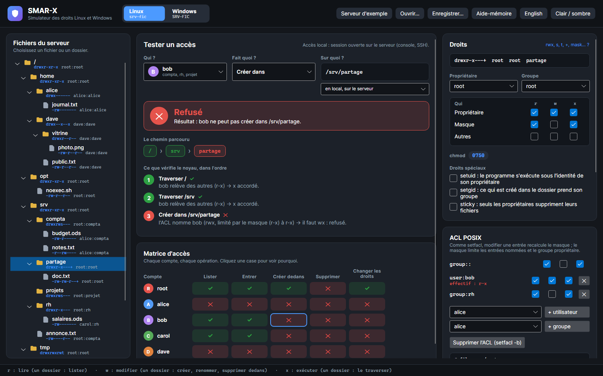

# SMAR-X

SMAR-X (*Simulate, Model and Audit Rights eXpert*) est la troisième application de la suite : un simulateur des **droits d'accès aux fichiers**, sous Linux et sous Windows. Il répond à une question : **qui peut faire quoi, sur quoi, et pourquoi** ? L'objectif est d'apprendre à donner seulement les droits nécessaires.

Un serveur Linux (`srv-fic`) et un serveur Windows (`SRV-FIC`) d'exemple s'ouvrent au démarrage. Le bouton **Linux / Windows** passe de l'un à l'autre, **Ouvrir...** et **Enregistrer...** lisent et écrivent un fichier `.smar-x.json`, **Aide-mémoire** explique chaque abréviation (`rwx`, `F`, `M`, `RD`, `(OI)`, `(CI)`…).

*Capture : bob crée un fichier dans `/srv/partage`. Le testeur montre chaque étape du noyau : l'ACL POSIX, puis le masque qui limite ce qu'elle accorde.*

## Ce que l'on fait dans chaque espace

| Zone | Linux | Windows |
|---|---|---|
| **Arborescence** | fichiers et dossiers, `ls -l` de chacun | fichiers et dossiers NTFS, propriétaire, héritage désactivé |
| **Testeur** | un compte, une opération, un chemin : autorisé ou refusé, avec chaque étape du noyau | la même chose avec AccessCheck : le jeton, puis chaque ACE dans l'ordre |
| **Matrice d'accès** | chaque compte, chaque opération ; un clic sur une case l'explique | idem |
| **Autorisations** | propriétaire, groupe, `chmod`, bits spéciaux, ACL POSIX et masque, ACL par défaut (voir [Droits Linux](droits-linux.md)) | l'[onglet Sécurité](onglet-securite.md) de l'Explorateur, et la liste des ACE comme `icacls` |
| **Création** | ce que recevrait un nouveau fichier : umask, setgid, ACL par défaut | ce que recevrait un nouveau fichier : héritage, CREATOR OWNER |
| **Commandes** | `chmod`, `chown`, `setfacl` qui recréent l'état affiché | `icacls` qui recrée l'état affiché |
| **Comptes** | comptes, groupes, `usermod`, `useradd`, `groupadd` | comptes du serveur et du domaine, groupes globaux, de domaine local et locaux, imbriqués selon AGDLP (voir [Les groupes : AGDLP](regles-windows.md#les-groupes-agdlp)) ; `Add-ADGroupMember`, `net localgroup` ; le [whoami](regles-windows.md#whoami-le-jeton-dun-compte) de chaque compte |

Sous **D'où ?**, le testeur choisit l'origine de l'accès : **Sur le serveur** (une session ouverte sur le serveur), ou **Depuis le réseau**, par un partage : **SMB** sous Windows (voir [Accès par un partage](partages.md)), **Samba** sous Linux (voir [Partage Samba](samba.md)).

Le bouton **Exercices** ouvre un exercice : un besoin à satisfaire avec seulement les droits nécessaires, corrigé par **Vérifier** (voir [Exercices](exercices.md)).

## Fidèle aux vrais systèmes

Les moteurs de SMAR-X ne sont pas écrits « de mémoire » : leurs résultats sont comparés à ceux de vrais systèmes. Les relevés sont figés dans les tests (`SMAR-X.Tests/Fidelity`), qui échouent si le simulateur s'en écarte.

| Système réel | Ce qui est comparé | Outil |
|---|---|---|
| Noyau Linux 6.19, Debian 13, `setfacl` 2.3.2 | 925 accès et 140 créations sur le serveur d'exemple | `tools/SmarxKernelCheck` |
| Samba 4.22, Debian 13 | 20 connexions, 160 opérations et 72 créations par les partages, sous chaque compte | `tools/SmarxSambaCheck` |
| Windows Server 2025 (contrôleur de domaine) | 1 512 ouvertures de fichiers et de dossiers sous le jeton de chaque compte, les propriétaires, les ACL dans leur ordre réel | `tools/SmarxWindowsCheck` |
| Windows Server 2025, depuis un Windows 11 du domaine | 1 540 ouvertures par les partages et 50 dossiers listés, sous l'identité réseau de chaque compte | `tools/SmarxWindowsCheck --network` |
| Windows 11 (Explorateur) | l'onglet Sécurité : 96 vues de comptes, 103 entrées de la fenêtre Avancé, 8 séquences de cases cochées | `tools/SmarxSecurityTabCheck` |

Ce que ces comparaisons ont appris sur Windows est décrit dans [Règles de Windows vérifiées](regles-windows.md).
