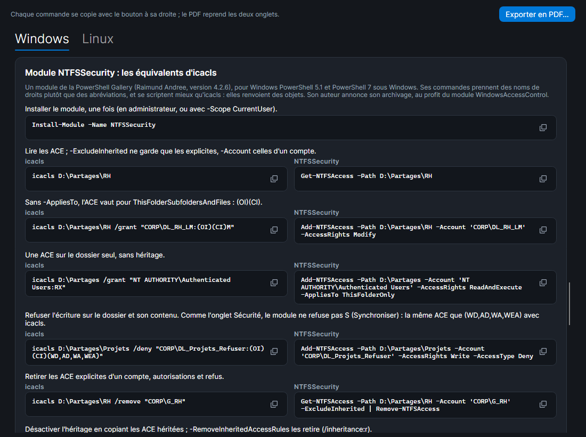

# SMAR-X

SMAR-X (*Simulate, Model and Audit Rights eXpert*) est la troisième application de la suite [SMA-X](../index.md) : un simulateur des **droits d'accès aux fichiers**, sous Linux et sous Windows. Il répond à une question : **qui peut faire quoi, sur quoi, et pourquoi** ? L'objectif est d'apprendre à donner seulement les droits nécessaires.

Un serveur Linux (`srv-fic`) et un serveur Windows (`SRV-FIC`) d'exemple s'ouvrent au démarrage. Le bouton **Linux / Windows** passe de l'un à l'autre, **Ouvrir...** et **Enregistrer...** lisent et écrivent un fichier `.smar-x.json`, **Aide-mémoire** explique chaque abréviation (`rwx`, `F`, `M`, `RD`, `(OI)`, `(CI)`…) et donne des commandes d'exemple (voir [L'aide-mémoire](#laide-memoire)).

*Capture : bob crée un fichier dans `/srv/partage`. Le testeur montre chaque étape du noyau : l'ACL POSIX, puis le masque qui limite ce qu'elle accorde.*

## Ce que l'on fait dans chaque espace

| Zone | Linux | Windows |
|---|---|---|
| **Arborescence** | fichiers et dossiers, `ls -l` de chacun | fichiers et dossiers NTFS, propriétaire, héritage désactivé |
| **Testeur** | un compte, une opération, un chemin : autorisé ou refusé, avec chaque étape du noyau | la même chose avec AccessCheck : le jeton, puis chaque ACE dans l'ordre |
| **Matrice d'accès** | chaque compte, chaque opération ; un clic sur une case l'explique | idem |
| **Autorisations** | propriétaire, groupe, `chmod`, bits spéciaux, ACL POSIX et masque, ACL par défaut (voir [Droits Linux](droits-linux.md)) | l'[onglet Sécurité](onglet-securite.md) de l'Explorateur, et la liste des ACE comme `icacls` |
| **Création** | ce que recevrait un nouveau fichier : umask, setgid, ACL par défaut | ce que recevrait un nouveau fichier : héritage, CREATOR OWNER |
| **Commandes** | `chmod`, `chown`, `setfacl` qui recréent l'état affiché | `icacls` qui recrée l'état affiché |
| **Comptes** | comptes, groupes, `usermod`, `useradd`, `groupadd` | comptes du serveur et du domaine, groupes globaux, de domaine local et locaux, imbriqués selon AGDLP, dans la fenêtre [Comptes et groupes](regles-windows.md#la-fenetre-comptes-et-groupes), comme la console Active Directory ; `Add-ADGroupMember`, `net localgroup` ; le [whoami](regles-windows.md#whoami-le-jeton-dun-compte) de chaque compte |

Chaque bloc de commandes (`chmod`, `setfacl`, `icacls`, PowerShell, section de `smb.conf`…) a, à sa droite, un bouton qui le **copie dans le presse-papiers** : une coche confirme la copie. On le colle ensuite dans un terminal du labo.

Sous **D'où ?**, le testeur choisit l'origine de l'accès : **Sur le serveur** (une session ouverte sur le serveur), ou **Depuis le réseau**, par un partage : **SMB** sous Windows (voir [Accès par un partage](partages.md)), **Samba** sous Linux (voir [Partage Samba](samba.md)).

Le bouton **Exercices** ouvre un exercice : un besoin à satisfaire avec seulement les droits nécessaires, corrigé par **Vérifier** (voir [Exercices](exercices.md)).

## L'aide-mémoire

**Aide-mémoire** ouvre une fenêtre à deux onglets, **Windows** et **Linux**. Chacun explique d'abord les abréviations que montre SMAR-X, puis donne des commandes d'exemple sur les serveurs d'exemple : pour chacune, ce qu'elle fait, puis la commande, avec un bouton qui la copie.

- **Windows** : `icacls` (donner, remplacer, refuser, retirer, héritage, propriétaire, sauvegarde) ; PowerShell sans module (`Get-Acl`, `Set-Acl`, `New-SmbShare`, `Grant-SmbShareAccess`, `Add-ADGroupMember`, `whoami /groups`) ; le module **NTFSSecurity**, chaque commande en face de son équivalent `icacls`, puis les valeurs de `-AppliesTo` en face des drapeaux d'héritage, et celles de `-AccessRights` en face des abréviations.
- **Linux** : `ls`, `stat`, `chown`, `chmod` (octal, lettres, `X`, setgid, sticky), `getfacl` et `setfacl` (ACL, ACL par défaut, récursif, sauvegarde et restauration), `umask`, les groupes d'un compte (`id`, `usermod -aG`), et `testparm`, `smbpasswd`, `smbcontrol` pour Samba.

NTFSSecurity est un module de la PowerShell Gallery (`Install-Module -Name NTFSSecurity`), pour Windows PowerShell 5.1 et PowerShell 7 sous Windows. Ses commandes prennent des noms de droits (`Modify`, `ReadAndExecute`) et renvoient des objets : elles se scriptent mieux qu'`icacls`. Son auteur annonce son archivage, au profit du module WindowsAccessControl. SMAR-X montre ces commandes, il ne les exécute pas. Chacune a été rejouée sur un vrai système (voir [Fidèle aux vrais systèmes](#fidele-aux-vrais-systemes)). Le refus d'écriture du module laisse la même ACE qu'`icacls` (WD,AD,WA,WEA), sans S. `Enable-NTFSAccessInheritance` laisse les mêmes ACE qu'`/inheritance:e`, mais rangées dans un autre ordre.

**Exporter en PDF…** enregistre les deux onglets dans un PDF, dans la langue de l'interface. En tête, le bouclier de SMAR-X et d'où vient le document : SMAR-X et sa version, la suite SMA-X et son [dépôt GitHub](https://github.com/JM2K69/SMAD-X), la date. Chaque page porte en bas la provenance et son numéro (« page 3 / 13 »).

*Capture : l'onglet Windows, aux équivalents `icacls` du module NTFSSecurity.*

## Fidèle aux vrais systèmes

Les moteurs de SMAR-X ne sont pas écrits « de mémoire » : leurs résultats sont comparés à ceux de vrais systèmes. Les relevés sont figés dans les tests (`SMAR-X.Tests/Fidelity`), qui échouent si le simulateur s'en écarte.

| Système réel | Ce qui est comparé | Outil |
|---|---|---|
| Noyau Linux 6.19, Debian 13, `setfacl` 2.3.2 | 925 accès et 140 créations sur le serveur d'exemple | `tools/SmarxKernelCheck` |
| Samba 4.22, Debian 13 | 20 connexions, 160 opérations et 72 créations par les partages, sous chaque compte | `tools/SmarxSambaCheck` |
| Windows Server 2025 (contrôleur de domaine) | 1 512 ouvertures de fichiers et de dossiers sous le jeton de chaque compte, les propriétaires, les ACL dans leur ordre réel | `tools/SmarxWindowsCheck` |
| Windows Server 2025, depuis un Windows 11 du domaine | 1 540 ouvertures par les partages et 50 dossiers listés, sous l'identité réseau de chaque compte | `tools/SmarxWindowsCheck --network` |
| Windows 11 (Explorateur) | l'onglet Sécurité : 96 vues de comptes, 103 entrées de la fenêtre Avancé, 8 séquences de cases cochées | `tools/SmarxSecurityTabCheck` |
| Windows 11 (`icacls`) | l'affichage des droits : les 16 383 combinaisons des droits spéciaux, autorisées et refusées, et les drapeaux d'héritage | `tools/SmarxWindowsCheck/icacls-display.ps1` |
| Windows 11 (PowerShell 5.1, NTFSSecurity 4.2.6) et Debian 13 | les 50 commandes de l'aide-mémoire, chacune telle qu'elle est écrite : elle fait ce qui est dit, et chaque commande NTFSSecurity laisse les mêmes ACE que son équivalent `icacls` | `tools/SmarxGlossaryCheck` |

Ce que ces comparaisons ont appris sur Windows est décrit dans [Règles de Windows vérifiées](regles-windows.md). Ce que SMAR-X ne simule pas est rassemblé dans [Limites](limites.md).
