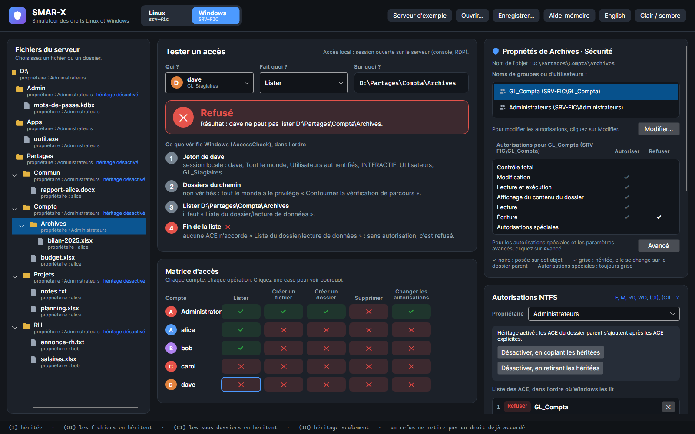
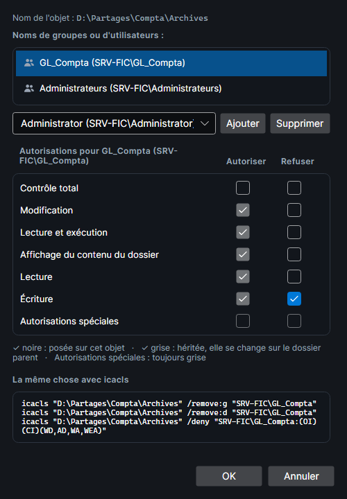
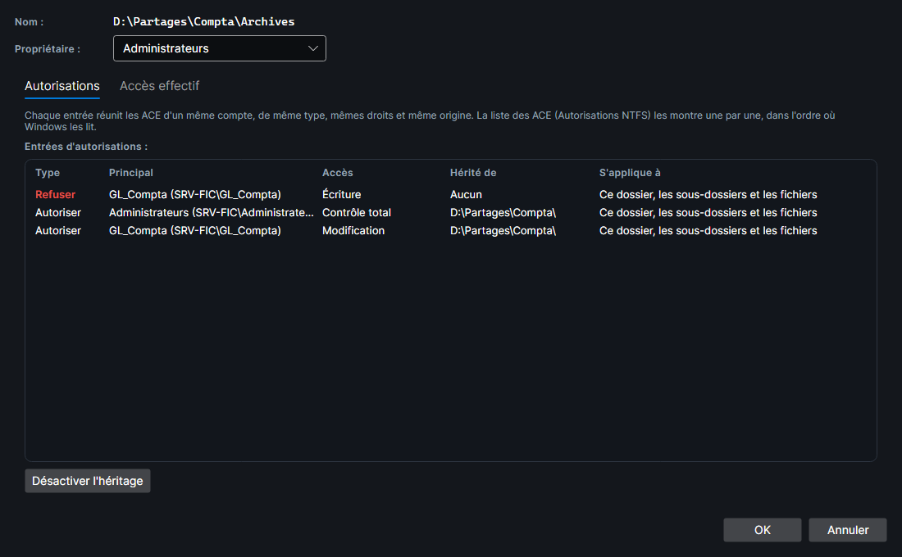

# L'onglet Sécurité

Sous Windows, SMAR-X montre en haut de la colonne **Autorisations** la carte **Propriétés de … · Sécurité**, comme l'onglet **Sécurité** des Propriétés de l'Explorateur. Ses boutons **Modifier…** et **Avancé** ouvrent les mêmes fenêtres que Windows. Tout ce que décrit cette page a été relevé sur un vrai Windows 11 (voir [Comment c'est vérifié](#comment-cest-verifie)).

*Capture : GL_Compta reçoit Modification de Compta par héritage (coches grises) ; sur Archives même, une ACE refuse l'Écriture (coche pleine).*

## La liste des comptes

**Noms de groupes ou d'utilisateurs** donne chaque compte cité par une ACE de l'objet, explicite ou héritée. Les identités prédéfinies s'affichent seules (**Tout le monde**, **Système**, **Utilisateurs authentifiés**) ; un groupe intégré, un compte ou un groupe local, avec le nom du serveur : **Administrateurs (SRV-FIC\Administrateurs)**.

L'ordre est celui de Windows : les comptes sont **rangés par SID, écrit en texte**. Tout le monde (`S-1-1-0`) passe ainsi avant CREATOR OWNER (`S-1-3-0`), Utilisateurs authentifiés (`S-1-5-11`) avant Système (`S-1-5-18`), et les comptes et groupes locaux (`S-1-5-21-…`) avant les groupes intégrés Administrateurs et Utilisateurs (`S-1-5-32-…`).

## Les coches

Pour le compte choisi, chaque autorisation de base a une coche **Autoriser** et une coche **Refuser** :

| Ligne | Droits | Cibles d'un dossier |
|---|---|---|
| Contrôle total | `F` | ce dossier, les sous-dossiers, les fichiers |
| Modification | `M` | ce dossier, les sous-dossiers, les fichiers |
| Lecture et exécution | `RX` | ce dossier, les sous-dossiers, les fichiers |
| Affichage du contenu du dossier | `RX` | ce dossier et les sous-dossiers seulement (un dossier n'a pas de fichiers à lire) |
| Lecture | `R` | ce dossier, les sous-dossiers, les fichiers |
| Écriture | `W` | ce dossier, les sous-dossiers, les fichiers |
| Autorisations spéciales | tout le reste | |

Un fichier n'a pas la ligne **Affichage du contenu du dossier**, et une seule cible : lui-même.

**Une ligne est cochée quand les ACE du compte, d'un même type, donnent tous ses droits à chacune de ses cibles.** Les ACE peuvent s'additionner : `RX (OI)` (ce dossier et les fichiers) plus `RX (CI)` (ce dossier et les sous-dossiers) cochent **Lecture et exécution**. Deux détails :

- **(NP)** ne change rien aux coches : `RX (OI)(CI)(NP)` coche Lecture et exécution sur le dossier qui porte l'ACE ;
- **Synchroniser** ne compte pas : le refus `(WD,AD,WA,WEA)` coche **Refuser Écriture**, bien que l'Écriture comprenne Synchroniser.

**Autorisations spéciales** est cochée dès qu'il reste des droits qu'aucune ligne cochée n'explique : un droit en plus, ou une portée incomplète. Exemples relevés :

| ACE du compte | Coches |
|---|---|
| `M (OI)(CI)` | Modification, Lecture et exécution, Affichage du contenu du dossier, Lecture, Écriture |
| `RX (OI)(CI)` | Lecture et exécution, Affichage du contenu du dossier, Lecture |
| `RX (CI)` | Affichage du contenu du dossier |
| `RX (OI)`, `RX` sur ce dossier seulement, `RX (OI)(CI)(IO)` | Autorisations spéciales : une cible manque |
| `(RX,DC) (OI)(CI)` | Lecture et exécution, Affichage du contenu du dossier, Lecture, Autorisations spéciales (le droit DC en plus) |
| `(RX,W) (OI)(CI)` | Lecture et exécution, Affichage du contenu du dossier, Lecture, Écriture : pas Modification, il manque Suppression |
| `M (CI)` | Affichage du contenu du dossier, Autorisations spéciales |
| `(RD) (OI)(CI)`, `(RC) (OI)(CI)` | Autorisations spéciales |
| `M` sur ce dossier + `M (OI)(IO)` + `M (CI)(IO)` | comme `M (OI)(CI)` : les trois ACE couvrent les trois cibles |
| Refuser `F (OI)(CI)` | toutes les lignes, côté Refuser |

### Noire ou grise

Les ACE héritées et les ACE explicites se lisent **à part** :

- une coche que l'**héritage** suffit à donner est **grise** : elle se change sur le dossier parent ;
- une coche que seules les ACE **explicites** de l'objet donnent est **pleine** (noire, ou claire en thème sombre).

Si l'héritage et une ACE explicite donnent tous deux la même ligne, la coche reste grise. **Autorisations spéciales** est **toujours grise**, même pour une ACE explicite.

## La fenêtre Modifier

**Modifier…** ouvre **Autorisations pour …**. Les coches y deviennent des cases :

- une case que **seul l'héritage** coche est **grisée** : on ne peut pas la décocher ici ;
- une case qu'une ACE explicite coche reste active, même si l'héritage la donne aussi ;
- **Autorisations spéciales** ne se coche jamais ici.

*Capture : Modification héritée, cases grisées ; le refus d'Écriture, posé sur Archives, reste modifiable.*

Windows ne se contente pas d'ajouter ou de retirer des droits : il **réécrit les ACE explicites du compte**. SMAR-X fait de même :

1. **Décocher** une case décoche aussi celles qui la contiennent sur la même portée. Décocher Lecture décoche Lecture et exécution, Modification et Contrôle total ; Affichage du contenu du dossier reste cochée, car elle ne vise pas les fichiers.
2. **Cocher** une case d'une colonne décoche, dans l'autre colonne, toutes celles qui partagent des droits avec elle : refuser la Lecture ne laisse, côté Autoriser, que l'Écriture.
3. Les ACE explicites du compte sont **réécrites** dans chaque colonne touchée : **une ACE par portée**, avec les lignes qui restent cochées. Une ligne contenue dans une autre n'ajoute rien. Les nouvelles ACE vont **en fin de liste**.
4. Un refus **omet Synchroniser**, sauf **Contrôle total**.

Séquences relevées sur un dossier où Users a Modification explicite :

| On clique | Windows écrit pour Users |
|---|---|
| Refuser Écriture | Refuser `(WD,AD,WA,WEA)` ; Autoriser `RX` (Modification perd Écriture et Suppression) |
| Refuser Lecture | Refuser `(RD,REA,RA,RC)` ; Autoriser `W` |
| Refuser Affichage du contenu du dossier | Refuser `(CI)(RD,REA,X,RA,RC)` ; Autoriser `W` |
| Refuser Contrôle total | Refuser `F`, Synchroniser compris ; plus aucune autorisation |
| décocher Autoriser Écriture | Autoriser `RX` |
| décocher Autoriser Lecture | Autoriser `(CI) RX` et `(OI)(CI) W` |
| décocher Modification, puis Affichage du contenu du dossier | Autoriser `R` + `W` en une ACE |
| cocher Autoriser Contrôle total | Autoriser `F` |

Quand on coche un refus, Windows avertit : *« Vous définissez une entrée d'autorisation de refus. Les entrées de refus sont prioritaires sur les entrées d'autorisation »*. SMAR-X affiche cet avertissement avec sa nuance : une autorisation **explicite** est lue avant un refus **hérité**, et l'emporte (voir [Règles de Windows vérifiées](regles-windows.md#accesscheck-lordre-des-ace)).

**Ajouter** donne au compte choisi Lecture et exécution (avec Affichage du contenu du dossier et Lecture), comme Windows. **Supprimer** retire ses ACE explicites, sauf s'il a aussi des ACE héritées : Windows le refuse alors, il faut d'abord désactiver l'héritage.

Sous les cases, **La même chose avec icacls** donne les commandes qui écrivent les mêmes ACE pour ce compte : `/grant:r` (et `/grant` pour une seconde portée), `/remove:d` puis `/deny`. **OK** garde les changements ; **Annuler**, ou la croix, remet l'objet comme il était.

## La fenêtre Avancé

**Avancé** ouvre **Paramètres de sécurité avancés pour …** :

- **Propriétaire** : il se change dans la liste (`icacls … /setowner`).
- **Entrées d'autorisations** : les ACE d'un même compte, de même type, mêmes droits et même origine sont **fusionnées** en une entrée, leurs portées réunies. `RX (OI)` + `RX (CI)` donnent une entrée « Ce dossier, les sous-dossiers et les fichiers ». La liste des ACE de la colonne Autorisations, elle, les montre une par une, dans l'ordre de la DACL.
- **Accès** : le nom d'une autorisation de base, **Affichage du contenu du dossier** pour `RX` sur ce dossier et les sous-dossiers, **Lecture, écriture et exécution** pour `RX` + `W`, le nom d'un droit spécial s'il est seul (**Liste du dossier/lecture de données**, **Autorisations de lecture**), sinon **Spéciale**.
- **Hérité de** : **Aucun** pour une ACE explicite, sinon le dossier qui la porte, terminé par `\`.
- **S'applique à** : la portée, sans (NP), que Windows ne montre que dans le détail d'une entrée. Un fichier n'a pas cette colonne.
- **Désactiver l'héritage** pose la question de Windows : **Convertir les autorisations héritées en autorisations explicites sur cet objet** (`icacls … /inheritance:d`) ou **Supprimer toutes les autorisations héritées de cet objet** (`/inheritance:r`). **Activer l'héritage** les fait revenir (`/inheritance:e`).
- L'onglet **Accès effectif** donne, pour un compte (et une session élevée ou non), chacun des 14 droits spéciaux à l'ouverture de l'objet. Quand le droit vient du dossier parent, SMAR-X l'indique : « (par le dossier parent) ».

Windows range les entrées de cette fenêtre à sa façon ; SMAR-X garde l'ordre de la DACL, celui qu'AccessCheck lit.

## Comment c'est vérifié

`tools/SmarxSecurityTabCheck` recrée sur un Windows 11 un dossier où chaque compte a des ACE choisies pour cette vérification : une autorisation de base, une portée incomplète, (NP), (IO), un droit en plus, deux ACE complémentaires, un refus. Il ajoute un sous-dossier qui en hérite, avec une ACE explicite en plus, et deux fichiers.

L'outil ouvre les vraies fenêtres Propriétés de l'Explorateur dans la session de l'administrateur et les lit par UI Automation et MSAA. Les coches sont noires ou grises selon la couleur de leurs pixels. Il clique aussi des cases de la fenêtre Modifier, puis relit la DACL écrite.

Le relevé est figé dans `SMAR-X.Tests/Fidelity/windows-security-tab.txt`, que les tests rejouent coche par coche, entrée par entrée et clic par clic.
