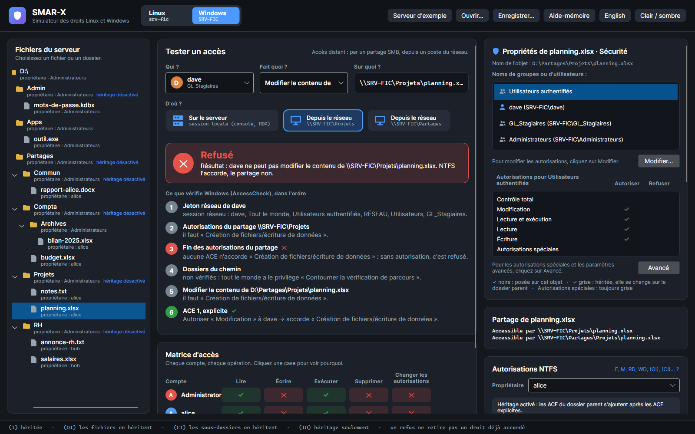
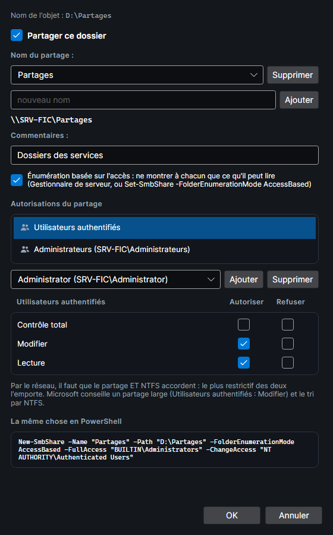

# Accès par un partage

Depuis un poste du réseau, on n'ouvre pas `D:\Partages\Projets\planning.xlsx` : on ouvre `\\SRV-FIC\Projets\planning.xlsx`. Windows ajoute alors une couche aux autorisations NTFS : celles du **partage**. Tout ce que décrit cette page a été vérifié sur un vrai serveur (voir [Comment c'est vérifié](#comment-cest-verifie)).

## Tester un accès par le réseau

Sous **D'où ?**, le testeur montre d'où vient l'accès, en cartes : **Sur le serveur** (icône de serveur), pour une session ouverte sur le serveur, puis **Depuis le réseau** (icône de poste) pour chaque partage qui contient l'objet, du plus proche au plus large ; la carte donne le partage (`\\SRV-FIC\Projets`). La carte choisie est encadrée, et son infobulle donne le chemin complet. Par un partage, le testeur montre le jeton réseau, les autorisations du partage, ce que cache l'énumération basée sur l'accès, puis les étapes NTFS habituelles ; le verdict dit lequel des deux refuse. La matrice d'accès suit le même chemin.

*Capture : NTFS laisse dave modifier `planning.xlsx`, mais le partage Projets ne donne que Lecture : par `\\SRV-FIC\Projets`, c'est refusé.*

## Le plus restrictif l'emporte

Par le réseau, chaque ouverture passe **deux** AccessCheck : la DACL du partage, puis celle du fichier ou du dossier. Il faut que **les deux** accordent le droit demandé.

| Autorisation de partage | Droits accordés |
|---|---|
| Lecture | `RX` : lire, exécuter, lister |
| Modifier | `M` : Lecture, plus écrire et supprimer |
| Contrôle total | `F` : Modifier, plus changer les autorisations et prendre possession |

Le serveur d'exemple montre les deux façons de faire :

| Partage | Autorisations du partage | Idée |
|---|---|---|
| `Partages` (`D:\Partages`) | Utilisateurs authentifiés : Modifier ; Administrateurs : Contrôle total ; énumération basée sur l'accès | un partage large, comme le conseille Microsoft : NTFS fait le tri |
| `Projets` (`D:\Partages\Projets`) | Tout le monde : Lecture | le même dossier par un autre partage : le même fichier, un autre résultat |
| `Compta$` (`D:\Partages\Compta`) | GL_Compta : Modifier ; Administrateurs : Contrôle total | le moindre privilège des deux côtés ; `$` cache le partage de la liste du serveur |
| `Apps` (`D:\Apps`) | Tout le monde : Lecture | ce que Windows propose quand on partage un dossier |

dave peut modifier `planning.xlsx` en local et par `\\SRV-FIC\Partages\Projets`, mais pas par `\\SRV-FIC\Projets`.

## Le jeton réseau

- Le jeton d'une session réseau contient **RÉSEAU** à la place d'**INTERACTIF**, avec le compte, ses groupes, Tout le monde, Utilisateurs authentifiés et Utilisateurs.
- **Restrictions distantes de l'UAC** : pour un **compte local** membre d'Administrateurs, le groupe Administrateurs est en « refus seulement », et aucune élévation n'est possible à distance. Le compte **Administrator** intégré et un **compte du domaine** ne sont pas filtrés : ils gardent leurs privilèges, et **Prendre possession** vaut même par un partage qui ne donne que Lecture.
- Si le partage n'accorde **aucun** droit au compte, la **connexion** au partage est refusée.

## L'énumération basée sur l'accès

Avec l'**énumération basée sur l'accès** (ABE), un dossier listé par le partage ne montre que ce que le compte peut lire (**Liste du dossier/lecture de données** sur l'entrée). Par `\\SRV-FIC\Partages`, alice voit Commun, Compta et Projets, pas RH.

L'ABE ne fait pas que cacher :

- un objet caché, dans un dossier que le compte **peut lister**, est **introuvable** même par son chemin, quel que soit le droit demandé, y compris **Attributs de lecture**, que NTFS accorderait par le dossier parent ;
- si le compte **ne peut pas lister** le dossier, l'accès est simplement **refusé** ;
- un fichier lisible reste accessible dans un dossier caché : alice lit `\\SRV-FIC\Partages\RH\annonce-rh.txt`.

## Le dossier d'un partage

Un dossier partagé ne s'ouvre pas pour être supprimé tant qu'un client est connecté au partage : le serveur le garde ouvert (violation de partage). Par son propre partage, c'est donc toujours le cas.

## La fenêtre Partage avancé

La carte **Partage de …** donne le chemin réseau de l'objet, s'il est partagé, et les partages plus larges qui y mènent. Pour un dossier, **Partage avancé…** ouvre la fenêtre de Windows :

- **Partager ce dossier** crée un partage du nom du dossier, avec **Lecture pour Tout le monde**, comme Windows. Un dossier peut avoir plusieurs noms de partage : **Ajouter** et **Supprimer**.
- **Commentaires** et **Énumération basée sur l'accès** (dans Windows : le Gestionnaire de serveur, ou `Set-SmbShare -FolderEnumerationMode AccessBased`).
- **Autorisations du partage** : pour chaque compte, Contrôle total, Modifier et Lecture, à autoriser ou à refuser. Chaque ligne contient la suivante : cocher Contrôle total coche Modifier et Lecture, décocher Lecture décoche tout. Comme dans la [fenêtre Modifier](onglet-securite.md#la-fenetre-modifier), cocher une case d'une colonne décoche l'autre colonne. **Ajouter** donne Lecture.
- **La même chose en PowerShell** : `New-SmbShare` avec les autorisations exactes (sans paramètre d'accès, Windows donnerait Lecture à Tout le monde) ; `Block-SmbShareAccess` pour un refus de Contrôle total.

**OK** garde les changements ; **Annuler** remet les partages comme avant.

## Comment c'est vérifié

`tools/SmarxWindowsCheck --network` s'exécute sur un poste Windows 11 du domaine, dans la session d'un administrateur du domaine. Par PowerShell à distance, il recrée sur un contrôleur de domaine Windows Server 2025 le serveur d'exemple, ses comptes et ses partages. Depuis le poste, il ouvre ensuite chaque objet de chaque partage avec chacun des 14 droits spéciaux, sous l'identité réseau de chaque compte, et liste chaque dossier par le partage.

Résultat : **1 540 ouvertures et 50 listes identiques** au simulateur, figées dans `SMAR-X.Tests/Fidelity/windows-shares.txt`. Les comptes de la mesure sont des comptes du domaine.

La mesure a dû contourner deux comportements du **client** SMB de Windows, bons à connaître :

- une ouverture qui ne demande que des attributs (**Attributs d'écriture**, **Attributs de lecture**), **Synchroniser** ou **Parcours** réussit d'abord **sans consulter le serveur** : c'est la première vraie opération qui échoue. La mesure en fait donc une, qui ne change rien ;
- le client garde en cache, une dizaine de secondes, les attributs lus et les sert même à **un autre compte** du même poste. La mesure attend entre deux comptes.
