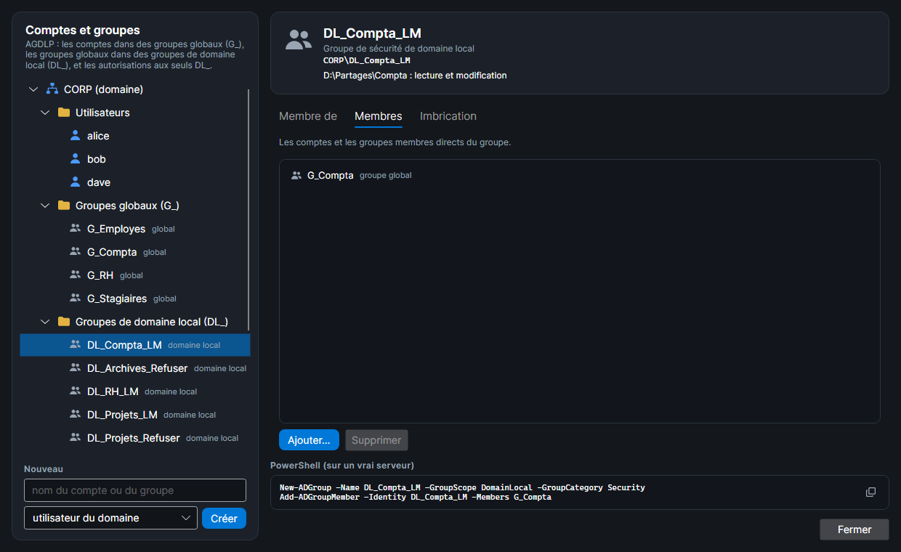
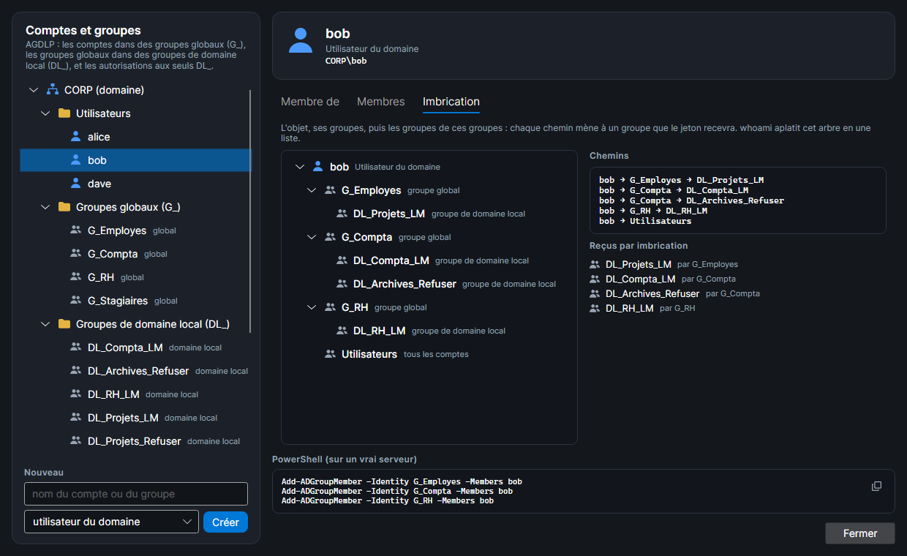
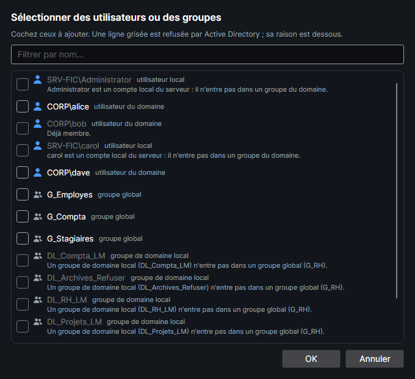
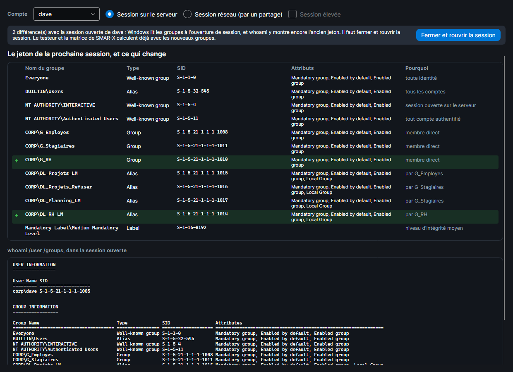

# Règles de Windows vérifiées

Le moteur Windows de SMAR-X reproduit ce que fait un vrai Windows. `tools/SmarxWindowsCheck` recrée le serveur d'exemple sur un contrôleur de domaine Windows Server 2025, relève ses propriétaires et ses ACL dans leur ordre réel, puis ouvre chaque fichier et chaque dossier avec chacun des 14 droits spéciaux, sous le jeton de chaque compte : 1 512 ouvertures, toutes identiques au simulateur. Cette page rassemble les règles que SMAR-X applique, y compris celles que ces mesures ont fait découvrir.

## AccessCheck : l'ordre des ACE

Windows lit la DACL **dans l'ordre** et s'arrête dès qu'il peut répondre :

- une ACE **Autoriser** qui s'applique au jeton accorde ses droits ; dès que tous les droits demandés sont accordés, l'accès est autorisé ;
- une ACE **Refuser** bloque l'accès si elle porte sur un droit demandé **qui n'est pas encore accordé** ; un refus ne reprend pas un droit déjà accordé ;
- à la fin de la DACL, ce qu'aucune ACE n'a accordé est refusé.

L'ordre canonique met **les ACE explicites avant les héritées**, et parmi les explicites, **les refus avant les autorisations**. Une autorisation explicite est donc lue avant un refus hérité, et l'emporte. L'avertissement de Windows (« les entrées de refus sont prioritaires ») ne vaut que pour des ACE de même rang.

## Le jeton

- Le jeton d'une session locale contient le compte, ses groupes et, de proche en proche, les groupes de ses groupes, **Tout le monde**, **Utilisateurs authentifiés**, **INTERACTIF** et **Utilisateurs**.
- **Contrôle de compte d'utilisateur (UAC)** : sans élévation, le groupe **Administrateurs** d'un administrateur est en « refus seulement ». Il compte pour les refus, jamais pour les autorisations. Le compte **Administrator** intégré n'est pas filtré.
- Un administrateur en session élevée a le privilège **Prendre possession de fichiers**.
- Les dossiers du chemin ne sont pas vérifiés : tout le monde a le privilège **Contourner la vérification de parcours**.

## Les groupes : AGDLP

Le serveur d'exemple est membre du domaine **CORP** et suit **AGDLP**, la méthode que conseille Microsoft :

- les **comptes** du domaine (alice, bob, dave) sont dans des **groupes globaux**, un par rôle : `G_Employes`, `G_Compta`, `G_RH`, `G_Stagiaires` ;
- les groupes globaux sont membres de **groupes de domaine local**, un par ressource et par droit : `DL_<ressource>_L` (lecture), `_LM` (lecture et modification), `_CT` (contrôle total), `_Refuser` (refus) ;
- les **autorisations** NTFS ne nomment que des groupes de domaine local et les identités intégrées (Administrateurs, Système, CRÉATEUR PROPRIÉTAIRE, Utilisateurs authentifiés…).

carol et Administrator sont des comptes locaux du serveur. Un compte du domaine s'écrit `CORP\alice`, un compte du serveur `SRV-FIC\carol`, comme dans `icacls`.

Le jeton contient les groupes du compte **et les groupes de ces groupes** : alice, membre de `G_Compta`, reçoit `DL_Compta_LM`, car `G_Compta` en est membre. Le testeur le montre dès la première étape ; la carte **Comptes** l'écrit sous chaque compte (« par imbrication : … ») ; l'onglet **Imbrication** de la fenêtre **Comptes et groupes** le dessine (voir plus bas).

Les imbrications suivent les règles d'Active Directory. Dans **Sélectionner des utilisateurs ou des groupes**, un choix impossible est grisé, et sa raison est écrite dessous :

| Groupe | Peut contenir |
|---|---|
| global (`G_`) | des comptes du domaine, des groupes globaux |
| domaine local (`DL_`) | des comptes du domaine, des groupes globaux, des groupes de domaine local |
| local du serveur (Administrateurs…) | tout compte, des groupes globaux et de domaine local, jamais un autre groupe local |

Un compte local du serveur n'entre que dans un groupe local. Une imbrication qui tournerait en rond est refusée.

### La fenêtre Comptes et groupes

Dans l'espace Windows, la carte **Comptes** liste les comptes ; son bouton **Comptes et groupes…** ouvre une fenêtre qui les gère comme la console *Utilisateurs et ordinateurs Active Directory*. Elle reste ouverte à côté de l'espace : chaque changement passe aussitôt dans le testeur, la matrice et la fenêtre whoami.

- **À gauche, l'arbre** : le domaine (`CORP`) avec ses **Utilisateurs**, ses **Groupes globaux (G_)** et ses **Groupes de domaine local (DL_)**, puis le serveur avec ses **Utilisateurs locaux** et ses **Groupes locaux** (Administrateurs, Utilisateurs…). Un serveur hors domaine n'a que cette seconde partie.
- **À droite, l'objet choisi** : son nom, ce qu'il est et son nom qualifié (`CORP\bob`, `SRV-FIC\carol`, `BUILTIN\Administrators`), puis trois onglets :
    - **Membre de** : les groupes dont il est membre directement ;
    - **Membres** : pour un groupe, ses membres directs, comptes et groupes ;
    - **Imbrication** : l'arbre du compte, de ses groupes et des groupes de ces groupes, chaque chemin écrit sur une ligne (`bob → G_Compta → DL_Compta_LM`), et la liste des groupes reçus par imbrication. C'est ce que `whoami` aplatit en une liste.
- **Ajouter…** ouvre **Sélectionner des utilisateurs ou des groupes** : on coche un ou plusieurs comptes ou groupes, un filtre réduit la liste. Ce qu'Active Directory refuserait est grisé, avec sa raison : déjà membre, compte local du serveur dans un groupe du domaine, groupe de domaine local dans un groupe global, imbrication qui tournerait en rond. **Supprimer** retire le lien choisi.
- **Nouveau** crée un compte ou un groupe : utilisateur du domaine, groupe global, groupe de domaine local, utilisateur ou groupe local du serveur. Il est aussitôt choisi dans l'arbre.
- Le groupe **Utilisateurs** contient tous les comptes du serveur et du domaine, sans qu'on les ajoute : on ne change pas ses membres.

Sous les onglets, les commandes qui feraient la même chose sur un vrai serveur : celles du domaine, `New-ADGroup -GroupScope Global` ou `DomainLocal` et `Add-ADGroupMember`, ou celles du serveur, `net localgroup`.

*Capture : le groupe de domaine local DL_Compta_LM, dans l'onglet Membres : le groupe global G_Compta en est membre.*

*Capture : l'imbrication de bob. Il est membre de trois groupes globaux, qui le font entrer dans quatre groupes de domaine local.*

*Capture : Ajouter… dans l'onglet Membres de G_RH. bob est déjà membre ; carol et Administrator, comptes locaux du serveur, n'entrent pas dans un groupe du domaine ; un groupe de domaine local n'entre pas dans un groupe global.*

La mesure sur le contrôleur de domaine crée ces groupes globaux et de domaine local et leurs imbrications. Toutes les ouvertures qui passent par un groupe imbriqué sont identiques au simulateur.

## whoami : le jeton d'un compte

**whoami de ce compte…**, sous **Qui ?** dans le testeur et dans la carte **Comptes**, ouvre ce qu'affiche `whoami /user /groups` : le compte et son SID, puis chaque identité du jeton avec son type, son SID et ses attributs. La colonne **Pourquoi** l'explique : membre direct, « par G_Compta » pour un groupe reçu par imbrication, session ouverte sur le serveur ou session réseau.

*Capture : dave vient d'être ajouté à G_RH. Le jeton de sa prochaine session reçoit G_RH et, par lui, DL_RH_LM ; dans sa session ouverte, whoami montre encore l'ancien jeton.*

- **Type** : `Well-known group` pour une identité prédéfinie, `Alias` pour un groupe local (`BUILTIN\…`) ou de domaine local (avec l'attribut `Local Group`), `Group` pour un groupe global.
- **Administrateurs** : sans élévation, `Group used for deny only` (refus seulement) ; en session élevée, `Group owner`, et le niveau d'intégrité passe de `Medium` à `High`. Par un partage, un compte local administrateur reste filtré.
- La fenêtre suit le compte, la session (sur le serveur, ou réseau par un partage) et l'élévation choisis. Elle reste ouverte à côté et se met à jour quand on change des groupes.

**Les groupes ne comptent qu'à la session suivante.** Windows lit les groupes d'un compte à l'ouverture de sa session ; après un changement, `whoami` montre encore l'ancien jeton. La fenêtre le signale et marque ce qui change : `+` ajouté, `−` retiré, `~` attributs changés. **Fermer et rouvrir la session** donne au compte son nouveau jeton. Dans SMAR-X, les sessions s'ouvrent au chargement du serveur ou au début d'un exercice. Le testeur et la matrice, eux, calculent toujours avec les groupes du moment, comme après une nouvelle ouverture de session.

Le texte est celui d'un Windows en anglais, comme les machines du labo. Un vrai jeton porte quelques identités de plus (`LOCAL`, `CONSOLE LOGON`, `This Organization`, `Domain Users`…) : elles ne changent rien aux accès que simule SMAR-X, qui ne les montre pas.

## Le propriétaire

Le propriétaire a toujours **Autorisations de lecture** et **Modifier les autorisations**, même sans ACE, sauf si la DACL contient une ACE **DROITS DU PROPRIÉTAIRE** (OWNER RIGHTS) : elle remplace alors ces droits implicites.

## Ce que le dossier parent accorde

Ouvrir un fichier ou un dossier passe par AccessCheck sur sa DACL, puis par deux règles de NTFS qui regardent le dossier parent. Les mesures les ont confirmées :

- **Suppression** est accordée si le dossier parent accorde **Suppression de sous-dossier et fichier** ;
- **Attributs de lecture** est accordé si le dossier parent accorde **Liste du dossier**. Lister un dossier montre déjà les attributs de ce qu'il contient. Sur le serveur d'exemple, dave n'a aucun droit sur `D:\Partages\Compta`, mais il lit ses attributs, car il peut lister `D:\Partages`.

L'onglet **Accès effectif** de SMAR-X (fenêtre Avancé) l'indique : « (par le dossier parent) ».

## L'héritage

- `(OI)` : les fichiers en héritent ; `(CI)` : les sous-dossiers en héritent ; `(IO)` : l'ACE ne s'applique pas au dossier qui la porte ; `(NP)` : seuls les enfants directs en héritent.
- Un sous-dossier garde une ACE `(OI)` seule en « héritage seulement », pour la passer à ses fichiers.
- **CREATOR OWNER** devient le propriétaire de chaque enfant, et reste transmis en « héritage seulement ».
- **Pas de doublon parmi les ACE héritées.** Une ACE déjà héritée n'est pas recopiée, et une ACE qui accorderait à l'objet ce qu'une ACE héritée **lue avant elle** accorde déjà ne garde que sa part transmise, en « héritage seulement ». Sous un dossier créé par un administrateur :
    - si la racine porte `Administrators (OI)(CI)(F)` **avant** `CREATOR OWNER (OI)(CI)(IO)(F)`, le dossier reçoit `Administrators (I)(OI)(CI)(F)` et `CREATOR OWNER (I)(OI)(CI)(IO)(F)` ;
    - si CREATOR OWNER est **avant**, il reçoit `Administrators (I)(F)`, `CREATOR OWNER (I)(OI)(CI)(IO)(F)` et `Administrators (I)(OI)(CI)(IO)(F)`.

## Les refus de l'onglet Sécurité

Presque toute ouverture de fichier demande **Synchroniser**. L'onglet Sécurité l'omet donc d'un refus. Refuser l'Écriture y écrit `(WD,AD,WA,WEA)`, alors que `icacls … /deny compte:(W)` refuse aussi Synchroniser : le compte ne pourrait plus ouvrir le fichier, même pour le lire. Seul le refus de **Contrôle total** garde Synchroniser. Le reste du comportement des cases est décrit dans [L'onglet Sécurité](onglet-securite.md#la-fenetre-modifier).

## Par un partage

Par le réseau, s'ajoutent les autorisations du partage, le jeton réseau (les restrictions distantes de l'UAC) et l'énumération basée sur l'accès : voir [Accès par un partage](partages.md). Par un partage, **Synchroniser** seul se décide comme **Attributs de lecture**.

## Comparer avec un vrai serveur

Pour comparer la sortie de SMAR-X avec celle d'un serveur :

- `icacls` affiche les ACE **dans l'ordre où elles sont stockées**, comme SMAR-X ;
- `icacls … /grant` ajoute chaque ACE **en tête** des explicites, et range celles qui ne s'héritent pas avant les autres : des commandes données dans un autre ordre donnent un autre ordre ;
- `Get-Acl` **trie les ACE explicites par SID** : son ordre n'est pas celui de la DACL.
