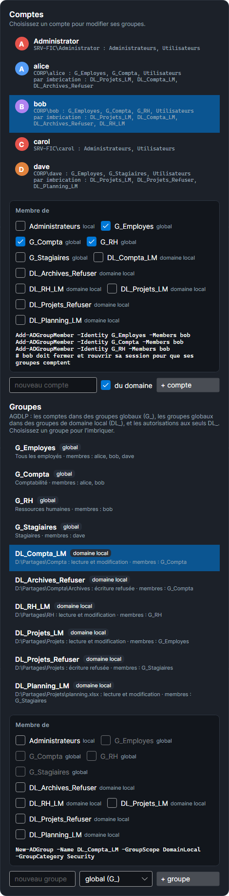

# Règles de Windows vérifiées

Le moteur Windows de SMAR-X reproduit ce que fait un vrai Windows. `tools/SmarxWindowsCheck` recrée le serveur d'exemple sur un contrôleur de domaine Windows Server 2025, relève ses propriétaires et ses ACL dans leur ordre réel, puis ouvre chaque fichier et chaque dossier avec chacun des 14 droits spéciaux, sous le jeton de chaque compte : 1 512 ouvertures, toutes identiques au simulateur. Cette page rassemble les règles que SMAR-X applique, y compris celles que ces mesures ont fait découvrir.

## AccessCheck : l'ordre des ACE

Windows lit la DACL **dans l'ordre** et s'arrête dès qu'il peut répondre :

- une ACE **Autoriser** qui s'applique au jeton accorde ses droits ; dès que tous les droits demandés sont accordés, l'accès est autorisé ;
- une ACE **Refuser** bloque l'accès si elle porte sur un droit demandé **qui n'est pas encore accordé** ; un refus ne reprend pas un droit déjà accordé ;
- à la fin de la DACL, ce qu'aucune ACE n'a accordé est refusé.

L'ordre canonique met **les ACE explicites avant les héritées**, et parmi les explicites, **les refus avant les autorisations**. Une autorisation explicite est donc lue avant un refus hérité, et l'emporte. L'avertissement de Windows (« les entrées de refus sont prioritaires ») ne vaut que pour des ACE de même rang.

## Le jeton

- Le jeton d'une session locale contient le compte, ses groupes et, de proche en proche, les groupes de ses groupes, **Tout le monde**, **Utilisateurs authentifiés**, **INTERACTIF** et **Utilisateurs**.
- **Contrôle de compte d'utilisateur (UAC)** : sans élévation, le groupe **Administrateurs** d'un administrateur est en « refus seulement ». Il compte pour les refus, jamais pour les autorisations. Le compte **Administrator** intégré n'est pas filtré.
- Un administrateur en session élevée a le privilège **Prendre possession de fichiers**.
- Les dossiers du chemin ne sont pas vérifiés : tout le monde a le privilège **Contourner la vérification de parcours**.

## Les groupes : AGDLP

Le serveur d'exemple est membre du domaine **CORP** et suit **AGDLP**, la méthode que conseille Microsoft :

- les **comptes** du domaine (alice, bob, dave) sont dans des **groupes globaux**, un par rôle : `G_Employes`, `G_Compta`, `G_RH`, `G_Stagiaires` ;
- les groupes globaux sont membres de **groupes de domaine local**, un par ressource et par droit : `DL_<ressource>_L` (lecture), `_LM` (lecture et modification), `_CT` (contrôle total), `_Refuser` (refus) ;
- les **autorisations** NTFS ne nomment que des groupes de domaine local et les identités intégrées (Administrateurs, Système, CRÉATEUR PROPRIÉTAIRE, Utilisateurs authentifiés…).

carol et Administrator sont des comptes locaux du serveur. Un compte du domaine s'écrit `CORP\alice`, un compte du serveur `SRV-FIC\carol`, comme dans `icacls`.

Le jeton contient les groupes du compte **et les groupes de ces groupes** : alice, membre de `G_Compta`, reçoit `DL_Compta_LM`, car `G_Compta` en est membre. Le testeur le montre dès la première étape ; la carte **Comptes** l'écrit sous chaque compte (« par imbrication : … »).

Les imbrications suivent les règles d'Active Directory. Une case impossible est grisée, et son info-bulle dit pourquoi :

| Groupe | Peut contenir |
|---|---|
| global (`G_`) | des comptes du domaine, des groupes globaux |
| domaine local (`DL_`) | des comptes du domaine, des groupes globaux, des groupes de domaine local |
| local du serveur (Administrateurs…) | tout compte, des groupes globaux et de domaine local, jamais un autre groupe local |

Un compte local du serveur n'entre que dans un groupe local. Une imbrication qui tournerait en rond est refusée.

*Capture : bob, avec ses groupes globaux, et les groupes de domaine local qu'il reçoit par imbrication. Un groupe de domaine local est choisi : il n'entre pas dans un groupe global, ces cases sont grisées.*

Dans la carte **Comptes**, la partie **Groupes** liste chaque groupe, avec sa portée et ses membres. Choisir un groupe permet de l'imbriquer dans un autre (**Membre de**). Les commandes équivalentes sont celles du domaine, `New-ADGroup -GroupScope Global` ou `DomainLocal` et `Add-ADGroupMember`, ou celles du serveur, `net localgroup`. Un nouveau compte est un compte du domaine, sauf si l'on décoche **du domaine** ; un nouveau groupe est global, de domaine local ou local au serveur.

La mesure sur le contrôleur de domaine crée ces groupes globaux et de domaine local et leurs imbrications. Toutes les ouvertures qui passent par un groupe imbriqué sont identiques au simulateur.

## Le propriétaire

Le propriétaire a toujours **Autorisations de lecture** et **Modifier les autorisations**, même sans ACE, sauf si la DACL contient une ACE **DROITS DU PROPRIÉTAIRE** (OWNER RIGHTS) : elle remplace alors ces droits implicites.

## Ce que le dossier parent accorde

Ouvrir un fichier ou un dossier passe par AccessCheck sur sa DACL, puis par deux règles de NTFS qui regardent le dossier parent. Les mesures les ont confirmées :

- **Suppression** est accordée si le dossier parent accorde **Suppression de sous-dossier et fichier** ;
- **Attributs de lecture** est accordé si le dossier parent accorde **Liste du dossier**. Lister un dossier montre déjà les attributs de ce qu'il contient. Sur le serveur d'exemple, dave n'a aucun droit sur `D:\Partages\Compta`, mais il lit ses attributs, car il peut lister `D:\Partages`.

L'onglet **Accès effectif** de SMAR-X (fenêtre Avancé) l'indique : « (par le dossier parent) ».

## L'héritage

- `(OI)` : les fichiers en héritent ; `(CI)` : les sous-dossiers en héritent ; `(IO)` : l'ACE ne s'applique pas au dossier qui la porte ; `(NP)` : seuls les enfants directs en héritent.
- Un sous-dossier garde une ACE `(OI)` seule en « héritage seulement », pour la passer à ses fichiers.
- **CREATOR OWNER** devient le propriétaire de chaque enfant, et reste transmis en « héritage seulement ».
- **Pas de doublon parmi les ACE héritées.** Une ACE déjà héritée n'est pas recopiée, et une ACE qui accorderait à l'objet ce qu'une ACE héritée **lue avant elle** accorde déjà ne garde que sa part transmise, en « héritage seulement ». Sous un dossier créé par un administrateur :
    - si la racine porte `Administrators (OI)(CI)(F)` **avant** `CREATOR OWNER (OI)(CI)(IO)(F)`, le dossier reçoit `Administrators (I)(OI)(CI)(F)` et `CREATOR OWNER (I)(OI)(CI)(IO)(F)` ;
    - si CREATOR OWNER est **avant**, il reçoit `Administrators (I)(F)`, `CREATOR OWNER (I)(OI)(CI)(IO)(F)` et `Administrators (I)(OI)(CI)(IO)(F)`.

## Les refus de l'onglet Sécurité

Presque toute ouverture de fichier demande **Synchroniser**. L'onglet Sécurité l'omet donc d'un refus. Refuser l'Écriture y écrit `(WD,AD,WA,WEA)`, alors que `icacls … /deny compte:(W)` refuse aussi Synchroniser : le compte ne pourrait plus ouvrir le fichier, même pour le lire. Seul le refus de **Contrôle total** garde Synchroniser. Le reste du comportement des cases est décrit dans [L'onglet Sécurité](onglet-securite.md#la-fenetre-modifier).

## Par un partage

Par le réseau, s'ajoutent les autorisations du partage, le jeton réseau (les restrictions distantes de l'UAC) et l'énumération basée sur l'accès : voir [Accès par un partage](partages.md). Par un partage, **Synchroniser** seul se décide comme **Attributs de lecture**.

## Comparer avec un vrai serveur

Pour comparer la sortie de SMAR-X avec celle d'un serveur :

- `icacls` affiche les ACE **dans l'ordre où elles sont stockées**, comme SMAR-X ;
- `icacls … /grant` ajoute chaque ACE **en tête** des explicites, et range celles qui ne s'héritent pas avant les autres : des commandes données dans un autre ordre donnent un autre ordre ;
- `Get-Acl` **trie les ACE explicites par SID** : son ordre n'est pas celui de la DACL.
