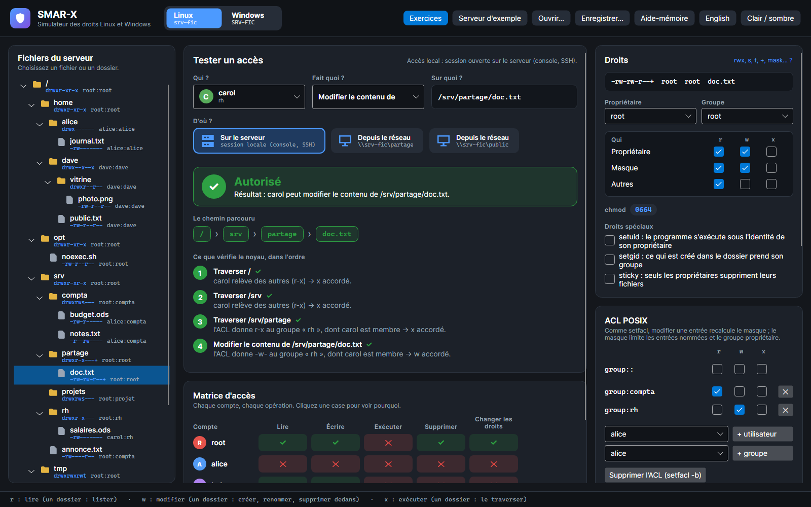
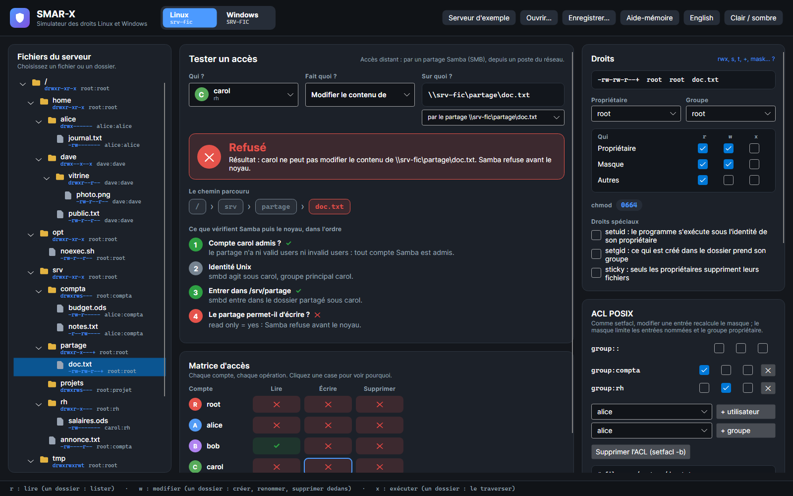
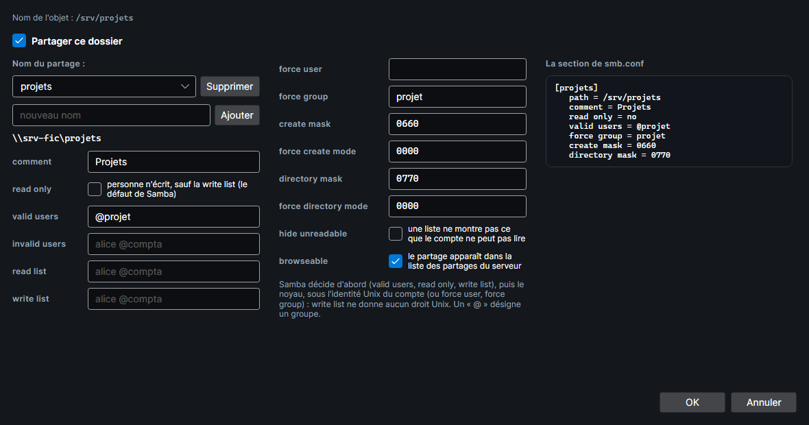

# Partage Samba

Sous Linux, un poste du réseau accède aux fichiers par un **partage Samba** : `\\srv-fic\compta\budget.ods`. Samba décide d'abord, puis le noyau, sous une identité Unix. Tout ce que décrit cette page a été vérifié sur un vrai Samba (voir [Comment c'est vérifié](#comment-cest-verifie)).

## Tester un accès par Samba

Sous **D'où ?**, le testeur propose **Sur le serveur** (icône de serveur), pour une session ouverte sur le serveur (console, SSH), puis **Depuis le réseau** (icône de poste) pour chaque partage qui contient l'objet ; la carte donne le partage (`\\srv-fic\partage`). En changeant d'objet, le testeur garde le partage choisi s'il contient le nouvel objet ; sinon, il revient sur **Sur le serveur**. Par un partage, il propose ce que fait un client SMB :
- pour un fichier : lire, modifier le contenu, supprimer ;
- pour un dossier : lister, créer dedans, supprimer.

Les étapes montrent ce que vérifie Samba, puis le noyau. Le verdict dit lequel refuse. La matrice d'accès suit le même chemin, et la carte **Ce que recevrait un nouvel élément** montre ce que Samba crée. Dans l'exemple, root n'a pas de mot de passe Samba (`smbpasswd -a`) : il ne se connecte à aucun partage.

Le même accès, sur le serveur puis depuis le réseau :

=== "Sur le serveur"

    

    *Capture : en local, carol écrit `doc.txt` : l'ACL donne `-w-` au groupe rh, dont elle est membre, et le masque le laisse passer.*

=== "Depuis le réseau"

    

    *Capture : par `\\srv-fic\partage`, le même accès est refusé. Le partage est en lecture seule, et carol n'est pas dans sa write list : Samba refuse avant le noyau.*

## Samba décide d'abord

Le serveur d'exemple a cinq partages :

| Partage | Dossier | Réglages | Idée |
|---|---|---|---|
| `compta` | `/srv/compta` | `valid users = @compta`, `read only = no`, `create mask = 0660`, `directory mask = 2770` | réservé au groupe, en écriture |
| `partage` | `/srv/partage` | `read only = yes`, `write list = bob` | la write list face à l'ACL du dossier |
| `projets` | `/srv/projets` | `valid users = @projet`, `read only = no`, `force group = projet` | tout ce qui est créé va au groupe projet |
| `public` | `/srv` | `read only = yes`, `hide unreadable = yes` | une vue d'ensemble qui cache ce qu'on ne peut pas lire |
| `depot` | `/tmp` | `read only = no`, masques par défaut | ce que donnent les valeurs par défaut de Samba |

1. **Se connecter.** Le compte doit être dans `valid users`, s'il y en a, et pas dans `invalid users`. Un nom précédé de `@` désigne un groupe Unix. Puis smbd entre dans le dossier partagé sous l'identité Unix du compte : il lui faut `x` sur ce dossier et sur ceux qui y mènent. alice ne se connecte pas à `partage`, où elle n'a aucun droit.
2. **L'identité Unix.** smbd agit sous le compte, ou sous `force user`, avec `force group` comme groupe principal.
3. **Écrire, créer, supprimer.** Le partage doit être en écriture pour ce compte. `read list` l'emporte, puis `write list`, puis `read only`.

**La write list ne donne aucun droit Unix.** bob est dans la write list de `partage`, mais l'ACL du dossier, bridée par le masque `r-x`, ne lui laisse rien créer : Samba laisse passer, le noyau refuse.

## Puis le noyau

Une fois que Samba a laissé passer, le noyau décide comme en local, sous l'identité Unix. Une différence vient du client : **pour écrire dans un fichier, il l'ouvre en lecture-écriture**. Il faut donc `r` et `w`, et avec une ACL, une **même** entrée doit donner les deux. bob lit `doc.txt` par le groupe compta (`r--`) et l'écrit par rh (`-w-`) : en local, il peut y écrire ; par Samba, non.

## Cacher ce qu'on ne peut pas lire

Avec `hide unreadable = yes`, une liste de dossier ne montre pas ce que le compte ne peut pas lire. Mais Samba juge « lisible » **comme Windows** : les droits de toutes les classes qui s'appliquent au compte s'additionnent. `annonce.txt` (`0604`, groupe compta) reste visible pour alice, du groupe compta : les autres peuvent la lire. Pourtant le noyau refuse à alice de la lire, car la classe du groupe (`---`) s'applique à elle.

Un fichier caché reste accessible par son chemin : l'ouvrir est simplement refusé par le noyau, s'il doit l'être. (La commande `del` de smbclient liste d'abord le dossier : elle ne trouve pas un fichier caché.)

## Ce que reçoit un fichier créé

Samba calcule le mode demandé, puis le noyau crée :

| Nouvel objet | Mode demandé par Samba |
|---|---|
| fichier | (`0666`, plus `x` pour le propriétaire, car l'attribut DOS « archive » le donne) `& create mask`, puis les bits de `force create mode` ajoutés |
| dossier | `0777 & directory mask`, puis les bits de `force directory mode` ajoutés |

- **L'umask du compte ne compte pas.** Avec les masques par défaut (`0744`, `0755`), un fichier créé dans `depot` est `-rwxr--r--`, même pour dave et son umask `077`.
- **Le noyau fait le reste.** Le bit setgid d'un dossier donne son groupe, et un sous-dossier reçoit setgid : sous `compta`, un dossier est `2770`. Une ACL par défaut devient l'ACL du nouvel objet, limitée par le mode demandé : sous `projets`, un fichier a l'ACL du dossier et le masque `rw-`.
- **Le groupe** est celui du dossier setgid, sinon `force group`, sinon le groupe principal du compte.

## La fenêtre Partage Samba

La carte **Partage Samba de …** donne le chemin réseau de l'objet et les partages qui y mènent. Pour un dossier, **Partage Samba…** ouvre la fenêtre des réglages :

- **Partager ce dossier** crée un partage avec les valeurs par défaut de Samba : lecture seule, `create mask = 0744`, `directory mask = 0755`.
- Un dossier peut avoir plusieurs partages : **Ajouter** et **Supprimer**.
- Chaque paramètre de smb.conf a sa ligne : à gauche, qui peut entrer, lire ou écrire ; au milieu, l'identité Unix et les modes des fichiers créés. À droite, **La section de smb.conf** l'écrit telle que Samba la lit.

**OK** garde les changements ; **Annuler** remet les partages comme avant.

## Comment c'est vérifié

`tools/SmarxSambaCheck` écrit un script lancé dans un conteneur Debian 13 jetable (Samba 4.22). Le script :
1. recrée le serveur d'exemple et ses partages, puis lance smbd ;
2. donne à chaque compte un mot de passe Samba tiré au hasard, qui ne sort pas du conteneur ;
3. avec smbclient, sous chaque compte et par chaque partage, lit, écrit et supprime chaque fichier, liste et supprime chaque dossier, et crée un fichier et un dossier, dont il relève le mode, le propriétaire, le groupe et les ACL.

Résultat : **20 connexions, 160 opérations et 72 créations identiques** au simulateur, figées dans `SMAR-X.Tests/Fidelity/linux-samba.txt`.
